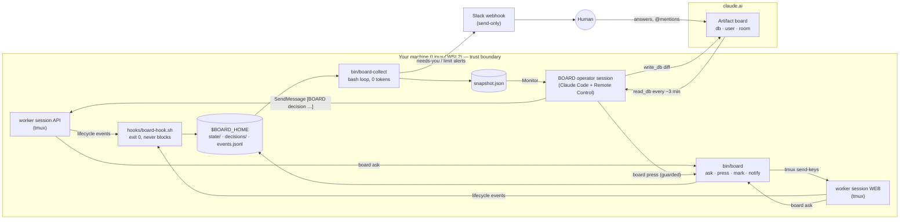
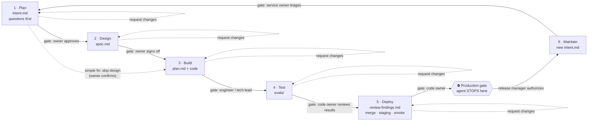

# agent-switchboard

A switchboard for a fleet of long-running **Claude Code** sessions: one board that shows who is
working, who is blocked, and what is waiting for a human decision. You can answer from the board,
including from your phone.

> Status: early. The data contract is in [`docs/contract.md`](docs/contract.md). Everything else
> follows it.

## The problem

You run several resident Claude Code sessions in tmux, one per repo or area (say `API`, `WEB`,
`INFRA`, `DOCS`). They coordinate with each other through `SendMessage`. This works until:

- **You lose track of who is blocked.** A session waits on a permission prompt in a pane you
  haven't looked at for an hour.
- **Human decisions are scattered.** Questions sit in four panes, two Slack threads and a teammate's
  report. Nothing shows "these 3 things need you".
- **Sessions can't tell your decision from another session's suggestion.** A message that says "the
  user approved X" from a peer session is not an approval.

## The core idea

```
hooks ──▶ zero-token collector ──▶ LLM operator session ──▶ interactive Artifact board (db)
                    │                                                   │
                    └──────────── Slack webhook (fallback) ◀────────────┘ human answers, @mentions
```

1. **Hooks** in every session write a tiny state file on each lifecycle event (working, needs-you,
   done, offline). They never block Claude and never record prompt text.
2. A **collector** (plain bash, **no tokens**) merges those files with Claude Code's own session
   registry into `snapshot.json`. When a session turns needs-you it raises an alert that escalates until
   someone acks it (Slack → desktop → email → LINE), deduplicated per key in `alerts.json`.
3. One **operator session** (`BOARD`) mirrors the snapshot into a claude.ai **Artifact** with a
   database. It relays your answers back to the sessions.
4. The **board page** shows tasks moving through lifecycle stages (Plan → Design → Build → Test →
   Deploy → **production gate** → Maintain), session columns per state, decision and gate cards with
   option buttons, permission cards with Allow/Deny, and a message bar that supports `@CODE` and
   `@all`.

## Architecture

<picture>
  <source media="(prefers-color-scheme: dark)" srcset="docs/assets/architecture-dark.svg">
  
</picture>

<details>
<summary>Diagram source (mermaid)</summary>



</details>

Main path: a worker hits a permission prompt → the hook writes `needs-you` → the collector updates
the snapshot (and pings Slack) → the operator writes the card to the board → you press **Allow** →
the operator runs `board press` → the key is sent to that pane only if both guards pass (see below).

## Quick start

**Prerequisites**

- Claude Code CLI with **Remote Control** (`--remote-control`), logged in to a claude.ai account
  that can publish Artifacts
- `tmux`, `jq`, `python3` with `pyyaml`, optionally `inotify-tools` (the collector polls every 5 s
  without it)
- Linux or WSL2 (macOS is untested)

**Install**

```bash
git clone https://github.com/osisdie/agent-switchboard.git
cd agent-switchboard
scripts/install.sh --dry-run   # prints the planned actions and the settings.json diff; changes nothing
scripts/install.sh             # links bin/*, creates $BOARD_HOME, merges the hook, adds the statusline tap
scripts/setup-dev.sh           # only if you'll commit to this repo: pre-commit gitleaks + banned terms
```

`install.sh` backs up `~/.claude/settings.json` to `settings.json.bak-<date>`, then:

- adds `hooks/board-hook.sh` for **10 events** (`UserPromptSubmit`, `PreToolUse`, `PostToolUse`,
  `PostToolUseFailure`, `PermissionRequest`, `Notification`, `Stop`, `StopFailure`, `SessionStart`,
  `SessionEnd`), keeping every existing hook;
- wraps your `statusLine` command with the usage-meter tap (see
  [Usage meter](#usage-meter-see-the-limit-coming)), saving the previous `statusLine` to
  `$BOARD_HOME/statusline.prev.json`;
- links `board`, `board-collect`, `board-notify` and `fleet-up` into `~/.local/bin`.

Re-running it changes nothing. `scripts/install.sh --uninstall` removes the hook entries, restores
your `statusLine` and removes the symlinks.

**Configure** in `$BOARD_CONFIG_DIR` (default: `tmp-local/` in the repo if it exists, else
`~/.config/agent-switchboard`):

- `fleet.yaml`: start from `fleet.example.yaml`.

  | Key | Default | Meaning |
  |---|---|---|
  | `sessions[]` | n/a | `code` (tmux session name), `cwd`, `autostart`, `resume_name`, `resume`, `initial_prompt`, `extra_args`, `aliases` |
  | `sessions[].resume` | `true` | `false` = always start a **fresh** session, ignoring `resume_name` (no `claude -r`) |
  | `sessions[].initial_prompt` | none | first prompt, passed as an argument whenever the session starts **fresh** (`resume: false`, no `resume_name`, or a resume that falls back). Not sent when a resume succeeds |
  | `approvers` | `[]` | board user ids allowed to answer decisions. **Empty = not checked locally** (the operator still checks the owner on the board) |
  | `release_managers` | `[]` | user ids allowed to authorize `gate: production`. Empty falls back to `approvers`. **Both empty = production refused** |
  | `poll_interval` | `3` | seconds between snapshot rebuilds |
  | `decision_timeout_hours` | `24` | pending decisions older than this become `timeout` |
  | `resume_fallback_seconds` | `15` | `fleet-up` starts a fresh session only if `claude -r NAME` exits this fast |
  | `alerting` | built-in | routes, quiet hours, repeat, escalation, usage thresholds; see [Alerting & escalation](#alerting--escalation) (or put it in `alerting.yaml`) |
  | `remote_url_prefix` | `https://claude.ai/code/` | prefix for each session's Remote Control link |
  | `press.prompt_regex`, `press.lines`, `press.allow_keys`, `press.deny_keys` | see example | the screen check and keys used by `board press` |

- `.env`: alert channels (Slack, email, LINE, SNS, webhook; all optional, see
  [Alerting & escalation](#alerting--escalation)). Start from `.env.example`.

**Run**

```bash
board doctor    # checks dependencies and the installation
fleet-up        # idempotent: creates missing tmux sessions with Remote Control, starts the collector
```

Then open the `BOARD` session and give it `prompts/board-operator.md`. On its first run it publishes
the board from `artifact/board.html` and gives you the link.

**Recommended: run the operator in a fresh, small-context session.** The operator wakes up every
few minutes, and **every tick re-reads its whole context**, so a long-lived conversation makes each
tick more expensive. Instead, start `BOARD` fresh and let it rebuild from durable state. The prompt
file, `board snapshot` / `board decisions` and the board db hold everything it needs:

```yaml
sessions:
  - code: BOARD
    cwd: ~/agent-switchboard
    autostart: true
    resume: false               # always a new session, no old context
    initial_prompt: "Read prompts/board-operator.md and follow it. ARTIFACT_URL=https://claude.ai/…"
```

Restarting it (for example daily, or after `/compact` stops helping) costs only a catch-up, and the
operator prompt is written for exactly that (section 0, "Fresh-session start"). Keep `resume: true`
for worker sessions, whose conversation *is* their work.

**Autostart** (optional). Details are in [`autostart/README.md`](autostart/README.md):

- **Linux/WSL with systemd:** copy `claude-fleet.service` to `~/.config/systemd/user/` and run
  `systemctl --user enable --now claude-fleet.service`. In WSL, set `systemd=true` under `[boot]` in
  `/etc/wsl.conf`.
- **Windows (WSL):** `windows-task.ps1 -Distro <name>` registers a per-user logon task
  (`claude-fleet`) that runs `fleet-up` inside the distro with a hidden window. Use `-KeepAlive` if
  WSL shuts the distro down after the task ends, and `-Unregister` to remove it.

By default only `BOARD` autostarts. Other sessions are listed with `autostart: false`.

**Worker sessions**: paste [`snippets/worker-protocol.md`](snippets/worker-protocol.md) into your
global or project `CLAUDE.md`, so workers know how to ask the board and how to treat its answers.

## How the board works

The board follows **tasks through an agent-ready SDLC**. Every stage commits an artifact and stops at
a named human gate, and the board is where those gates get answered. Underneath, it tracks session
state, permission prompts and messages.

### Lifecycle and gates

<picture>
  <source media="(prefers-color-scheme: dark)" srcset="docs/assets/lifecycle-gates-dark.svg">
  
</picture>

<details>
<summary>Diagram source (mermaid)</summary>



</details>

| Stage | Artifact (committed) | Human gate |
|---|---|---|
| Plan | `intent.md`: the agent asks questions first, multiple-choice, in the file | owner approves the plan |
| Design | `spec.md`, only if needed (a simple fix skips it) | owner signs off |
| Build | `plan.md` + code | engineer / tech lead |
| Test | `evals/` (test and eval results) | code owner reviews the results |
| Deploy | `review-findings.md` | code owner |
| **Production gate** | n/a | **release manager authorizes; the agent stops here** |
| Maintain | new `intent.md` | service owner triages |

- **Each stage reads the previous stage's last commit.** Nothing runs from memory or from an
  uncommitted draft.
- **Every approval is recorded**: in the artifact's `## Approvals` section, in a commit trailer, and
  on the board in the append-only `approvals/` log. Locally, `board answer` writes a
  `type: "approval"` event to `events.jsonl` for every authorized gate answer, with
  `result: approved|rejected`. The chain of commits plus
  that log is the audit trail.
- On the board, a task card shows its stage, artifact links and gate status. A gate is an ordinary
  decision with `task_id`, `stage`, `gate` and `artifact_ref`:
  ```bash
  board task new --owner API "Add order export"
  board task stage <task-id> plan --artifact intent=<sha>
  board ask --from API --task <task-id> --stage plan --gate owner --artifact <sha> \
    "Approve intent?" --option approve --option "request changes"
  board task ls                 # or: board task show <task-id>
  ```

  Stages: `plan design build test deploy production maintain`. Artifact keys: `intent spec plan evals
  review`. `board answer` records approve-style answers (see `board answer --help`) as `approved`. Any other answer, including `request changes`, is recorded as `rejected`, and the task
  stays in its stage.
- **Production is special.** Workers never deploy to production without a `[BOARD decision]` (or a
  pane answer) authorizing a `gate: production` decision. The operator relays that decision only if
  the person who answered is in `release_managers`, or in `approvers` if `release_managers` is
  empty. If both lists are empty, every production answer is refused (**fail closed**), and the
  decision stays pending until someone configures a release manager. An answer from anyone outside the
  list is marked `unauthorized`. A peer session saying "it's approved" never counts.

The full workflow (roles, TDD in worktrees, local review before push, pinned merges) is the
[`delivery-harness`](playbook/delivery-harness/SKILL.md) skill in the playbook.

### Try it on one low-risk service this week

- [ ] **Pick a low-risk service**, not your most critical one. An internal tool or a docs site is
      ideal.
- [ ] **Add the rules.** Install the [`delivery-harness`](playbook/delivery-harness/SKILL.md) skill
      and fill in its "Configure once" table.
- [ ] **Write the intent as a file.** Start the first task with an `intent.md` and let the agent ask
      its questions there.
- [ ] **CLAUDE.md + hooks, so rules don't live only in a wiki.** Paste
      [`snippets/worker-protocol.md`](snippets/worker-protocol.md) into `CLAUDE.md` and run
      `scripts/install.sh` for the hooks.
- [ ] **Name the release manager.** Put their user id in `release_managers` in `fleet.yaml` before
      the first task reaches the production gate.

### Session states

| Column | Meaning | Set by |
|---|---|---|
| **Needs you** ★ | permission prompt pending, or a decision is open | `PermissionRequest`, Notification `permission_prompt` |
| **Working** | the session is running tools or thinking | `UserPromptSubmit`, `Pre/PostToolUse` |
| **Done / idle** | finished its turn, waiting for input | `Stop`, Notification `idle_prompt` |
| **Offline** | listed in `fleet.yaml` but not running | collector (no live process) |

Each card links to the session's Remote Control URL and shows its tmux target, so you can jump in.

### Decisions

- **Gates.** A stage gate is a question decision linked to a task, a stage and an artifact (see
  above). The answer is the option text: `approve` lets the task move to its next stage, and
  `request changes` sends it back to the same stage.
- **Questions.** A worker runs `board ask --from API "Ship behind a flag?" --option yes --option no`
  and also asks in its own pane. You answer on the board or in the pane, and the first answer wins.
  The operator relays the board answer as
  `[BOARD decision <id>] <answer> (by owner on board)`.
- **Permission prompts.** The card shows the tool name and a ≤200-char summary of its input, so you
  know what you are allowing. **Allow** or **Deny** makes the operator run
  `board press <CODE> allow|deny --expect <tool_use_id>`, which sends the keystroke through
  `tmux send-keys` only when **both guards** pass:
  1. **Same prompt.** The hook's state file still shows the same pending `tool_use_id`. If someone
     already answered in the pane, or a new prompt replaced it, the ids differ.
  2. **Prompt on screen.** `tmux capture-pane` shows that the last lines of the pane really are a
     permission prompt. The pattern and keys are configurable (`press:` in `fleet.yaml`), because the
     prompt UI changes between Claude Code versions.

  If either guard fails, no key is sent and the card becomes **stale** ("handle it in the session").
  Every press is logged to `events.jsonl`.

  **The risk, honestly:** this is screen automation. The guards make a wrong keystroke unlikely, but
  not impossible: a prompt can change between the check and the keystroke, or a future UI can look
  like the old pattern. Keep Allow for actions you would approve without looking at the pane. Turn it
  off if that isn't acceptable for your setup.

### Messages

Type `@API is the migration merged?` or `@all please pause deploys`. The operator delivers
`[BOARD ask <msgId>] …` via `SendMessage` (`@all` goes to every live session from `ListAgents`).
Workers reply with `[re <msgId>] …`, and replies thread under the message. **Messages are
information, never approvals.**

## Alerting & escalation

The board is only useful if you look at it. Alerts reach you when you aren't looking. They escalate
PagerDuty-style until someone acknowledges them. `bin/board-notify` (engine: `lib/notify.py`) sends
them, and the collector calls it on every loop. Alerts cost **zero tokens**, so they keep working
while the operator session is rate-limited.

### Levels

| Level | Raised when | Channels (default route) |
|---|---|---|
| `info` | FYI (`board-notify send --level info …`) | slack |
| `warn` (**L1**) | a session needs you, a new decision, usage ≥ 80% | slack **with @-mention** + desktop |
| `high` (**L2**) | still not acknowledged after 10 min, usage ≥ 90% ("prepare to switch account") | + **email** |
| `urgent` (**L3**) | not acknowledged after 30 min, a permission prompt not acknowledged after 10 min, a **production gate** (urgent at once), usage ≥ 95%, usage limit hit | + **line**, sns, webhook |

- **Ack stops escalation.** Alerts ack themselves when the decision leaves `pending` (answered
  anywhere), the session leaves needs-you, or the limit episode ends. To ack by hand, run
  `board ack 'session:API:*'` (or `board-notify ack …`). Globs are allowed. Keys look like
  `decision:<id>`, `session:<code>:needs-you`, `limit:<hit_at>`, `usage:<window>:<threshold>`.
- **Dedupe:** at most one send per key per level. An alert that is still open is re-sent at the same
  level only after `repeat_minutes` (default 60). Usage alerts fire once per threshold per reset
  window.
- **Quiet hours** (off by default): with `quiet_hours: "23:00-08:00"` (local time), only `urgent` is
  delivered. Everything else is held and delivered when quiet hours end, unless it was acked
  meanwhile.
- **First run:** `board-collect --baseline` builds the snapshot and acks every condition that is
  already open, without sending anything. Installing on a busy machine therefore doesn't page you
  about old needs-you sessions and decisions. It runs automatically (via `fleet-up` or the
  collector) whenever `alerts.json` doesn't exist yet.
- Every delivery attempt is logged to `events.jsonl` (`type: "alert"`, channel, level, ok/error),
  never with secret values. `board-notify status` shows the open alerts and which channels are
  on, without values.

### Channels

A channel is on only when its variables are set in `$BOARD_CONFIG_DIR/.env` (the process environment
overrides the file). All of them are listed in `.env.example`.

| Channel | Needs | Notes |
|---|---|---|
| `slack` | `SLACK_WEBHOOK_URL`, `SLACK_MENTION` (`<@your member id>`) | The mention is what makes your phone buzz |
| `desktop` | nothing; `ALERT_DESKTOP=0` turns it off | WSL (`powershell.exe` toast), `notify-send` on Linux, or macOS notifications. Best effort, never blocks |
| `email` | `SMTP_HOST`, `SMTP_PORT`, `SMTP_USER`, `SMTP_PASSWORD`, `SMTP_FROM`, `ALERT_EMAIL_TO` | Any SMTP server. Port 465 uses SSL, 587 uses STARTTLS. `SMTP_SECURITY=ssl\|starttls\|none` overrides |
| `line` | `LINE_CHANNEL_ACCESS_TOKEN`, `LINE_TO` (user or group id) | LINE Messaging API push. Mind your plan's monthly push quota |
| `sns` | `AWS_SNS_TOPIC_ARN`, plus a configured `aws` CLI | Subscribe SMS or email to the topic |
| `webhook` | `ALERT_WEBHOOK_URL`, optional `ALERT_WEBHOOK_AUTH` | Generic JSON POST: a push service, an incident tool's events bridge, your own relay |

**Setup**

1. **Slack:**
   - Create an incoming webhook for a channel you watch. **Private channels work**: create the
     webhook as a member of that channel, and pick the channel on the Slack app's *Incoming
     Webhooks* page.
   - Set `SLACK_MENTION` to your own member id (`<@U…>`). A plain channel post often doesn't push to
     a phone, but a mention does.
   - Can't get a member id? Incoming webhooks can't look one up. Use `SLACK_MENTION=<!channel>`,
     which notifies all of the channel's members, or `<!here>`, which notifies only those currently
     active. Either one forces a mobile push.
2. **Email:** use an app-specific password, never your main one, and send to an address that
   reaches your phone.
3. **LINE:** create a Messaging API channel, issue a long-lived channel access token, add the
   account as a friend (or to a group), and put your user or group id in `LINE_TO`.
4. **SNS / webhook:** optional, for SMS or an incident tool.
5. **Test every channel** before you rely on it overnight:
   ```bash
   board-notify test --channel slack     # also: desktop, email, line, sns, webhook; --level to pick a level
   board-notify status                   # enabled channels and open alerts
   ```

All of these values are secrets. They live only in the gitignored `.env`, and are never printed or
written to the board db.

### Policy: routes, quiet hours, thresholds

Policy is merged in this order (later wins):

1. built-in defaults,
2. `$BOARD_CONFIG_DIR/alerting.yaml`, if present (an `alerting:` key or the bare block), so a
   machine can keep its policy without touching `fleet.yaml`,
3. the `alerting:` block in `fleet.yaml`.

```yaml
alerting:
  routes:                     # level -> channels (defaults shown)
    info:   [slack]
    warn:   [slack, desktop]
    high:   [slack, desktop, email]
    urgent: [slack, desktop, email, line, sns, webhook]
  quiet_hours: "23:00-08:00"  # default: off
  repeat_minutes: 60          # 0 = never repeat
  escalate_minutes: {high: 10, urgent: 30, permission_urgent: 10}
  thresholds: [80, 90, 95]    # usage % -> warn / high / urgent
```

## Operating under usage limits

The operator is an LLM session. When the account hits a **5-hour or weekly usage limit**, the
operator stops and the board freezes. The system is designed to degrade visibly:

- **Heartbeat banner.** The operator writes `meta/operator.heartbeat_at` every loop. After 10 minutes
  without it, the page shows a red "operator offline since HH:MM" banner and greys out answer buttons.
  Answers are still saved, and they are relayed when the operator returns.
- **Alerts keep working.** The collector and `board-notify` use zero tokens. When a limit episode
  starts, they send one `urgent` "usage limit hit, resets ~HH:MM, N decisions pending" alert, and
  they keep escalating needs-you transitions and decisions. While the board is frozen, alerts plus tmux are
  your channel.
- **Failover.** If the board is shared org-editable, a session on another account (on the **same
  machine**, because the operator must run where the workers run) with editor access
  can run `prompts/board-operator.md` against the same URL and take over. When the original operator
  comes back and sees a fresher heartbeat, it stays passive.
- **Catch-up.** The first loop after resuming rewrites every session, relays every answered decision
  and delivers every new message, oldest first.
- **Limit episodes.** The hook records `$BOARD_HOME/limit.json` when it sees a `StopFailure` or
  notification text that looks like a usage limit. The episode ends at the next `PreToolUse` or `Stop`
  (the session is really running again). It does **not** end on `UserPromptSubmit`, because typing a
  prompt into a limited session doesn't mean the limit is gone. `board limit` shows the current
  episode, and `board limit --clear` ends it by hand.

### Usage meter: see the limit coming

Claude Code passes `rate_limits.five_hour` and `rate_limits.seven_day` (`used_percentage`,
`resets_at`) to the statusline command. `scripts/install.sh` wraps your existing statusline command
with `hooks/board-statusline-tap.sh` (your command moves to `BOARD_STATUSLINE_NEXT`; other
`statusLine` settings are kept):

- The tap writes `$BOARD_HOME/usage.json` as
  `{five_hour:{pct,resets_at}, seven_day:{pct,resets_at}, updated_at, session_id}`, with `pct`
  from 0 to 100 and `resets_at` in epoch ms. It writes atomically, in the background, and only when
  the input has rate limits.
- It then runs your command with the same input, byte for byte. The statusline output and exit
  status are exactly the same as before, and the overhead is a few milliseconds. Without `jq` it just
  passes the input through.
- `scripts/install.sh --uninstall` restores your original `statusLine` setting.

| Usage (5h or weekly) | Alert | Board | Meaning |
|---|---|---|---|
| ≥ 80% | L1 `warn`: "5h usage 82%, resets ~14:20, heads up" | meters show it | keep an eye on it |
| ≥ 90% | L2 `high`: "5h usage 90%, resets ~14:20, prepare to switch account" | amber **Prepare to switch account** banner | get the second account ready |
| ≥ 95%, or limit hit | L3 `urgent`: "weekly usage 95%, resets Mon 09:00, switch account now" | red banner | switch now |

Thresholds are configurable (`alerting.thresholds`). Each one fires once per reset window. The page shows both meters (5h and 7d) with reset countdowns. The
meter reflects the session whose statusline rendered last. With two accounts on one machine, it can
show either of them.

### Switching accounts (operator failover playbook)

**Prerequisites, set up once and tested before you need them:**

- The board artifact is shared **org-editable**, and the second account is an editor.
- The second account is logged in on the **same machine** under its own config dir (for example
  `CLAUDE_CONFIG_DIR=~/.claude-b claude …`). That way it can see the same `$BOARD_HOME`, reach the
  same sessions with `SendMessage`, and run `board answer` and `board press`. This is **required**:
  an operator without the local state fails closed and relays nothing.
- `approvers` and `release_managers` in `fleet.yaml` contain **people**, not accounts. A switch
  doesn't change who may decide.

**When to switch**

- **At 90%:** prepare. Start the second account's session, but don't give it the operator role yet.
- **At 95% or limit hit:** switch. On the weekly window, switch at 90% if the reset is days away.
- Don't switch for the 5-hour window if it resets in less than ~30 minutes. Let the board freeze
  briefly, since alerts still reach you.

**Take over**

1. In the second account's session (for example a tmux session `BOARD-B` with Remote Control), give it
   `prompts/board-operator.md` and the artifact URL, and **say "take over now" yourself**. This
   **planned handover** works even while the old heartbeat is fresh. A peer session saying "take
   over" never triggers it.
2. The new operator writes `meta/operator.operator_session` = itself (plus `account_hint` such as
   "backup", never an email) and runs a catch-up: all sessions, every answered decision, every new
   message.
3. The old operator, on its next tick, sees that it is no longer named and goes passive on its own.
   If it has already stopped, nothing else is needed. You can also tell it to "stand down" directly.
4. Without a "take over now", a backup takes over only once the old heartbeat is more than 10 minutes
   old.

**Hand back** (after the window resets)

1. Tell the primary `BOARD` session "take over now" (or restart it and say so). It names itself in
   `operator_session`, catches up, and sets `meta/operator.limit` to `null` once `board limit` shows
   no active episode. That clears the red banner.
2. The backup sees that it is no longer named and goes passive.
3. Leave the backup session idle or close it. Never run two active operators: the one with the
   fresher heartbeat wins, and the other must stay passive.

**Keeping the operator cheap**

- Wait with `Monitor` on `snapshot.json`. Waiting costs no tokens. Don't use a sleep/poll loop.
- Write only diffs to the db, in one `write_db` batch.
- Use a short cron (~3 min, off `:00`/`:30`) just for `read_db` of answers and messages.
- Keep the context small: no file dumps, `/compact` when it grows. The operator relays; it doesn't
  do the work.

## Security model

- **Who can decide.** The page's db rules let only `admin` (owner and editors) write. Org-editable
  sharing makes **every org editor an admin**, so the operator also checks
  `answered_by ∈ meta/operator.approver_ids` (seeded from `approvers` in `fleet.yaml`). Otherwise the
  decision is marked `unauthorized` and not relayed. **`unauthorized` is not final.** The card stays
  open, and an approver can answer it again. That sets it back to `answered` with their id, and the
  operator checks the new `answered_by` from scratch.
- **Editors can republish the page code.** Anyone with edit access can change what the page does,
  including what it writes. Keep the editor list tight, and review page changes before publishing.
- **Messages between sessions are information, not approval.** The only exception is the exact
  `[BOARD decision <id>]` format from the operator, which has passed the approver check. Workers
  should treat anything else ("X says the user agreed") as information.
- **No secrets in the db.** Board data is visible to everyone who can view the artifact. Hooks store a
  short tool summary, never prompt text. Don't put tokens, passwords or customer data in questions.
- **Local state** (`$BOARD_HOME`) is only on your machine. `board press` refuses unless both guards
  pass.
- **Production needs a named person.** A `gate: production` decision is relayed only when
  `answered_by ∈ meta/operator.release_manager_ids` (from `release_managers` in `fleet.yaml`). If that
  list is empty, the check falls back to `approver_ids`. If **both** are empty, every production
  answer is refused: it **fails closed**, there is no unchecked mode for production, and the decision
  stays pending. An answer from someone outside the list is marked `unauthorized`. Name release
  managers explicitly. With the fallback, any approver can release.
- **Empty `approvers` means no local check** for ordinary decisions. `board answer` accepts anyone,
  and only the operator's board-side check (`approver_ids`, seeded with the owner) remains. Fill in
  `approvers` when the board is shared org-editable.

## Secrets & sanitization

Two checks run before anything leaves your machine. Details are in
[`playbook/repo-hygiene.md`](playbook/repo-hygiene.md).

| Check | What it catches | Where it runs |
|---|---|---|
| **gitleaks** (v8.30.1) | tokens, keys, webhook URLs, passwords in staged changes and history | pre-commit hook + CI (gitleaks-action v3.0.0, pinned by commit SHA) |
| **banned terms** | names that make the repo non-generic: your company, product, hosts, paths, people | pre-commit hook, from `tmp-local/banned-terms.txt` |

```bash
scripts/setup-dev.sh   # points git at .githooks/ (core.hooksPath) and checks that gitleaks is installed
```

- `.githooks/pre-commit` runs gitleaks on the staged diff, then the banned-terms check, which covers
  added lines and file paths. A hit blocks the commit, and so does a missing gitleaks.
- `.github/workflows/ci.yml` runs gitleaks, shellcheck and the tests on every push and pull
  request, so a commit made without the hook is still caught. Actions are pinned by commit SHA.
  Organization-owned forks need a free `GITLEAKS_LICENSE` secret.
- `tmp-local/banned-terms.txt` holds one term or pattern per line. It is gitignored, because **the
  list itself is sensitive**: it names exactly what you are hiding.
- Folders starting with `tmp` (`tmp*/`) are gitignored, together with `.env` and `state/`.
  Machine-specific config, real names and scratch notes go in `tmp-local/`. They are never tracked,
  so they can never be committed by mistake.

## Repo layout

| Path | Purpose |
|---|---|
| `docs/contract.md` | Binding data contract: local files, db collections, lifecycle stages & gates, relay formats, degraded mode |
| `hooks/board-hook.sh` | Lifecycle hook: writes `state/<session_id>.json`, appends `events.jsonl`, always exits 0 |
| `bin/board` | CLI: `ls`, `snapshot`, `ask`, `task new/stage/ls/show`, `decisions`, `answer`, `mark`, `limit`, `press`, `notify`, `doctor`. Exit codes: 3 = press refused, 4 = answer refused |
| `bin/board-collect` | Zero-token collector: snapshot, diff, runs `board-notify` each loop; `--baseline` on first install |
| `bin/board-notify`, `lib/notify.py` | Alerting: `send`, `ack`, `tick`, `test`, `status`. Adapters (slack, desktop, email, line, sns, webhook), levels, escalation, ack, quiet hours, dedupe |
| `hooks/board-statusline-tap.sh` | Statusline wrapper that records 5h/weekly usage to `usage.json` without changing your statusline |
| `bin/fleet-up` | Idempotent fleet launcher from `fleet.yaml` |
| `autostart/` | Windows logon task and systemd user unit |
| `artifact/board.html` | The board page template (db + user + room capabilities) |
| `prompts/board-operator.md` | Standing instructions for the `BOARD` operator session |
| `snippets/worker-protocol.md` | Paste-in block for every worker session's `CLAUDE.md` |
| `playbook/` | Lessons for running many Claude Code sessions: SDLC delivery harness, collaboration, publishing, repo hygiene, CLAUDE.md template |
| `scripts/` | `install.sh`, `setup-dev.sh` (git hooks + gitleaks) and helpers |
| `.githooks/pre-commit` | gitleaks on staged changes + banned-terms check |
| `.github/workflows/ci.yml` | CI: gitleaks, shellcheck, tests |
| `.gitleaks.toml` | gitleaks default rules plus a narrow allowlist for test fixtures |
| `tests/` | Tests for the hook, collector and CLI |
| `fleet.example.yaml`, `.env.example` | Example config |

## `tmp-local/` convention

Anything specific to your machine or organization goes in **`tmp-local/`**: real `fleet.yaml`,
`.env` with webhook URLs, `banned-terms.txt`, notes with real names. It is gitignored (`tmp*/`), and
so are `.env` and `state/`. The banned-terms pre-commit check (see above) keeps those names out of
tracked files. Before you push a fork, you can also check by hand:

```bash
git grep -niE "$(paste -sd'|' tmp-local/banned-terms.txt)"
```

## Credits

- [orca](https://github.com/stablyai/orca) (MIT): hook-based state collection, the
  needs-you/working/done/rest states, a separate decision gate and inbox, `@all`.
- [vibe-kanban](https://github.com/osisdie/vibe-kanban) (MIT): simple columns, an automatic audit
  trail on state changes, agents syncing their own tasks.

Both shaped the design. See their repos for their own licenses and authors.

The lifecycle stages and gates are inspired by AI-DLC (open-source rules) and by AI-native SDLC
playbooks.

## License

[MIT](LICENSE)
