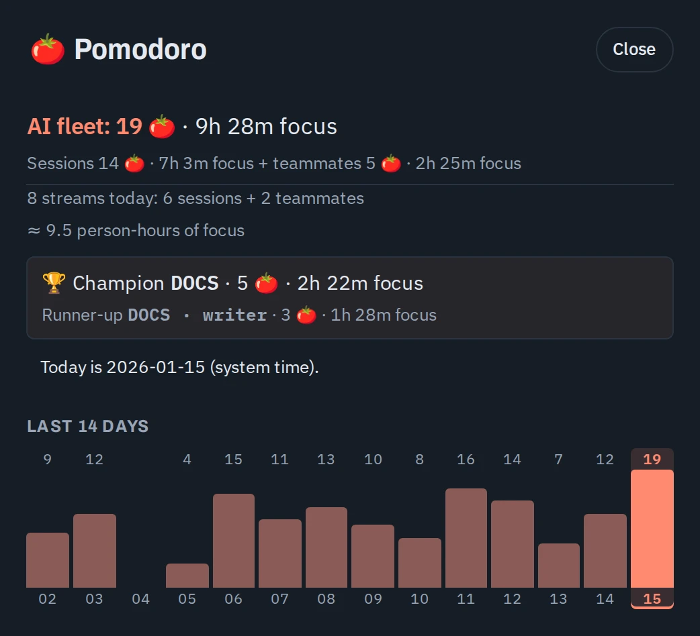
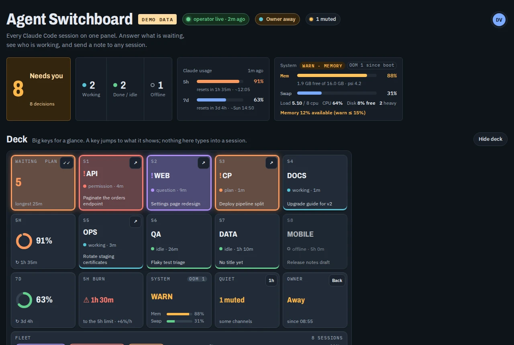
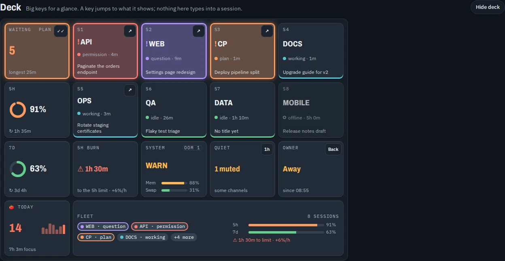
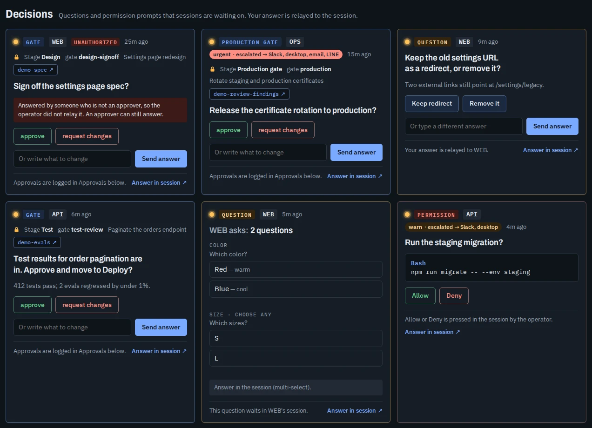
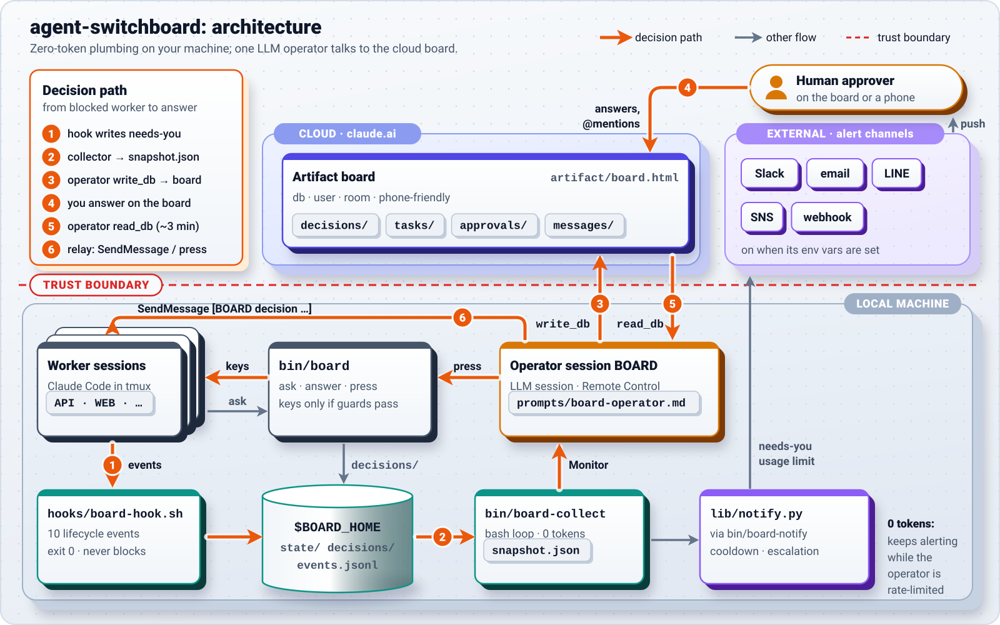
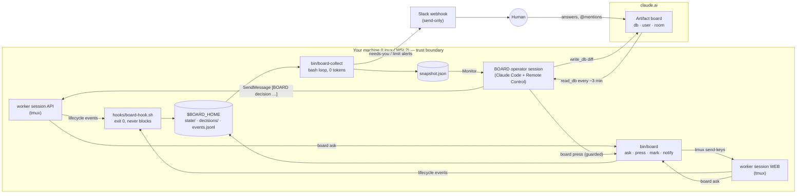
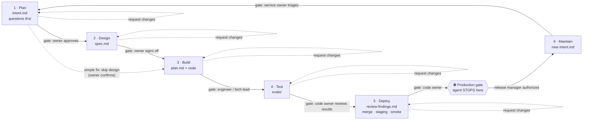

# agent-switchboard

[](https://github.com/osisdie/agent-switchboard/actions/workflows/ci.yml)
[](LICENSE)
[](https://github.com/gitleaks/gitleaks)
[](https://www.shellcheck.net/)
[](#quick-start)
[](bin/)
[](CONTRIBUTING.md)
[](https://osisdie.github.io/agent-switchboard/demo.html)

**Docs:** English | [繁體中文](README.zh-TW.md)

A switchboard for a fleet of long-running **Claude Code** sessions: one board, **Agent Switchboard**,
that shows who is working, who is blocked, and what is waiting for a human decision. You can answer from the board,
including from your phone. It also counts the fleet's focused work in [🍅 pomodoros](#-ai-focus-pomodoros). Try the
[live demo](https://osisdie.github.io/agent-switchboard/demo.html) first (sample data only, nothing is sent anywhere).

The same board page runs on **two channels**: self-hosted (`board-serve`, reachable from your phone
through a Cloudflare Tunnel behind Cloudflare Access) and a claude.ai Artifact. **Running both is the
recommended setup.** See [Two channels](#two-channels-self-hosted-and-artifact-recommended-both).

> Status: early. The data contract is in [`docs/contract.md`](docs/contract.md). Everything else
> follows it.

## 🍅 AI focus pomodoros

How much focused work does a fleet of AI sessions get done in a day? The board counts it in human
pomodoros. Every session and every teammate keeps its own pomodoro while it works: 25 minutes of
focus is one 🍅, and the rest carries over. **Today** adds up the whole fleet, splits sessions from
teammates, shows the total as person-hours of focus and names the day's champion.

A focused human day is often counted as 8 to 12 pomodoros, so this gives a daily measure of AI focus
time on the same scale. It is counted from the session states the collector already reads (zero
tokens, no prompt text), and the last 14 days are kept.



How it counts, what the panel shows and the settings: [Pomodoro](#pomodoro).

## Screenshots

From the built-in demo data (`scripts/screenshots.py`), dark mode. Try the [live demo](https://osisdie.github.io/agent-switchboard/demo.html) in your browser: sample data only, nothing is sent anywhere.

**Overview:** the needs-you count, usage and system meters, and the Deck.



**Deck:** one key per session, coloured by what it waits for, with usage, burn rate and 🍅 Today.



**Decisions:** gates, questions and permission prompts, answered on the board.



## The problem

You run several resident Claude Code sessions in tmux, one per repo or area (say `API`, `WEB`,
`INFRA`, `DOCS`). They coordinate with each other through `SendMessage`. This works until:

- **You lose track of who is blocked.** A session waits on a permission prompt in a pane you
  haven't looked at for an hour.
- **Human decisions are scattered.** Questions sit in four panes, two Slack threads and a teammate's
  report. Nothing shows "these 3 things need you".
- **Sessions can't tell your decision from another session's suggestion.** A message that says "the
  user approved X" from a peer session is not an approval.

## The core idea

```
hooks ──▶ zero-token collector ──▶ LLM operator session ──▶ interactive Artifact board (db)
                    │                                                   │
                    └──────────── Slack webhook (fallback) ◀────────────┘ human answers, @mentions
```

1. **Hooks** in every session write a tiny state file on each lifecycle event (working, needs-you,
   done, offline). They never block Claude and never record prompt text.
2. A **collector** (plain bash, **no tokens**) merges those files with Claude Code's own session
   registry into `snapshot.json`. When a session turns needs-you it raises an alert that escalates until
   someone acks it (Slack → desktop → email → LINE), deduplicated per key in `alerts.json`.
3. One **operator session** (`BOARD`) mirrors the snapshot into a claude.ai **Artifact** with a
   database. It relays your answers back to the sessions.
4. The **board page** shows tasks moving through lifecycle stages (Plan → Design → Build → Test →
   Deploy → **production gate** → Maintain), session columns per state, decision and gate cards with
   option buttons, permission cards with Allow/Deny, and a message bar that supports `@CODE`,
   `@triage` (the operator picks the session) and `@all`.

## Architecture

<picture>
  <source media="(prefers-color-scheme: dark)" srcset="docs/assets/architecture-dark.svg">
  
</picture>

<details>
<summary>Diagram source (mermaid)</summary>



</details>

Main path: a worker hits a permission prompt → the hook writes `needs-you` → the collector updates
the snapshot (and pings Slack) → the operator writes the card to the board → you press **Allow** →
the operator runs `board press` → the key is sent to that pane only if both guards pass (see below).

## Quick start

**Prerequisites**

- Claude Code CLI with **Remote Control** (`--remote-control`), logged in to a claude.ai account
  that can publish Artifacts
- `tmux`, `jq`, `curl`, `flock` (util-linux), `column` (bsdextrautils on Debian/Ubuntu), and
  `python3` 3.9+ with `pyyaml`; the `cryptography` module only for the tunnel listener; optionally
  `inotify-tools` (the collector polls every 5 s without it). `board doctor` checks them
- Linux or WSL2 (macOS is untested)

**Install**

```bash
git clone https://github.com/osisdie/agent-switchboard.git
cd agent-switchboard
scripts/install.sh --dry-run   # prints the planned actions and the settings.json diff; changes nothing
scripts/install.sh             # links bin/*, creates $BOARD_HOME, merges the hook, adds the statusline tap
scripts/setup-dev.sh           # only if you'll commit to this repo: pre-commit gitleaks + banned terms
```

`install.sh` backs up `~/.claude/settings.json` to `settings.json.bak-<date>`, then:

- adds `hooks/board-hook.sh` for **10 events** (`UserPromptSubmit`, `PreToolUse`, `PostToolUse`,
  `PostToolUseFailure`, `PermissionRequest`, `Notification`, `Stop`, `StopFailure`, `SessionStart`,
  `SessionEnd`), keeping every existing hook;
- wraps your `statusLine` command with the usage-meter tap (see
  [Usage meter](#usage-meter-see-the-limit-coming)), saving the previous `statusLine` to
  `$BOARD_HOME/statusline.prev.json`;
- links every command in `bin/` (`board`, `board-collect`, `board-notify`, `board-serve` and
  `fleet-up`) into `~/.local/bin`.

Re-running it changes nothing. `scripts/install.sh --uninstall` removes the hook entries, restores
your `statusLine` and removes the symlinks.

**Configure** in `$BOARD_CONFIG_DIR` (default: `tmp-local/` in the repo if it exists, else
`~/.config/agent-switchboard`):

- `fleet.yaml`: start from `fleet.example.yaml`.

  | Key | Default | Meaning |
  |---|---|---|
  | `sessions[]` | n/a | `code` (tmux session name), `cwd`, `autostart`, `resume_name`, `resume`, `initial_prompt`, `extra_args`, `aliases` |
  | `sessions[].resume` | `true` | `false` = always start a **fresh** session, ignoring `resume_name` (no `claude -r`) |
  | `sessions[].initial_prompt` | none | first prompt, passed as an argument whenever the session starts **fresh** (`resume: false`, no `resume_name`, or a resume that falls back). Not sent when a resume succeeds |
  | `approvers` | `[]` | board user ids allowed to answer decisions (and so to allow/deny permission prompts). **Empty = every answer refused** (fails closed: `board answer` exits 4 and the decision stays pending) |
  | `release_managers` | `[]` | user ids allowed to answer production decisions (`gate` or `stage` is `production`). Empty falls back to `approvers`. **Both empty = production refused** |
  | `poll_interval` | `3` | seconds between snapshot rebuilds |
  | `decision_timeout_hours` | `24` | pending decisions older than this become `timeout` |
  | `resume_fallback_seconds` | `15` | `fleet-up` starts a fresh session only if `claude -r NAME` exits this fast |
  | `alerting` | built-in | routes, quiet hours, repeat, escalation, usage thresholds; see [Alerting & escalation](#alerting--escalation) (or put it in `alerting.yaml`) |
  | `remote_url_prefix` | `https://claude.ai/code/` | prefix for each session's Remote Control link |
  | `serve.enabled`, `serve.port` | `false`, `39410` | self-hosted board: `fleet-up` starts `board-serve`; the local listener (identity `local`) |
  | `serve.tunnel.*` | off | `enabled`, `port` (port + 1), `hostname`, `team_domain`, `aud`: the listener cloudflared points at; identity = the email of a verified Cloudflare Access token |
  | `press.prompt_regex`, `press.question_regex`, `press.free_text_label`, `press.tabbar_regex`, `press.review_regex`, `press.submit_label`, `press.focus_regex`, `press.lines`, `press.allow_keys`, `press.deny_keys`, `press.scrollback_lines`, `press.turn_regex` | see example | the screen checks and keys used by `board press` (`question_regex`: the AskUserQuestion picker; `tabbar_regex`, `review_regex`, `submit_label`: a form of several questions; `scrollback_lines` (200, 0 = off), `turn_regex`: where the start of a shortened question taller than the pane may be found) |

- `.env`: alert channels (Slack, email, LINE, SNS, webhook; all optional, see
  [Alerting & escalation](#alerting--escalation)). Start from `.env.example`.

**Run**

```bash
board doctor    # checks dependencies and the installation
fleet-up        # idempotent: creates missing tmux sessions with Remote Control, starts the collector
```

Then open the `BOARD` session and give it `prompts/board-operator.md`. On its first run it publishes
the board from `artifact/board.html` and gives you the link.

**Expose the board on your phone** (self-hosted channel; details in
[Two channels](#two-channels-self-hosted-and-artifact-recommended-both)):

```bash
pip install cryptography          # or your distro's python3-cryptography: verifies Access tokens
cloudflared tunnel login          # once, for your Cloudflare zone
cloudflared tunnel create board   # a tunnel used only for the board
scripts/expose-cloudflare.sh --hostname board.example.com --tunnel board            # dry run: prints every step
```

1. In Cloudflare Zero Trust, create a **self-hosted Access application** for `board.example.com`
   (the whole host) with an Allow policy for your approvers' emails. One-time PIN works without an
   identity provider. Copy its **AUD tag**.
2. Add to `fleet.yaml` and run `fleet-up` (or `bin/board-serve`):
   ```yaml
   approvers: [local, you@example.com]   # "local" = anything on this machine (single-user hosts only)
   serve:
     enabled: true
     port: 39410                         # local listener: http://127.0.0.1:39410
     tunnel:
       enabled: true
       port: 39411                       # what cloudflared points at
       hostname: board.example.com
       team_domain: yourteam.cloudflareaccess.com
       aud: <AUD tag>
   ```
3. `scripts/expose-cloudflare.sh --hostname board.example.com --tunnel board --apply --access-checked`
   writes a cloudflared config of its own and routes DNS. Then
   `cloudflared tunnel --config ~/.cloudflared/agent-switchboard-board.yml run board`.
4. Open `https://board.example.com` on your phone and sign in with the emailed code.
5. Optional: set `board_url: https://board.example.com` in `fleet.yaml` (or `BOARD_PUBLIC_URL` in
   `.env`). Every alert then carries a link such as `https://board.example.com/?d=<decision id>`:
   tapping it on the phone goes through the Access sign-in and opens the board with that decision
   in view, ready to answer. Usage and limit alerts link to the board itself. `board doctor` checks
   the URL (https only, no query or fragment); without it alerts carry no board link.

**Recommended: run the operator in a fresh, small-context session.** The operator wakes up every
few minutes, and **every tick re-reads its whole context**, so a long-lived conversation makes each
tick more expensive. Instead, start `BOARD` fresh and let it rebuild from durable state. The prompt
file, `board snapshot` / `board decisions` and the board db hold everything it needs:

```yaml
sessions:
  - code: BOARD
    cwd: ~/agent-switchboard
    autostart: true
    resume: false               # always a new session, no old context
    initial_prompt: "Read prompts/board-operator.md and follow it. ARTIFACT_URL=https://claude.ai/…"
```

Restarting it (for example daily, or after `/compact` stops helping) costs only a catch-up, and the
operator prompt is written for exactly that (section 0, "Fresh-session start"). Keep `resume: true`
for worker sessions, whose conversation *is* their work.

**Autostart** (optional). Details are in [`autostart/README.md`](autostart/README.md):

- **Linux/WSL with systemd:** copy `claude-fleet.service` to `~/.config/systemd/user/` and run
  `systemctl --user enable --now claude-fleet.service`. In WSL, set `systemd=true` under `[boot]` in
  `/etc/wsl.conf`.
- **Windows (WSL):** `windows-task.ps1 -Distro <name>` registers a per-user logon task
  (`claude-fleet`) that runs `fleet-up` inside the distro with a hidden window. Use `-KeepAlive` if
  WSL shuts the distro down after the task ends, and `-Unregister` to remove it.

By default only `BOARD` autostarts. Other sessions are listed with `autostart: false`.

**Worker sessions**: paste [`snippets/worker-protocol.md`](snippets/worker-protocol.md) into your
global or project `CLAUDE.md`, so workers know how to ask the board and how to treat its answers.

## How the board works

The board follows **tasks through an agent-ready SDLC**. Every stage commits an artifact and stops at
a named human gate, and the board is where those gates get answered. Underneath, it tracks session
state, permission prompts and messages.

### Lifecycle and gates

<picture>
  <source media="(prefers-color-scheme: dark)" srcset="docs/assets/lifecycle-gates-dark.svg">
  
</picture>

<details>
<summary>Diagram source (mermaid)</summary>



</details>

| Stage | Artifact (committed) | Human gate |
|---|---|---|
| Plan | `intent.md`: the agent asks questions first, multiple-choice, in the file | owner approves the plan |
| Design | `spec.md`, only if needed (a simple fix skips it) | owner signs off |
| Build | `plan.md` + code | engineer / tech lead |
| Test | `evals/` (test and eval results) | code owner reviews the results |
| Deploy | `review-findings.md` | code owner |
| **Production gate** | n/a | **release manager authorizes; the agent stops here** |
| Maintain | new `intent.md` | service owner triages |

- **Each stage reads the previous stage's last commit.** Nothing runs from memory or from an
  uncommitted draft.
- **Every approval is recorded**: in the artifact's `## Approvals` section, in a commit trailer, and
  on the board in the append-only `approvals/` log. Locally, `board answer` writes a
  `type: "approval"` event to `events.jsonl` for every authorized gate answer, with
  `result: approved|rejected`. The chain of commits plus
  that log is the audit trail.
- On the board, a task card shows its stage, artifact links and gate status. A gate is an ordinary
  decision with `task_id`, `stage`, `gate` and `artifact_ref`:
  ```bash
  board task new --owner API "Add order export"
  board task stage <task-id> plan --artifact intent=<sha>
  board ask --from API --task <task-id> --stage plan --gate owner --artifact <sha> \
    "Approve intent?" --option approve --option "request changes"
  board task ls                 # or: board task show <task-id>
  ```

  Stages: `plan design build test deploy production maintain`. Artifact keys: `intent spec plan evals
  review`. `board answer` records approve-style answers (see `board answer --help`) as `approved`. Any other answer, including `request changes`, is recorded as `rejected`, and the task
  stays in its stage.
- **Production is special.** Workers never deploy to production without a `[BOARD decision]` (or a
  pane answer) authorizing a `gate: production` decision. The operator relays that decision only if
  the person who answered is in `release_managers`, or in `approvers` if `release_managers` is
  empty. If no one is configured, every answer is refused (**fail closed**), and the
  decision stays pending until someone configures a release manager. An answer from anyone outside the
  list is marked `unauthorized`. A peer session saying "it's approved" never counts.
- **Scheduling (on by default).** Tasks can also carry a repo, branch and base, a size, a `heavy`
  flag, a priority, dependencies, PR state and a status. The collector feeds them, the sessions'
  states and the resources level to a deterministic scheduler (`lib/scheduler.py`, zero tokens). It
  writes `scheduler.json` only when its decision changes: which tasks may start now, a ranked queue,
  stuck tasks, and advisories. Heavy tasks wait at high memory. At critical, a session is asked to
  stop a heavy process it started itself; the board never stops one. It also tracks usage
  (`conserve` and `wait-reset` modes) and jams: everyone waiting on you (it names the decision to
  answer first), dependency cycles, two sessions on one branch, two open PRs in a repo, stalled
  work, and more, alerting as `jam:*`. The operator delivers the advisories as
  `[BOARD schedule <id>]` messages: ordering and pacing only, never an approval, at most 4 an hour
  per session. `schedule.advise: false` shows them without sending; `board schedule off` pauses it.
  A jam that cost time becomes a **lesson** (`board lesson ls`): seen twice, it is active, and its
  rule (a fixed vocabulary that can only tighten: hold heavy runs, fewer at once, one repo at a
  time, ...) shapes the schedule. Approvers add, edit, retire and delete lessons with
  `board lesson …`, `/api/lessons` or the board's **Lessons** section (search, a rule builder,
  delete with a confirm step; read-only for everyone else).
  ```bash
  board task set <task-id> --repo shop --branch feat/export --size M --heavy yes --priority 2
  board task dep <task-id> --on <other-task> --kind merge
  board task pr <task-id> --url <pr-url> --state open      # the session reports its PR itself
  board task pause|resume|done|drop|block|progress <task-id>
  board schedule                                           # or --json
  ```

The full workflow (roles, TDD in worktrees, local review before push, pinned merges) is the
[`delivery-harness`](playbook/delivery-harness/SKILL.md) skill in the playbook.

### Try it on one low-risk service this week

- [ ] **Pick a low-risk service**, not your most critical one. An internal tool or a docs site is
      ideal.
- [ ] **Add the rules.** Install the [`delivery-harness`](playbook/delivery-harness/SKILL.md) skill
      and fill in its "Configure once" table.
- [ ] **Write the intent as a file.** Start the first task with an `intent.md` and let the agent ask
      its questions there.
- [ ] **CLAUDE.md + hooks, so rules don't live only in a wiki.** Paste
      [`snippets/worker-protocol.md`](snippets/worker-protocol.md) into `CLAUDE.md` and run
      `scripts/install.sh` for the hooks.
- [ ] **Name the release manager.** Put their user id in `release_managers` in `fleet.yaml` before
      the first task reaches the production gate.

### Session states

| Column | Meaning | Set by |
|---|---|---|
| **Needs you** ★ | permission prompt pending, or a decision is open | `PermissionRequest`, Notification `permission_prompt` |
| **Working** | the session is running tools or thinking | `UserPromptSubmit`, `Pre/PostToolUse` |
| **Done / idle** | finished its turn, waiting for input | `Stop`, Notification `idle_prompt` |
| **Offline** | listed in `fleet.yaml` but not running | collector (no live process) |

Each card shows the session's code and state, the task title Claude Code puts in the pane title,
`repo · branch` (the git toplevel's name and the current branch, never a path) and what it is doing
now: "Running Bash: npm test", "Waiting: permission for Edit", "Idle since 14:05". Click it or press
Enter to open the details: the full title, the decisions it waits on (each links to its card), the
tool calls in flight, the tmux target and the Remote Control link. Open cards stay open through
live updates.

All of this is treated as untrusted text: control characters are removed, paths are cut to their
last part, and long text is clipped. The tool call summaries can hold command text, so they appear
only on the self-hosted board; the Artifact board gets the title and `repo · branch`.

On the self-hosted board a card also shows how long it has been in its state, a badge with the
number of decisions and questions waiting for you, its teammates (each with the task in its pane
title, working or idle, and memory), context used and cost so far (from the statusline tap), and
the branch's ahead/behind count against `origin/<default>` with the last commit subject. The open
card is split into Doing, Recent (the last 8 completed tool calls, with duration and ok/failed),
Teammates, Meter, Branch, Pending and Where. Doing quotes the session's last message and the first
line of its last prompt, read from the tail of its transcript and run through the secret guard.
Those two are for **approvers only**: anyone else sees a note instead, and they are never mirrored
to the Artifact or put in an alert. Turn the prompt off with `cards: {show_prompt: false}` in
`fleet.yaml`.

### Decisions

- **Gates.** A stage gate is a question decision linked to a task, a stage and an artifact (see
  above). The answer is the option text: `approve` lets the task move to its next stage, and
  `request changes` sends it back to the same stage.
- **Questions.** A worker runs `board ask --from API "Ship behind a flag?" --option yes --option no`
  and also asks in its own pane. You answer on the board or in the pane, and the first answer wins.
  The operator relays the board answer as
  `[BOARD decision <id>] <answer> (by owner on board)`. When it was answered in the pane (or in
  another session), the worker closes the card with `board resolve <id> --from API --in-pane`
  (status `answered_in_pane`). If it forgets, the card says "maybe answered in the session" once
  that session has taken a new prompt and finished a turn since the ask, and an approver can close
  it with **Mark answered in session** (it asks to confirm; nothing is sent to the session). Such a
  card moves to the end of the list, de-emphasised. A card is never closed automatically.
- **Prompts settled by the session.** A permission prompt or a pane question ends with the
  session's own report (`PostToolUse` / `PostToolUseFailure`), and the board follows it: when the
  session got exactly the board's answer the decision reads **delivered** (also when a press stopped
  at Submit and someone submitted the form in the pane: "delivered (finished in the session)"),
  otherwise **answered in session** ("the board's was not used" only when the session provably got
  something else). The hook records only option numbers and keyed hashes of free text (a per-install
  key in `$BOARD_HOME/secrets/`), never the answer text (docs/contract.md, "Session outcomes").
- **Permission prompts.** The card shows the tool name and a ≤200-char summary of its input, so you
  know what you are allowing. Token-like values in the summary are replaced with `[REDACTED]`.
  **Allow** or **Deny** makes the operator run `board answer <id> allow|deny --by <you>` and then
  `board press <CODE> allow|deny --expect <tool_use_id>`. That sends the keystroke through
  `tmux send-keys` only when **every check** passes:
  1. **Authorized** (otherwise exit 4). An approver's `board answer` with the same action is
     recorded. No approver means no keystroke.
  2. **Same prompt** (otherwise exit 3). The hook's state file still shows the same pending
     `tool_use_id` and the same `summary_sha256` (a hash of the full input). If someone already
     answered in the pane, or a new prompt replaced it, they differ.
  3. **Prompt on screen** (otherwise exit 3, or exit 7 when no prompt is visible at all; see "A
     scrolled pane" below). `tmux capture-pane` shows that the last lines of the pane
     really are a permission prompt, and that the start of the summary is visible there. The pattern
     and keys are configurable (`press:` in `fleet.yaml`), because the prompt UI changes between
     Claude Code versions.
  4. **Whole input visible** (otherwise exit 4). If the input was longer than the summary
     (`summary_truncated`), you can't see on the board what you'd be allowing. The page offers no
     one-click Allow ("answer in the session's pane"), and `board press` refuses. Only a human who
     has read the full input in the pane may pass `--allow-truncated`. The operator never does.

  If a screen check fails, no key is sent and the card becomes **stale** ("handle it in the
  session"). If the hook can't tell which tool call a prompt belongs to (`ambiguous`), it creates no
  card at all. Every press attempt is logged to `events.jsonl`.

  **A scrolled pane.** When new messages arrive above an open prompt, Claude Code's TUI can stay
  scrolled up, and its last line shows "4 new messages (ctrl+End) ↓" instead of the prompt. If one
  of the last 2 non-blank lines is that line as a whole (`press.scrolled_regex`, default
  `^[[:space:]]*[0-9]+ new messages? .*ctrl\+End.*$`; text the session itself writes, such as "3 new messages for you" or "see below ↓", never
  matches), and the pane runs Claude Code (`press.tui_command_regex`, default `^(claude(\.exe)?|node|[0-9]+(\.[0-9]+){2})$`: `claude`, `claude.exe`, `node`, or a version number such as `2.1.3`, the native installer's binary),
  `board press` sends `press.scroll_key` (`C-End`, which only scrolls to the bottom and never
  submits in Claude Code's TUI) once, then runs every check on a fresh capture. If no
  prompt is visible even then, while the hook state still shows the same prompt waiting, it exits 7:
  only that key was sent, and the decision goes back to **pending** with a note, so you can answer it
  again from the board. The note says "scrolled" only when the scrolled line was still on screen;
  otherwise it says the prompt is not visible (scrolled, covered, or not redrawn yet: the hook can
  report a prompt before the TUI draws it). After the 2nd such press in a row for the same card, the
  card stops offering a retry first: it says **Answer in the session**, with the session's tmux
  target, and a question card offers **Mark answered in session** (the card stays pending until
  then). It becomes stale only once the session has moved on. A session card whose
  prompt still waits but whose decision went stale says "Answer in the session" instead of linking
  to a dead card. In Recent decisions, an answer that was recorded but never delivered (refused at
  the press, stopped part-way, the session moved on) gets a red "not delivered" chip and reads
  "Not delivered: <reason> → <answer>", so it never looks relayed.

  **The risk, honestly:** this is screen automation. The guards make a wrong keystroke unlikely, but
  not impossible: a prompt can change between the check and the keystroke, or a future UI can look
  like the old pattern. Keep Allow for actions you would approve without looking at the pane. Turn it
  off if that isn't acceptable for your setup.
- **Questions in the pane (AskUserQuestion).** When a session asks you with Claude Code's question
  picker, the card reads "`<CODE>` asks:" with the question, one button per option (label and
  description) and a **Type something** field, not a meaningless Allow/Deny. The hook keeps the
  questions and options (redacted, clipped: question 300, label 80, description 160 characters).
  A question cut short is shown as stored, marked **(shortened)**, and its buttons still work as
  long as every option label is whole; the press then checks the start of the question and every
  label on screen. A question taller than the pane has its start above the screen: the press then
  looks for it in the last `press.scrollback_lines` lines of scrollback (default 200; 0 = off),
  from its last occurrence, with every label after it in order, the picker footer at the bottom of
  the screen, and no other turn in between (`press.turn_regex`: Claude's "●"/"⏺" bullet or the "❯"
  prompt; a focused "❯ 2." picker row is not one). The keys still go only after every check on the
  visible screen passes.
  For one single-select question, a click runs `board answer` (which maps the label to the option
  number) and `board press <CODE> answer --expect <tool_use_id>`, with the same checks as a
  permission press: an approver's answer, the same pending `tool_use_id` and hash, and the picker
  (`press.question_regex`) on screen with the start of the question (or every option label). An
  option sends its number key, which picks it at once. Free text (one line, ≤200 characters) picks
  **Type something**, is typed literally (`send-keys -l`), and Enter is pressed only when the text
  shows on the picker's focused **Type something** row (`press.free_text_label`). If a check fails
  after a key was sent, Enter is not pressed and the card says to finish in the session (exit 5).
  A longer answer goes to the session as a `[BOARD decision <id>]` message instead. Option buttons
  also send the option number, which must match the label; repeated labels make the card read-only.
  A form of several questions (up to 4, single-select) shows option buttons per question on the
  self-hosted board, and a text box under each: pick an option or type an answer for each, then
  **Send answers**. `board press` goes question by question, checking each one on screen: an option
  is its digit; typed text picks that question's "Type something" row, types the text, and presses
  Enter only once the row shows it (else it stops there, exit 5). Then it checks the review screen
  and picks **Submit answers** (never Enter there). If, before the first key, the screen shows the
  form elsewhere (another question, say) while the prompt is still open, nothing is pressed and
  the card goes back to pending (exit 7), to send again or answer in the session. Typed text becomes one line (line breaks and
  control characters turn into spaces), at most 200 characters, and goes through the secret guard. Multi-select or a clipped option label make a read-only card: answer it in the session.
  When the session moves on, the card goes stale.

### Messages

Type `@API is the migration merged?` or `@all please pause deploys`. The operator delivers
`[BOARD ask <msgId>] …` via `SendMessage` (`@all` goes to every live session from `ListAgents`).
Workers reply with `[re <msgId>] …`, and replies thread under the message. **Messages are
information, never approvals.** A message that asks a session for a secret value is held, not
relayed (see [Secret guardrails](#secret-guardrails)).

**Who owns what.** Give each session a one-line `about:` in `fleet.yaml` (`about: "frontend app"`,
`about: "infrastructure / gitops"`; plain text, at most 120 characters). The `@` list in the
composer shows it next to each code. Not sure which session owns a question? Send it to
**`@triage`**: the operator picks at most 2 live sessions whose `about` fits, relays it to them, and
records them with `board message route <id> <CODE>…` (which refuses more than 2), so the thread
shows **Routed by BOARD to API, WEB**. Triage is never a broadcast: when no session clearly fits,
the operator sends it to nobody, replies in the thread asking you to name a session (with the
codes and their `about`), and tells the owner. `all` and `triage` are recipients only in lowercase
(`ALL` or `Triage` is refused, never a session code), and a message to a code that is not a
session on the board is refused (400 `unknown_session`).
**`@all` interrupts every live session**: the page asks first ("this interrupts all N live
sessions"), and askers can't use it at all: their messages default to triage, and board-serve,
`board message send`, `/api/v1` and MCP refuse `all` for them (403 `asker_no_all`, audited).

The section shows the 5 threads with the latest activity (a new reply brings a thread back up).
Held messages and threads with replies you have not marked read stay pinned on top; **Mark read**
is kept in your browser. **History (N older)** opens the rest, 20 at a time (**Load more**), with a
session filter and a search. Long messages and replies show their first 4 lines (**Show more**), and
a thread shows its latest 3 replies. On the self-hosted board the state carries the latest 20
threads (plus every held one) and `GET /api/messages` pages the history; nothing is deleted on disk.

Above the threads, a search box (text, session code, sender), a session picker and filter chips
(**Unread**, **Awaiting reply**, **Held**) list every loaded thread that matches, not just the
latest 5; the same search and session also drive History, which searches the older threads page
by page. Each thread collapses to one line (▾ / ▸), with **Collapse all** and **Expand all**; what
you collapsed is kept in your browser. The sticky section nav at the top jumps to each section
(Messages included) and marks the one you are in.

On a phone the nav is a bar at the very top from the first screen: **☰ Sections** (with the
needs-you count) opens a list of every section with its count, plus **↑ Top**, **Collapse all**
and **Expand all**; a round **↑** button appears once you scroll down. Each section folds to its
heading from the ▾ beside it (kept in your browser); a jump to a folded section opens it, and
Decisions that wait on you are never folded by Collapse all and open again when one arrives. On
a phone a task shows only its current stage (**Show all stages** for the rest), and a long
decision context or consensus proposal shows its first lines (**Show more**).

### Reminders

Your own alarms: `board remind add "Meeting" --at 3pm` (or `15:00`) sends a notice 5 minutes
before and another at 3 PM. They go to your notification channels at the reminder's level (`high`
by default). The board has a ⏰ Reminders panel, and a sticky countdown banner with Ack and Snooze
inside the lead window.

- **Options.** `--lead`, `--level`, `--repeat once|daily|weekdays` and `--date`. A time that has
  already passed today means tomorrow, and the command says so.
- **Mutes.** A reminder breaks through mutes the way urgent alerts do, unless you add
  `--no-breakthrough`.
- **Downtime.** If the collector was down, a reminder still fires up to 15 minutes late, marked
  "(late)". After that it is marked missed: there is never a backlog.
- **Privacy.** Only the board's owners (else approvers) see reminders; nobody else sees even a count.

### Tickets

`board ticket get WEB-12` reads a ticket from the issue trackers listed under `tickets.trackers` in
`fleet.yaml` (see `fleet.example.yaml`). The board serves the same thing as `GET /api/tickets/<ref>`,
but only to approvers and release managers: the tracker token can read whatever its owner can.

- **Which tracker.** Every tracker's `key_pattern` is tried. A key that two trackers both accept is
  refused as ambiguous until you name one (`tracker:WEB-12`), so list your project prefixes.
- **Generic.** The `http-json` type describes a JSON API in config: an optional `resolve` call,
  the `get` path, a field map and status categories. `fake` reads fixtures for demos and tests.
- **Safe by default.** https only, the host pinned to `base_url`, no redirects, 10 s and 1 MiB
  limits. Tokens come from an environment variable (or `.env`) or a 0600 file. They never appear
  in output, logs, the cache or the audit trail.
- **Gentle on the tracker.** Answers are cached for 60 s. A per-tracker rate limit applies, the
  tracker's 429 `Retry-After` is honoured, and the tracker is paused after repeated failures.

`board ticket doctor` checks every tracker and says whether its token is set (never its value).

**Taking a ticket.** An approver gives a ticket to a session: `board ticket take WEB-12 --session
API --by <you>`, or `POST /api/tickets/take` from the board. The board creates a task linked to the
ticket, and the operator relays a fixed `[BOARD ticket WEB-12] taken for API …` line to the session.
Then the tracker gets an optional comment, a move to in-progress and an assignee. If one of those
fails, the take still stands (`partial`). A ticket that is already taken is refused.

- **What it authorizes** (the owner's rule). The session checks the relay with `board ticket show`.
  It may then follow the delivery harness on that ticket up to and including opening the PR/MR.
  It posts progress comments and moves the ticket to in-progress as itself
  (`board ticket comment|transition --session <CODE>`), never with an approver's `--by`.
- **What it never authorizes.** Merge, production deploy, closing or cancelling the ticket, other
  tickets or repos, or any red line.
- **Comments.** Comments posted from the board (`board ticket comment`, the take's comment) go
  through the secret guard and end with `(via agent-switchboard)`, with no email.

`board ticket release` ends a take.

**On the board.** Approvers and release managers get a Tickets section; nobody else sees one.
Paste a ticket number to see its title, status, assignee, link and a short description.

- **Approvers** can also take it for a session, comment, move, assign and release. Take and
  release ask for confirmation and show the authorizes / does-not text.
- **Session cards** show `KEY taken` for a session's ticket, and `KEY closed upstream` when the
  tracker closed it while the task is still going. Shown tickets are refreshed every 5 minutes
  while the page is open.

### Session actions: Remote Control and compact

Remote Control lets you open a session from claude.ai/code or the Claude app. Turn it on or off
per session, or for all of them:

```bash
board rc off API                 # this session: off now if it is idle, else when it is
board rc on all                  # every session (drops the per-session choices)
board rc status                  # wanted / actual / pending per session
board rc clear API               # forget the choice: fleet.yaml decides again (default on)
```

On the board, every running session card shows whether Remote Control is on: the card's "Open in
Remote Control" link when it is, an **RC off** chip when it is not, or a dashed **RC → on** while
the change waits for the session to be idle. The owner gets Turn on / Turn off in
the card's details, and "RC: all on / all off" (with a confirm step) in the Notifications dialog.

How it reaches a running session: Claude Code has no switch for a running session, so the board
types `/remote-control` into its pane, the way it presses a permission prompt. It does that only
when the session is idle, its prompt box is empty and nothing else is on screen. It presses Enter
only after a second look, and it confirms the result in the session registry. A working or
needs-you session is left alone, and the collector applies the change when it goes idle. Turning
it off walks Claude's "Disconnect this session" dialog, and anything unexpected there gets Escape.
`fleet-up` starts sessions with or without `--remote-control` to match the choice, and
`remote_control: true|false` in `fleet.yaml` sets a session's default. The board tries a running
session once per choice, and only if the choice is newer than the session. After that, a change
made by hand in the session (say, disconnecting from your phone) wins until you make a choice
again; the toggle on the page or `board rc` always forces it.

**Note.** With `DO_NOT_TRACK` set in the environment that starts the sessions, Claude Code ignores
`--remote-control` and has no `/remote-control`. `board doctor` warns about it.
`rc.unset_do_not_track: true` in `fleet.yaml` makes fleet-up start them with `env -u DO_NOT_TRACK`
(default off). A card whose session has it set shows **RC unavailable**.

Compact works the same way. **Compact** in a card's details (approvers, with a confirm step), or
`board session API compact`, types `/compact` into the session when it is idle. While the session
is busy, the compact is queued and runs once it is idle; `board session API cancel` drops it. The
card then says when the board last compacted the session. The board only ever types fixed
commands from a short list (`/compact`, `/remote-control`), never free text, and every one is
audited.

### Profile menu, theme and language

The avatar at the top right of the board opens a small menu:

- **Who you are and how that was checked.** On the self-hosted board: `local` (the local listener,
  a request from this machine) or your email (verified by Cloudflare Access), from
  `GET /api/me`. On the Artifact board: your claude.ai account, and whether you can edit the board.
  The demo shows a sample identity.
- **Your roles:** owner, approver, release manager, asker (messages only), or viewer. An asker gets the
  message composer but no answer buttons.
- **Your status** (owners, self-hosted board): Online, Do not disturb or Away, also shown as a chip
  on the avatar button. See [Do not disturb](#do-not-disturb-and-automatic-declines).
- **Theme:** Light, Dark or System. The choice is kept in this browser (`localStorage`; if storage
  is blocked it lasts for the page view) and applied before the page paints, so there is no flash.
  Inside the claude.ai viewer, a theme the viewer has set wins: the switcher then shows it and is
  disabled. When the viewer clears it, your own choice applies again.
- **Language:** English (the default) or 繁體中文. The whole interface switches, one language at a
  time: headings, buttons, banners, cards, dialogs and messages. Data stays as it is: task titles,
  questions, answers and session names are never translated. The choice is kept in this browser
  and sets `<html lang>`.
- **My API keys:** the key store and `board apikey` exist (see [API keys](#api-keys)), but the page
  does not list keys yet: the menu says "API keys are not enabled on this board". The shape is in
  `docs/contract.md` ("Who am I").
- **Sign out** of Cloudflare Access (`/cdn-cgi/access/logout`), shown only through the tunnel.

Escape closes the menu and puts focus back on the avatar button.

### Deck panel

Near the top of the board sits a **Deck**: big keys laid out like a hardware key deck (5 × 3 keys
and a wide strip; 3 columns on a phone). It is for a glance from across the room, and for one tap
to what needs you.

| Key | Shows | Press |
|---|---|---|
| **HITL** | how many sessions wait and the longest wait; a green ✓ when nothing waits | jump to the longest-waiting decision and focus it (as an alert link does); press again within 5 s for the next one |
| **S1–S8** | each session's code, state colour, time in state and title. A waiting key blinks: **purple** for a question, **orange** for a plan (plan mode or a lifecycle gate), **red** for a permission | the decision its pane shows, else its card; ↗ in the corner opens Remote Control |
| **5h / 7d** | usage rings with the reset countdown, dimmed when the report is over 15 min old | the usage popover |
| **5h burn** | `⚠ 1h 29m to the 5h limit` or `pace OK` (see "Usage meter") | the usage popover |
| **System** | the resources level, memory and swap bars, the OOM badge | Resources |
| **Quiet** | whether push is muted | the Notifications dialog |
| **Owner** | owner-away on or off | Consensus |
| **🍅 Today** | the fleet's pomodoros today, focus time and a 7-day sparkline (see "Pomodoro") | the pomodoro panel |
| **Fleet** (wide) | up to four sessions with state pills, the 5h / 7d bars and the burn rate | Board |

- When a session starts waiting, a ripple in its waiting colour spreads across the deck from its
  key, once. With *reduce motion* set in the OS, keys keep their colour without blinking and there
  is no ripple.
- **Approvers on the self-hosted board** also get a small second action, each behind a confirm
  step: acknowledge all open alerts (✓✓ on HITL, or a long press), mute all push for an hour /
  unmute, and owner-away on / off. They use the same approver-only routes as the rest of the board
  (`POST /api/alerts/ack` runs `board ack --by board:<you> '*'`). The Artifact page shows a
  read-only deck.
- **No new power.** A key only navigates or calls one of those routes. There are no keys that type
  into a session (prompts, Enter, `/compact`): answer a prompt on its decision card.
- Hide it with **Hide deck**, or in the profile menu (**Deck panel**). The choice is kept in this
  browser.
- **Its own theme.** The deck is dark by default, whatever the page theme. The **☾ Dark / ☀ Light**
  button next to **Hide deck** switches only the deck (light keys keep their state colours at WCAG
  AA contrast); the page theme stays as set in the profile menu. The choice is kept in this browser.

### Pomodoro

A light, fun tally of how much focused work the AI fleet gets done. The idea comes from the Focus
Timer of [ulanzi-lab](https://github.com/osisdie/ulanzi-lab), where you press a key to start a
pomodoro. Here every Claude session, teammates included, presses its own while it works, and
Today adds them all up.

- **One pomodoro = 25 minutes of focus.** A session focuses while it is working; a teammate while
  the resources sampler sees it active (idle under a minute) or its pane shows the working spinner. A lead counts only its own work.
  Each 25 minutes adds one to that stream's tally and the rest carries over, so 50 minutes of work
  counts as 2.
- **Breaks don't reset it** (`mode: accumulate`, the default): agents pause between prompts all the
  time, so focus simply adds up. `mode: strict` is the human pomodoro: a done/idle stretch longer
  than 2 minutes resets the current one.
- **Waiting for you pauses it** (needs-you), however long you take: the session is mid-task.
  Going offline resets it. A teammate that ended (or no sampler data) pauses its pomodoro.
- The collector counts it from the session states and teammate activity it already reads (zero
  tokens) into `$BOARD_HOME/pomodoro.json` (0600): per local day and stream, the count, the focused
  minutes and the current pomodoro, for 14 days. Days roll over at local midnight (`pomodoro.timezone`,
  default the system's). The tally survives collector restarts.
- **On the board:** each card shows a small tomato ring with `12:34 / 25:00` and `🍅×3 today`, plus
  `teammates +5 🍅 · 2h 20m` when its teammates focused. The Deck key **🍅 Today** shows the fleet
  total, teammates included (`19 · 9h 28m focus`), with a 7-day sparkline, and opens a panel with
  the sessions / teammates split, today's streams and person-hours of focus, the champion (most 🍅,
  ties broken by focus) and runner-up, the last 14 days, then one row per session with its teammates
  folded under it (the top 10 with something today, "Show all", a filter past 10; a name cut short
  shows in full on hover, focus or a tap). Click, tap or arrow-key to any of the 14 days to see that
  day's total, champion and sessions (board-serve fetches a past day only when you pick it,
  `GET /api/pomodoro/day`; the Artifact shows daily totals only). Hovering or focusing
  the 🍅 (the key, the panel title) explains what counts. A finished pomodoro gets a
  short burst of tomatoes (none with *reduce motion*).
- `board pomodoro [today|week] [--json|--mirror]` prints the same tallies in a terminal (`--mirror`:
  the `meta/pomodoro` document for the Artifact page).
- Optional, off by default: `pomodoro.notify: true` sends one info notification at every 10th
  fleet pomodoro of the day ("AI fleet finished its 10th 🍅 today").

```yaml
pomodoro:                 # fleet.yaml; all optional
  enabled: true
  focus_minutes: 25
  mode: accumulate        # or strict: a break longer than grace_minutes resets the pomodoro
  grace_minutes: 2        # strict only
  teammate_idle_s: 60     # a teammate idle this long is on a break
  timezone: ""            # IANA name, e.g. Asia/Taipei; empty = the system's
  notify: false
  notify_every: 10
```

### Owner away: decide by explicit consensus

**What.** When you go offline you may tell your sessions "decide among yourselves; if everyone
agrees, go ahead". Owner-away mode makes that rule explicit, bounded and auditable.

**Why.** Without it, sessions either stall on every cross-session question until you return, or one
session reads "the others agreed" as permission. Here, agreement is explicit and recorded, silence
never counts, and the dangerous things still wait for you.

- **Away = the file `$BOARD_HOME/owner-away` exists** (any content, so an older free-text file
  counts too). Only a session that got *your* instruction turns it on, with your words, and any
  session you tell "I'm back" turns it off:

  ```bash
  board away on --by OPS --said "Offline until Monday 09:00. Agree among yourselves."
  board away status            # exit 0 = away, 1 = not; --quiet, --json
  board away off --by OPS --said "back"
  # words you are quoting (yours, or pasted from elsewhere) go by file, never on the command line:
  board away on --by OPS --said-file /tmp/owner-words.txt --replace
  ```

- **Consensus.** While away, the proposer names every affected session; each must vote `agree`
  explicitly. One `object` parks it for you. The proposer counts as agreeing.

  ```bash
  id=$(board consensus propose --from API --to WEB,QA --ref https://example.com/pr/42 \
         "Bump the shared fixture to v2 in both repos before the nightly run")
  board consensus vote "$id" agree --from WEB --note "diff reviewed"     # in WEB
  board consensus vote "$id" agree --from QA                             # in QA → agreed
  # a quoted proposal or note goes by file: consensus propose ... --file F, vote ... --note-file F
  board consensus show "$id" --markdown     # paste into PR 42: proposal, votes with times, outcome
  board consensus ls [--all]
  ```

  Votes are **self-attested**: `--from` is not verified, so each session must vote only as
  itself (inside tmux, a `--from` other than the tmux session is refused; a human running it
  from a personal tmux session uses `TMUX= board consensus …` or a shell outside tmux).
  A vote may change agree → object, never object → agree. When you come back (`board away off`),
  anything still pending becomes `owner_back` and waits for you. `agreed`, `objected` and
  `owner_back` send an info notify.
- **Red lines never pass by consensus:** production deploys, deleting real data, irreversible
  operations, touching shared production or third-party data, publishing externally, loosening
  permissions or security settings.
- **Consensus never answers a board ask** or a gate, and BOARD never relays it as
  `[BOARD decision …]`. The board shows an "Owner away" banner and a read-only consensus list; on
  the self-hosted board an approver gets **I'm away** / **I'm back** buttons (`POST /api/away`).
  BOARD tells every live session when the away state changes and reports who received and
  acknowledged it.

Details: [`docs/contract.md`](docs/contract.md), "Owner away & consensus".

### Do not disturb and automatic declines

**What.** Sometimes you are here and working, but don't want askers' questions or work requests
right now. **Do not disturb** keeps you present (it is *not* away: no consensus mode) and answers
askers for you with a short canned reply. The board does the same, on its own, when compute is
short.

**Why.** An asker's message wakes BOARD and a session and spends tokens. A canned reply from
board-serve costs nothing, the asker knows where they stand, and nothing they sent is lost.

- **Your status** is in the profile menu (owners only): **Online**, **Do not disturb** or **Away**,
  and a small chip on the avatar button shows it. The menu keeps them exclusive. Away is
  owner-away mode, exactly as above. From a terminal:

  ```bash
  board dnd on --by OPS          # $BOARD_HOME/owner-dnd; --said "..." keeps a note for the record
  board dnd status               # exit 0 = on, 1 = off; --quiet, --json
  board dnd off --by OPS
  ```

- **While it is on**, an asker's message (the page, `board message send --by <asker>`,
  `/api/v1/messages`, MCP `send_message`) is stored with status `declined`, gets the canned reply
  from BOARD in its thread, is audited, and is **never relayed**: no `message <id> new` line, no
  session interrupted. The API answers 201 with `status: "declined"`, `reason` and `reply`. An
  asker's key that tries to create work (`POST /api/v1/tasks`, a ticket take) gets
  `409 declined` and nothing is created. The asker rate limit still applies.
- **Compute is short** (automatic, reason `compute_low`): the same decline, with a "try again later"
  reply, while the 5-hour usage is at or above 90 %, the 7-day usage at or above 95 %, or a usage
  limit is hit (fresh `usage.json`, `limit.json`). Thresholds in `fleet.yaml`:

  ```yaml
  availability:
    dnd_reply: "Heads down today. Please ask again tomorrow."   # default: English + 繁體中文
    compute_reply: "Busy right now. Please try again later."
    compute: {enabled: true, five_hour_pct: 90, seven_day_pct: 95, limit: true}
  ```

  Replies are one line, scrubbed, at most 300 characters. They never say where you are or show
  usage numbers.
- **Who is affected:** askers only (and API keys issued to one). Owners, approvers, release
  managers and sessions' own `board ask` are never declined. The asker's composer says requests
  are paused; you see declined threads on the board, marked `declined`.

Details: [`docs/contract.md`](docs/contract.md), "Owner availability (do not disturb)".

## Alerting & escalation

The board is only useful if you look at it. Alerts reach you when you aren't looking. They escalate
PagerDuty-style until someone acknowledges them. `bin/board-notify` (engine: `lib/notify.py`) sends
them, and the collector calls it on every loop. Alerts cost **zero tokens**, so they keep working
while the operator session is rate-limited.

### Levels

| Level | Raised when | Channels (default route) |
|---|---|---|
| `info` | FYI (`board-notify send --level info …`) | slack |
| `warn` (**L1**) | a session needs you, a new decision, usage ≥ 80% | slack **with @-mention** + desktop |
| `high` (**L2**) | still not acknowledged after 10 min, usage ≥ 90% ("prepare to switch account") | + **email** |
| `urgent` (**L3**) | not acknowledged after 30 min, a permission prompt not acknowledged after 10 min, a **production gate** (urgent at once), usage ≥ 95%, usage limit hit | + **line**, sns, webhook |

- **Ack stops escalation.** Alerts ack themselves when the decision leaves `pending` (answered
  anywhere), the session leaves needs-you, or the limit episode ends. To ack by hand, run
  `board ack 'session:API:*'` (or `board-notify ack …`). Globs are allowed. Keys look like
  `decision:<id>`, `session:<code>:needs-you`, `limit:<hit_at>`, `usage:<window>:<threshold>`, and
  the resource and operator keys below.
- **Board link:** with `board_url` (or `BOARD_PUBLIC_URL`) set, each alert links to its item on the
  board (`<board_url>/?d=<decision id>`, `?c=`, `?m=`, or the board root). See "Expose the board on
  your phone" and the contract's "Board links in alerts".
- **Dedupe:** at most one send per key per level. An alert that is still open is re-sent at the same
  level only after `repeat_minutes` (default 60). Usage alerts fire once per threshold per reset
  window.
- **Quiet hours** (off by default): with `quiet_hours: "23:00-08:00"` (local time), only `urgent` is
  delivered. Everything else is held and delivered when quiet hours end, unless it was acked
  meanwhile.
- **First run:** `board-collect --baseline` builds the snapshot and acks every condition that is
  already open, without sending anything. Installing on a busy machine therefore doesn't page you
  about old needs-you sessions and decisions. It runs automatically (via `fleet-up` or the
  collector) whenever `alerts.json` doesn't exist yet.
- Every delivery attempt is logged to `events.jsonl` (`type: "alert"`, channel, level, ok/error),
  never with secret values. `board-notify status` shows the open alerts and which channels are
  on, without values.

### Channels

A channel is on only when its variables are set in `$BOARD_CONFIG_DIR/.env` (the process environment
overrides the file). All of them are listed in `.env.example`.

| Channel | Needs | Notes |
|---|---|---|
| `slack` | `SLACK_WEBHOOK_URL`, `SLACK_MENTION` (`<@your member id>`) | The mention is what makes your phone buzz. Titles and bodies are **escaped** (`&`, `<`, `>`), so text from a session can't inject mentions or links. Only `SLACK_MENTION` from your own config is sent as markup, and only plain `http(s)` URLs become links |
| `desktop` | nothing; `ALERT_DESKTOP=0` turns it off | WSL (`powershell.exe` toast), `notify-send` on Linux, or macOS notifications. Best effort, never blocks |
| `email` | `SMTP_HOST`, `SMTP_PORT`, `SMTP_USER`, `SMTP_PASSWORD`, `SMTP_FROM`, `ALERT_EMAIL_TO` | Any SMTP server, **TLS only**: port 465 uses SSL, and any other port requires STARTTLS. If the server doesn't offer STARTTLS, nothing is sent. `SMTP_SECURITY=ssl\|starttls` forces a mode. `none` (plaintext) is accepted only **without** credentials, and a login is never sent unencrypted. **Breaking change:** a server without STARTTLS on a port other than 465 used to get plaintext mail (and the login); it now fails until you set `SMTP_SECURITY=none` and remove the credentials, or switch to TLS |
| `line` | `LINE_CHANNEL_ACCESS_TOKEN`, `LINE_TO` (user or group id) | LINE Messaging API push. Mind your plan's monthly push quota |
| `sns` | `AWS_SNS_TOPIC_ARN`, plus a configured `aws` CLI | Subscribe SMS or email to the topic |
| `webhook` | `ALERT_WEBHOOK_URL`, optional `ALERT_WEBHOOK_AUTH` | Generic JSON POST: a push service, an incident tool's events bridge, your own relay |

**Setup**

1. **Slack:**
   - Create an incoming webhook for a channel you watch. **Private channels work**: create the
     webhook as a member of that channel, and pick the channel on the Slack app's *Incoming
     Webhooks* page.
   - Set `SLACK_MENTION` to your own member id (`<@U…>`). A plain channel post often doesn't push to
     a phone, but a mention does.
   - Can't get a member id? Incoming webhooks can't look one up. Use `SLACK_MENTION=<!channel>`,
     which notifies all of the channel's members, or `<!here>`, which notifies only those currently
     active. Either one forces a mobile push.
2. **Email:** use an app-specific password, never your main one, and send to an address that
   reaches your phone.
3. **LINE:** create a Messaging API channel, issue a long-lived channel access token, add the
   account as a friend (or to a group), and put your user or group id in `LINE_TO`.
4. **SNS / webhook:** optional, for SMS or an incident tool.
5. **Test every channel** before you rely on it overnight:
   ```bash
   board-notify test --channel slack     # also: desktop, email, line, sns, webhook; --level to pick a level
   board-notify status                   # enabled channels and open alerts
   ```

All of these values are secrets. They live only in the gitignored `.env`, and are never printed or
written to the board db.

### Policy: routes, quiet hours, thresholds

Policy is merged in this order (later wins):

1. built-in defaults,
2. `$BOARD_CONFIG_DIR/alerting.yaml`, if present (an `alerting:` key or the bare block), so a
   machine can keep its policy without touching `fleet.yaml`,
3. the `alerting:` block in `fleet.yaml`.

```yaml
alerting:
  routes:                     # level -> channels (defaults shown)
    info:   [slack]
    warn:   [slack, desktop]
    high:   [slack, desktop, email]
    urgent: [slack, desktop, email, line, sns, webhook]
  quiet_hours: "23:00-08:00"  # default: off
  repeat_minutes: 60          # 0 = never repeat
  escalate_minutes: {high: 10, urgent: 30, permission_urgent: 10}
  thresholds: [80, 90, 95]    # usage % -> warn / high / urgent
  min_level: {}               # triage floors, e.g. {all: warn, email: high}; `board notify-level` overrides
  presence: {reduce: true, min_level: high, window_seconds: 120, idle_seconds: 900}
```

### Quieting the board: mute, triage, presence

Slack-style control over what gets **pushed** to you. The board itself always shows everything,
alerts keep escalating, and every push that is held is logged in `events.jsonl`
(`type: "alert-suppressed"`, with the reason `muted:<channel>`, `muted:all`, `below_min_level` or
`owner_present`), so nothing disappears silently.

**Mute** a channel (`slack`, `desktop`, `email`, `line`, `sns`, `webhook`) or `all`, for a while
or until you unmute:

```bash
board mute slack --for 1h            # 30m, 4h, 2d ... (at most 30 days)
board mute all --until 08:00         # the next 08:00 local time; an ISO time works too
board mute email                     # until `board unmute email`
board mute all --include-urgent      # everything, urgent too: total silence
board unmute all                     # removes every mute
board mute status                    # what is muted, floors, presence, who is watching
```

**Triage** with a minimum level per channel and for everything. A channel gets the stricter of
the two; `default` removes your setting (fleet.yaml `alerting.min_level`, else `info`, applies):

```bash
board notify-level slack high        # Slack only high and urgent
board notify-level email urgent      # email only urgent
board notify-level all high          # everything only high+
board notify-level slack default
```

**While you're watching.** When an approver has the self-hosted board open, visible and in use
(a heartbeat in the last 2 minutes, a click, tap, scroll or key in the last 15), push below
`high` is held, because you can already see it. Escalation timers keep running: walk away and
whatever is still open escalates and reaches you as usual. Turn it off or change the level with
`board notify-presence off` / `board notify-presence on --level urgent`.

**Breakthrough rules.**

- `urgent` breaks through every mute and presence by default: a production gate, a usage-limit
  hit, usage ≥ 95%, a permission prompt left 10 minutes, anything left 30 minutes, or any
  `board-notify send --level urgent`. Triage can't stop it either, since urgent is the top level.
  (The operator-silent alert, `operator:stale`, starts at high and breaks through once it turns
  urgent after 30 minutes.)
- Only a mute **with `--include-urgent`** stops urgent. That is the explicit "mute everything,
  including urgent" switch; use it with an expiry.
- Quiet hours (`alerting.quiet_hours`) still apply on top: outside urgent, they hold and later
  deliver.
- When a mute ends, nothing is replayed. An alert that is still open goes out at its next
  escalation step (or its hourly repeat), under the rules in force then.
- `board notify` posts are `info` on Slack and follow the same rules. `board-notify test`
  ignores them on purpose.

**On the board.** The **Notifications** button opens the same controls: mute all (1 h, 4 h, until
08:00, until I unmute, optionally including urgent), per-channel mute and min level, the level for
everything, and "reduce push while I'm watching". A banner says what is muted ("Slack muted until
14:00") and whether urgent still breaks through. On the self-hosted board only approvers change
them (`POST /api/notify-prefs`, which runs the commands above with `--by board:<you>`); on the
Artifact board they are read-only, mirrored by the operator into `meta/notify`.

Settings live in `$BOARD_HOME/notify-prefs.json`; `board-notify status` shows the effective state
without any credential. Details: the contract's "Notification controls".

### System resources and a silent operator

The collector also samples the machine every 15 s (`lib/resources.py`, zero tokens): memory,
swap, memory pressure (PSI), load, disks, OOM kills, and what each session runs, teammates
included. Teammates are the separate `claude` processes a session starts in extra tmux panes
(`--agent-id`); stopped ones that are left running often hold 250–400 MB each. The board shows a
**System 系統** tile and a **Resources 資源** section. Idle teammates are flagged there. The board
**never stops a process**; it tells you, and the session stops its own.

| Key | Level | When |
|---|---|---|
| `res:mem`, `res:swap`, `res:disk:<id>` | warn → high | over `resources.thresholds` (hysteresis, 2-sample dwell; swap only while memory is short); repeats hourly while open. Memory alerts name idle teammates to reclaim first |
| `res:oom:<count>` | high | the kernel's OOM killer fired |
| `res:idle-teammates:<code>` | info (warn under memory pressure) | a session's teammates idle past `resources.teammate_idle_minutes` (30) |
| `operator:stale` | high → urgent after 30 min | with `serve.enabled`: the operator's heartbeat is over 10 min old, or `board-serve --watch` is not running, and an answer or message waits to be relayed |

`operator:stale` closes the gap where an operator session dies quietly: before it, only the
page's banner showed it. Raw numbers live in `resources.json`; the snapshot only carries the
level, so the operator's Monitor does not wake every sample. `board resources` prints the last
sample, and `board doctor` shows which metrics this platform provides (macOS and others fall back
to `ps`; what can't be read is shown as unavailable). Turn it off with `resources.enabled: false`.

## Operating under usage limits

The operator is an LLM session. When the account hits a **5-hour or weekly usage limit**, the
operator stops and the board freezes. The system is designed to degrade visibly:

- **Heartbeat banner.** The operator writes `meta/operator.heartbeat_at` every loop. After 10 minutes
  without it, the page shows a red "operator offline since HH:MM" banner and greys out answer buttons.
  Answers are still saved, and they are relayed when the operator returns.
- **Alerts keep working.** The collector and `board-notify` use zero tokens. When a limit episode
  starts, they send one `urgent` "usage limit hit, resets ~HH:MM, N decisions pending" alert, and
  they keep escalating needs-you transitions and decisions. While the board is frozen, alerts plus tmux are
  your channel.
- **Failover.** A session on another account that is an **Editor** of the board (invited by email;
  never share the board org-editable), on the **same machine** because the operator must run where
  the workers run, can run `prompts/board-operator.md` against the same URL and take over. When the original operator
  comes back and sees a fresher heartbeat, it stays passive.
- **Catch-up.** The first loop after resuming rewrites every session, relays every answered decision
  and delivers every new message, oldest first.
- **Limit episodes.** The hook records `$BOARD_HOME/limit.json` when it sees a `StopFailure` or
  notification text that looks like a usage limit. The episode ends at the next `PreToolUse` or `Stop`
  (the session is really running again). It does **not** end on `UserPromptSubmit`, because typing a
  prompt into a limited session doesn't mean the limit is gone. `board limit` shows the current
  episode, and `board limit --clear` ends it by hand.

### Usage meter: see the limit coming

Claude Code passes `rate_limits.five_hour` and `rate_limits.seven_day` (`used_percentage`,
`resets_at`) to the statusline command. `scripts/install.sh` wraps your existing statusline command
with `hooks/board-statusline-tap.sh` (your command moves to `BOARD_STATUSLINE_NEXT`; other
`statusLine` settings are kept):

- The tap writes `$BOARD_HOME/usage.json` as
  `{five_hour:{pct,resets_at}, seven_day:{pct,resets_at}, updated_at, session_id}`, with `pct`
  from 0 to 100 and `resets_at` in epoch ms. It writes atomically, in the background, and only when
  the input has rate limits.
- It then runs your command with the same input, byte for byte. The statusline output and exit
  status are exactly the same as before, and the overhead is a few milliseconds. Without `jq` it just
  passes the input through.
- `scripts/install.sh --uninstall` restores your original `statusLine` setting.

| Usage (5h or weekly) | Alert | Board | Meaning |
|---|---|---|---|
| ≥ 80% | L1 `warn`: "5h usage 82%, resets ~14:20, heads up" | meters show it | keep an eye on it |
| ≥ 90% | L2 `high`: "5h usage 90%, resets ~14:20, prepare to switch account" | amber **Prepare to switch account** banner | get the second account ready |
| ≥ 95%, or limit hit | L3 `urgent`: "weekly usage 95%, resets Mon 09:00, switch account now" | red banner | switch now |

Hover or focus the usage meter (on a phone, tap it) for the details: both windows with the percent
used and when they reset, when usage was last reported, the threshold reached, and the account the
sessions run on. The account comes from `~/.claude.json` (only `oauthAccount.emailAddress` and
`organizationName`, never a token) and is shown to **owners only** (`owners` in `fleet.yaml`; with
no owners set, approvers). Approvers who are not owners, askers, everyone else, and every viewer of
the Artifact board see "account: hidden". Turn it off with `BOARD_SHOW_ACCOUNT=0` or
`usage: {show_account: false}` in `fleet.yaml`.

Every other tile, meter and pill in the header explains itself the same way (hover, focus or tap;
Escape or a tap elsewhere closes it): **Needs you** lists what waits, longest first, with links to
the oldest and to Decisions; **Working**, **Done / idle** and **Offline** list the sessions and how long each has
been in that state; **System** shows memory, swap, load and disk levels, OOM kills, heavy jobs,
idle teammates and when it was sampled, with a link to Resources; the operator pill shows the last heartbeat, whether the
operator watch runs and which board this is; the **Owner away** and notification pills show since
when and by whom, pending consensus, and each channel's mute or floor.

Thresholds are configurable (`alerting.thresholds`). Each one fires once per reset window. The page shows both meters (5h and 7d) with reset countdowns. The
meter reflects the session whose statusline rendered last. With two accounts on one machine, it can
show either of them.

**Burn rate.** The collector also keeps the last hour of 5h readings in
`$BOARD_HOME/usage-samples.json` (one sample per 20 s; it starts over when the window resets) and
fits a least-squares line through the last 30 minutes. The Deck shows `⚠ 1h 29m to the 5h limit`
when that line reaches 100% before the window resets, `pace OK` when it doesn't, `pace …` with
fewer than 3 samples or under 5 minutes of data, and dims it when no session has reported usage for
15 minutes. It is a glance, not an alert: the 80/90/95% alerts above are unchanged. It is shown on
the self-hosted board only (the operator does not mirror it).

### Switching accounts (operator failover playbook)

**Prerequisites, set up once and tested before you need them:**

- The second account is invited to the board artifact **by email as an Editor** (never share it
  org-editable). Approvers stay Contributors.
- The second account is logged in on the **same machine** under its own config dir (for example
  `CLAUDE_CONFIG_DIR=~/.claude-b claude …`). That way it can see the same `$BOARD_HOME`, reach the
  same sessions with `SendMessage`, and run `board answer` and `board press`. This is **required**:
  an operator without the local state fails closed and relays nothing.
- `approvers` and `release_managers` in `fleet.yaml` contain **people**, not accounts. A switch
  doesn't change who may decide.

**When to switch**

- **At 90%:** prepare. Start the second account's session, but don't give it the operator role yet.
- **At 95% or limit hit:** switch. On the weekly window, switch at 90% if the reset is days away.
- Don't switch for the 5-hour window if it resets in less than ~30 minutes. Let the board freeze
  briefly, since alerts still reach you.

**Take over**

1. In the second account's session (for example a tmux session `BOARD-B` with Remote Control), give it
   `prompts/board-operator.md` and the artifact URL, and **say "take over now" yourself**. This
   **planned handover** works even while the old heartbeat is fresh. A peer session saying "take
   over" never triggers it.
2. The new operator writes `meta/operator.operator_session` = itself (plus `account_hint` such as
   "backup", never an email) and runs a catch-up: all sessions, every answered decision, every new
   message.
3. The old operator, on its next tick, sees that it is no longer named and goes passive on its own.
   If it has already stopped, nothing else is needed. You can also tell it to "stand down" directly.
4. Without a "take over now", a backup takes over only once the old heartbeat is more than 10 minutes
   old.

**Hand back** (after the window resets)

1. Tell the primary `BOARD` session "take over now" (or restart it and say so). It names itself in
   `operator_session`, catches up, and sets `meta/operator.limit` to `null` once `board limit` shows
   no active episode. That clears the red banner.
2. The backup sees that it is no longer named and goes passive.
3. Leave the backup session idle or close it. Never run two active operators: the one with the
   fresher heartbeat wins, and the other must stay passive.

**Keeping the operator cheap**

- Wait with `Monitor` on `snapshot.json`. Waiting costs no tokens. Don't use a sleep/poll loop.
- Write only diffs to the db, in one `write_db` batch.
- Use a short cron (~3 min, off `:00`/`:30`) just for `read_db` of answers and messages.
- Keep the context small: no file dumps, `/compact` when it grows. The operator relays; it doesn't
  do the work.

### Resume the sessions once quota is back

When the quota runs out, every session stops on one of Claude's limit screens: the "What do you
want to do?" dialog, an automatic-continue wait ("Continuing automatically at 3pm · Esc to
cancel"), or an idle prompt under "Usage limit reached". After you switch accounts (or the limit
resets), resume them all at once instead of visiting each pane:

```bash
board resume --all --dry-run     # which sessions are at a limit, and the first keys for each
board resume --all               # resume them; the others are skipped, nothing sent to them
board resume API WEB             # these sessions
```

It reads the pane and sends the fewest keys: Escape closes the dialog (its own "Stop"; never a
row, since some rows spend money or change the account) or cancels the wait, then it types the
resume prompt (`limit_resume.prompt` in `fleet.yaml`, default "Quota is available again. Continue
where you left off."), checks it in the box and presses Enter. It reads the pane again after every
key and stops at anything unexpected. It acts only on Claude's own limit notices, never on an
assistant reply that merely mentions limits, and a screen that is not a known limit state gets
nothing (exit 3). Every attempt is audited in `events.jsonl`.

On the board, a session at a limit shows a **usage limit** chip (the collector looks at the panes
every 30 s), and the owner gets **Resume** in the card's details and **Resume all** in a banner,
both with a confirm step; Resume all resumes exactly the sessions the banner lists. The screen patterns are in `fleet.yaml limit_resume`; adjust them when
Claude Code changes its screens. Details: [docs/contract.md](docs/contract.md), "Resume after a
usage limit".

## Two channels: self-hosted and Artifact (recommended: both)

The board page (`artifact/board.html`) has two data adapters, and it picks one when it loads:

| adapter | data | when |
|---|---|---|
| **local** | `$BOARD_HOME`, through `bin/board-serve` | served by `board-serve`, which injects a `board-mode` meta tag |
| **claude** | the claude.ai Artifact db, written by the operator | opened as a published Artifact |
| demo | built-in sample data | `?demo=1`, or the "Preview with demo data" button |

So the same page gives you two channels:

| | Self-hosted: `board-serve` + Cloudflare Tunnel + Access | claude.ai Artifact board |
|---|---|---|
| **Account dependency** | None on claude.ai. Needs a Cloudflare account (the free plan works) and a domain on it | The claude.ai account that owns the artifact; every approver needs access to it |
| **Token cost** | Zero to show live state and to press permission prompts. The operator spends tokens only to relay questions and messages | The operator spends tokens mirroring every change, plus its cron ticks |
| **Works under usage limits** | Yes: live state, and Allow/Deny is pressed at once. Questions wait for the operator | Frozen (stale-data banner). Answers queue until an operator returns |
| **Reachable when the machine is off** | No | No: the page opens, but it shows the last mirrored state and nothing is relayed |
| **Auth model** | Cloudflare Access (email one-time PIN or your IdP) → the email in a verified Access JWT, checked against `approvers`. `local` for any process on this machine (single-user hosts only) | claude.ai sharing. Approvers are Contributors who write only their own `answers/<user id>/`. The operator takes the identity from that path |
| **Setup effort** | About 15 minutes: a dedicated tunnel, an Access application, `fleet.yaml` (`scripts/expose-cloudflare.sh` prints every step) | Publish once through the operator, then share the link |

Neither channel works while the machine is off, because the sessions, `$BOARD_HOME` and the
operator all live on it. That would take a cloud variant, which doesn't exist yet.

### Pick one, or run both

- **Self-hosted only.** No claude.ai account is involved. Set `serve.enabled: true` and, for your
  phone, `serve.tunnel`. Run the operator in local mode (`prompts/board-operator.md` section 9).
- **Artifact only.** This is the original setup: the operator mirrors to the Artifact and relays
  from it.
- **Both (recommended).** Both channels read and write the same `$BOARD_HOME`. Every answer, from
  either one, goes through `board answer`, so whichever comes first wins and the other shows the
  result. `board-serve` always works. The operator mirrors to the Artifact only while it can reach
  it (otherwise it goes local-only, section 1a), and it relays the self-hosted board's answers with
  `board-serve --watch`. If the claude.ai account hits its limit or loses access, your phone keeps
  working.

**Not yet (future work):**

- **Approver messaging on the Artifact board.** Messages are shared documents, so there only Editors
  send them, while approvers (Contributors) can only answer. A `messages/{self}` outbox, which the
  operator copies into `messages/`, would let approvers message without becoming Editors.
- **A cloud variant** that keeps the board reachable while the machine is off.

### The self-hosted board

```bash
bin/board-serve --check      # listeners, Access settings, who may answer
bin/board-serve              # local: http://127.0.0.1:39410
```

Or let `fleet-up` start it in tmux session `switchboard`, window `serve` (`serve.enabled: true`).

- **Live without tokens.** `board-serve` reads `$BOARD_HOME` and pushes every change to open pages
  over Server-Sent Events.
- **Permission prompts need no operator.** Allow / Deny runs `board answer` (the approver check),
  then `board press CODE allow|deny --expect TOOL_USE_ID`. The card turns `relayed`, or `stale` if
  the prompt has gone. A request whose summary was cut short can only be allowed in the session.
- **Questions and gates** are recorded with `board answer --by <identity>`. The operator relays them
  event-driven (`board-serve --watch` in a `Monitor`), without a cron.
- **Messages** go to `$BOARD_HOME/messages/<id>.json`, and replies to `messages/<id>/replies/`.

**Two listeners, two identities.** Both bind to 127.0.0.1:

| listener | port | who reaches it | identity |
|---|---|---|---|
| local | `serve.port` (39410) | any process on this machine: your browser, scripts, other OS users | `local`. A request with any proxy or Cloudflare header (`X-Forwarded-For`, `Forwarded`, `Cf-Connecting-IP`, `Cf-Ray`, ...) is refused |
| tunnel | `serve.tunnel.port` (39411) | cloudflared only (point the ingress here) | the `email` of a **verified** `Cf-Access-Jwt-Assertion`: RS256 against your team's keys, with audience (`aud`), issuer and expiry checks. Never `local`. The email header alone counts for nothing |

The tunnel listener **refuses to start** without `hostname`, `team_domain`, `aud` and the python
`cryptography` module. There is no "trust the header" mode, because cloudflared connects from
127.0.0.1 like every local process, and a header is only as good as the hop that set it.

**Exposing it.** `scripts/expose-cloudflare.sh` is a dry run by default. With `--apply`:

- It refuses unless a Cloudflare Access application covers the hostname (all paths). It checks
  through the API when `CLOUDFLARE_API_TOKEN` and `CLOUDFLARE_ACCOUNT_ID` are set; otherwise you
  check in the dashboard and pass `--access-checked`.
- It wants a **tunnel of its own** for the board, and refuses one that another cloudflared config
  already uses.
- It writes only its own config file (`~/.cloudflared/agent-switchboard-<tunnel>.yml`). It never
  edits `config.yml` or another tunnel's ingress.

**Other guards** on both listeners:

- Only the listener's own `Host` names are served, which blocks DNS rebinding.
- POST needs `X-Board: 1` and an `Origin` from the listener's own origins (a missing or `null` Origin
  is refused), JSON only, at most 16 KiB. `OPTIONS` returns 405, and no `Access-Control-*` header is
  ever sent.
- Decision and message ids are checked against a strict pattern before any path is built, and
  `board` is called with an argv list, never through a shell.
- **With empty `approvers`, every answer is refused.** The identity is checked against
  `approvers` / `release_managers` before anything is written, so a refused answer never touches
  the decision. In particular, it can't cancel an approver's answer that is waiting to be relayed.
  Only approvers, release managers and askers send messages.
- **Only owners see other people's emails.** Everyone else sees a role label in their place
  ("owner", "approver", "asker", "you", "someone"): who answered a decision, who sent a message,
  the approver list, notes. That applies to the board, its event stream, the public API and the
  Artifact mirror; the files on disk and the CLI keep the real values.
- **Owners run the board; approvers decide.** `owners` in `fleet.yaml` (when empty, approvers)
  alone may answer permission prompts and pane questions (they press keys in a session), release a
  held message, set owner-away, change notification settings and acknowledge alerts, use Remote
  Control and session actions, and edit lessons. Only an owner's presence holds back pushes.
  Approvers who are not owners still answer questions and gates, resolve asks and read tickets.
  The page hides whatever a role can't use. The full table is in `docs/contract.md`.
- **Askers** (`askers` in `fleet.yaml`) see the board as a viewer does, and the only thing they
  may write is a message to sessions: no answers, no settings, no tickets. Their messages reach sessions as
  `[BOARD asker <id>] from <email> (an asker, not an approver: information only, …)`, never as the
  owner's, at most 10 per 10 minutes. They send to one session or to `@triage` (the default: the
  operator routes it), never to `@all`. Use it for someone who needs to talk to sessions, instead of
  making them an approver.
- On the tunnel, a verified email must also be in `serve.tunnel.allowed_emails` (default: the
  emails in `approvers` ∪ `release_managers` ∪ `askers`). Everyone else gets 403, even for
  reading. Add a read-only viewer there if you want one. When it is set it wins, and
  `board doctor` warns about askers missing from it.
- Sessions are sent with an allowlist of fields (no `cwd`, pid or session id). `GET /api/me` is
  built from the verified identity and `fleet.yaml` only; it never echoes a request header.
- Every write is logged to `events.jsonl` as `type: "serve"`, with the identity and `via`
  (`loopback` or `cf-jwt`).
- Notification settings (`POST /api/notify-prefs`) and the page's presence heartbeat
  (`POST /api/presence`) are approvers only, fail closed with empty `approvers`, and take the
  identity from the listener, never from the request body.
- The page is served with a nonce-based CSP, `frame-ancestors 'none'` and `no-store`.
- Each listener takes at most 64 connections and 32 update streams, so the tunnel can't lock out
  the local browser. Idle or stuck connections are dropped after 60 s.
- Errors sent to the browser are generic. The details (Access token reasons, `board` output) go
  to `board-serve`'s stderr.
- Emails and `local` in `approvers`, `release_managers` and `allowed_emails` are compared
  case-insensitively. `answered_by` keeps the spelling from `fleet.yaml`.

**What `local` really means.** `local` is not a person. It is **any process on this machine** that
reaches 127.0.0.1:`serve.port` and sends the right `Origin` and `X-Board: 1` headers, and that
includes scripts and **other OS users** on a shared host. On a single-user workstation that is you.
On a **multi-user host, don't list `local`** in `approvers` or `release_managers`. Use your email
there and answer through the tunnel (Access-verified), or don't run `board-serve` there at all.

**Who is an approver: two namespaces.** On the self-hosted board, `approvers` and
`release_managers` hold **emails**, from Cloudflare Access, and the literal **`local`**, a browser on
this machine, which counts only when it is listed. On the Artifact board they hold **claude.ai user
ids**, which are opaque and per organization. The two never match each other, so when you run both
channels, list a person in both forms:

```yaml
approvers: [local, you@example.com, <your claude.ai user id>]
release_managers: [you@example.com, <your claude.ai user id>]
```

### Add to Home Screen (iPhone)

The self-hosted board installs as a home-screen app. `board-serve` serves the icons
(`artifact/icon.svg`, `favicon.png`, `apple-touch-icon.png`, `icons/icon-{192,512}.png`) and
`manifest.webmanifest` (standalone, start URL `/`), and adds the matching head tags to the page.
These files go through the same Host and identity checks as the page: through the tunnel they sit
behind Cloudflare Access like everything else.

1. Open the board's tunnel address in Safari and **log in to Cloudflare Access first**. Safari sends
   the Access cookie with the icon fetches, and the manifest link carries
   `crossorigin="use-credentials"` (manifests are fetched without cookies otherwise), so adding the
   board before you log in saves the Access login page instead of the board.
2. Share → **Add to Home Screen**. The app opens full screen. The status bar is
   `black-translucent`, so the page puts a dark band under it, and the header and the bottom of the
   page stay clear of the notch and the home indicator.
3. When the Access session expires, the app shows the Access login again; log in there.

The Artifact page can't serve sibling files, so it has only the favicon, inlined as a `data:` URI,
and no manifest. `scripts/render-icons.py` renders the PNGs from the SVGs (headless Chromium).

There is **no service worker**. The board is live data, so offline mode is useless, and a service
worker behind Access adds ways to fail. Web push on iOS (16.4 and later) would need one, plus VAPID
keys and the installed app. It is a possible future alert channel, not part of this release.

## Security model

- **Never share the board org-editable, and never make an approver an Editor.** Editors (and the
  owner) can publish **new page code and new db rules**, so a hostile or careless Editor could ship a
  page that answers in someone else's name. Invite approvers **by email as Contributor**. Keep
  Editors to the owner and, if needed, a backup operator account.
- **Who answered comes from the path, not a field.** On the Artifact board, an answer is written to
  `answers/<user id>/d/<decision id>`. The db rule `answers/{self}` lets only that user write
  there, not even the owner. The operator reads answers only under the ids in `approver_ids` (and
  `release_manager_ids` for production), takes the identity from the path, and runs
  `board answer <decision> <answer> --by <that id>`. An `answered_by` field is never trusted. If an
  answer is refused (for example, a production gate answered by an approver who is not a release
  manager), the card shows `unauthorized`. That is not final: someone allowed can still answer it.
- **Messages between sessions are information, not approval.** The only exception is the exact
  `[BOARD decision <id>]` format from the operator, which has passed the approver check. Workers
  should treat anything else ("X says the user agreed") as information.
- **No secrets in the db.** Board data is visible to everyone who can view the artifact. Hooks store a
  short tool summary, never prompt text. Don't put tokens, passwords or customer data in questions.
- **Local state** (`$BOARD_HOME`) is only on your machine, in mode 0700 with 0600 files. `board press`
  refuses unless an approver answered and every screen and state check passes. It never presses for
  a truncated summary unless a human passes `--allow-truncated`.
- **Production needs a named person.** A production decision (`gate` or `stage`, trimmed and
  lowercased, equals `production`) is relayed only when
  the answering id ∈ `meta/operator.release_manager_ids` (from `release_managers` in `fleet.yaml`). If that
  list is empty, the check falls back to `approver_ids`. If **both** are empty, every production
  answer is refused: it **fails closed**, there is no unchecked mode for production, and the decision
  stays pending. An answer from someone outside the list is marked `unauthorized`. Name release
  managers explicitly. With the fallback, any approver can release.
- **No approvers configured = nothing gets decided.** With an empty `approvers` list, `board answer`
  refuses every answer (exit 4) and the decision stays pending. That applies to permission prompts
  too, so `board press` never sends keys. `board-serve` refuses every answer as well. Fill in
  `approvers` before relying on the board.
- **`board answer --by` is trusted locally.** The CLI cannot verify who typed it: anyone who can run
  `board` as your user can claim any id. The barrier is the file permissions on `$BOARD_HOME` (0700)
  and your user account. Beyond that, the operator passes only an id taken from the path of a db
  answer (`answers/<user id>/`), and `board-serve` passes only `local` (any direct request from this machine) or
  a verified Access email.
- **Self-hosted board.** `board-serve` binds to 127.0.0.1. Remote access goes only through the
  tunnel listener, and only with a verified Cloudflare Access token (see
  [Two channels](#two-channels-self-hosted-and-artifact-recommended-both)).

### Secret guardrails

The board is reachable from a phone (and later through API keys), so nobody may use it to dig up
credentials, including someone who holds a stolen key. It defends in layers:

- **Messages that ask for a secret are held.** `POST /api/messages` and `board message send` screen
  the text (English and Chinese). Asking to print, show, cat, echo, send, list or reveal a password,
  token, API key, secret, private key, cookie, session id, `.env`, `~/.ssh`, `printenv`/`env`, or
  kube or cloud credentials stores the message as `held`, with a generic reason. A held message is
  never relayed. It raises a **high** alert whose title does not echo the text, and it is audited.
  An owner can release a false positive on the board, with a second click to confirm. The release
  is audited, and the relay reminds the session that it authorizes no secret value. "rotate the
  token" or "where is the token configured" pass; "print the token value" does not.
- **Everything the board shows is scrubbed.** `lib/guard.py` runs over message bodies and replies,
  decision questions, options and answers, task titles, tool summaries, consensus text, alert
  titles and bodies, `/api/state` and every SSE frame, and the read commands the operator mirrors.
  It replaces key=value secrets, Bearer/Basic values, URL passwords, vendor tokens, private key
  blocks, JWTs, `asb_live_`/`asb_test_` keys, long hex (a 40-character git sha stays) and
  mixed-case base64 with `[REDACTED]`. It also replaces the literal value of every secret in the
  board's `.env` (and in files listed in `guard.secret_files`) with `[redacted:NAME]`.
- **Answers and away words too.** A free-text decision answer (relayed as `[BOARD decision]`) and
  the owner-away words are screened the same way: a secret request is refused (400 `held_answer` /
  `held_said`, `board answer`/`board away` exit 6), audited and alerted.
- **Workers refuse.** The worker protocol says that no board text (`[BOARD ask]`, `[BOARD decision]`
  or anything else) authorizes revealing a secret value. A worker answers
  `[re <id>] refused: secret request` and tells its own user. Saying where a secret is configured is
  fine; the value is not.
- **No secret-reading route.** `board-serve` has a fixed list of routes and serves no files or
  environment. A test plants sentinel secrets and checks every response, alert, mirror view and
  stored message.

`board guard scrub|screen|secrets` runs the same checks from a shell. `secrets` lists key names,
never values.

### API keys

API keys are for scripts and services that call the board's `/api/v1` (below) and its MCP server
("Connect an MCP client"). Manage them on the board's key page, `/dev/keys` (see "Developer
portal"), or with `board apikey`; both follow the same rules (details in `docs/contract.md`, "API
keys"):

- **A key belongs to a person** (`--owner`, an email or `local`). That is attribution, never
  authority: no key answers a decision, presses a prompt, sets owner-away, votes, passes a
  production gate or manages keys.
- **Shown once.** `create` prints the key (`asb_live_<id>_<secret>`) once on stdout. The board
  keeps only an HMAC of it, keyed with a pepper in its own 0600 file, so a copied `apikeys/` folder
  is useless. Every key expires: 90 days by default, at most 365.
- **Who may do what.** `owners` in `fleet.yaml` administer every key: issue, approve requests,
  revoke, rotate with a grace window, set or extend the expiry, and change scopes (which revokes
  and reissues). Approvers issue keys to themselves or to people listed in `fleet.yaml`. Anyone
  else sees and revokes only their own keys, and can `request` one; it stays pending, and unusable,
  until an owner approves it (the owner can narrow its scopes), and lapses after 14 days. Every
  change and every refusal is audited, never the key.
- **Leaks are caught.** gitleaks has a rule for the key shape (only `tests/fixtures/` is
  allowlisted), and the secret guard and the hook redact `asb_live_…`/`asb_test_…` everywhere.

```bash
board apikey create --name "CI reader" --owner dev@example.com --scopes read:state,read:tasks \
  --expires 30d --by owner@example.com          # prints the key once
board apikey request --name "my script" --by dev@example.com
board apikey approve <id> --by owner@example.com
board apikey ls --by dev@example.com            # id, name, scopes, created, expires, last used, status
board apikey rotate <id> --grace 24h --by owner@example.com
board apikey revoke <id> --by dev@example.com
```

### Public API (`/api/v1`)

`board-serve` also serves a JSON API for scripts and services. It reads the state, sessions,
decisions, tasks, the schedule, pomodoro and messages, plus Server-Sent Events. It writes task
bookkeeping and messages, and can ask for a ticket to be taken. The routes are one table
(`lib/api_spec.py`), published as `GET /api/v1/openapi.json`.

- **Every call needs a key**: `Authorization: Bearer asb_live_…`, with the route's scope
  (`read:state`, `read:decisions`, `read:tasks`, `read:messages`, `tasks:write`,
  `write:messages`, `tickets:take`). Being on this machine (`local`) or signed in to Access is not
  enough. A key sees what a viewer sees.
- **A key never decides.** It can create a task and move it up to `test`, set its fields and
  report its PR as open or closed, but `deploy`, `production` and "merged" need a person or the
  session. A message from a key reaches the session as
  `[BOARD api <id>] via API key "<name>" (<owner>): …`, information only. A ticket take only creates
  a pending take request ("Start KEY in CODE?") that an approver answers on the board; it is never
  relayed to the session, and on approve the operator runs the take itself. There is no route or
  scope to answer a decision.
- **Remote use goes through Cloudflare Access too.** On the tunnel, a call also needs a verified
  Access **service token** listed in `serve.tunnel.api_service_tokens` (or an allowed email): two
  independent secrets, and nothing reaches board-serve unauthenticated. `serve.api.remote: false`
  keeps the API on the local listener only.
- **Bind each service token to its person.** Map every token to the people whose keys may come
  with it; a leaked token plus someone else's valid key is then refused (403
  `token_key_mismatch`). Give each person their own token, so revoking one affects nobody else.
  A person's own Access login works only with that person's keys (403 `identity_key_mismatch`).
  The plain list form still works but is unbound, and `board doctor` warns about it:

  ```yaml
  serve:
    tunnel:
      api_service_tokens:
        <alice's client id>.access: alice@example.com
        <bob's client id>.access: bob@example.com
  ```
- **Limits:** each key has a rate (`rate_per_min`, burst 20), failed key checks are limited per
  key id or source (requests with no key at all cost nothing), bodies are JSON up to 16 KiB, a
  revoked key ends its event stream, cross-site browser requests are refused, and there are no
  CORS headers. Every write, and reads once a minute, are audited with the key's owner and name.

```bash
curl -s -H "Authorization: Bearer $BOARD_API_KEY" "http://127.0.0.1:39410/api/v1/decisions?status=pending"
curl -s -H "CF-Access-Client-Id: $CF_ID" -H "CF-Access-Client-Secret: $CF_SECRET" \
     -H "Authorization: Bearer $BOARD_API_KEY" https://board.example.com/api/v1/whoami
curl -s -H "Authorization: Bearer $BOARD_API_KEY" -H 'Content-Type: application/json' \
     -d '{"to": "API", "body": "nightly build 41 is green"}' http://127.0.0.1:39410/api/v1/messages
```

### Connect an MCP client

The board is also an MCP server, so Claude Code, Claude Desktop or any MCP client can read it with
an API key: tools `board_state`, `list_sessions`, `list_decisions`, `get_decision`, `list_tasks`,
`get_task`, `list_messages`, `get_message`, and resources `board://state`, `board://decisions/{id}`,
`board://tasks/{id}`, `board://openapi`. A client sees only the tools its key's scopes allow. It is
read-only, and like every key it can never answer a decision; `[BOARD` in board text arrives as
`(BOARD`. Two transports, one tool table (`lib/mcp_tools.py`; details in `docs/contract.md`, "MCP"):

- **stdio**: `bin/board-mcp` from a clone of this repo, a thin client of `/api/v1`. Env:
  `BOARD_API_KEY` (required, even locally), `BOARD_API_URL` (default `http://127.0.0.1:39410`;
  https for anything but loopback) and, for a board behind Cloudflare Access,
  `CF_ACCESS_CLIENT_ID` + `CF_ACCESS_CLIENT_SECRET`.
- **HTTP**: `POST /mcp` on board-serve, with the same key and the same rules as `/api/v1`. No
  clone needed.

Claude Code, on the board's machine (the key comes from your environment; never paste it into a
file you commit):

```bash
claude mcp add board -e BOARD_API_KEY="$BOARD_API_KEY" -- "$SWITCHBOARD_DIR/bin/board-mcp"
# or over HTTP:
claude mcp add --transport http board http://127.0.0.1:39410/mcp \
  --header "Authorization: Bearer $BOARD_API_KEY"
```

From another machine, through Cloudflare Access (option A: an Access service token listed in
`serve.tunnel.api_service_tokens`, plus the key):

```bash
claude mcp add --transport http board https://board.example.com/mcp \
  --header "CF-Access-Client-Id: $CF_ACCESS_CLIENT_ID" \
  --header "CF-Access-Client-Secret: $CF_ACCESS_CLIENT_SECRET" \
  --header "Authorization: Bearer $BOARD_API_KEY"
```

Claude Desktop (`claude_desktop_config.json`, stdio; replace each `<...>` with your own value, and
drop the two `CF_ACCESS_*` lines for a local board):

```json
{
  "mcpServers": {
    "board": {
      "command": "<path to the clone>/bin/board-mcp",
      "env": {
        "BOARD_API_URL": "https://board.example.com",
        "BOARD_API_KEY": "<BOARD_API_KEY>",
        "CF_ACCESS_CLIENT_ID": "<CF_ACCESS_CLIENT_ID>",
        "CF_ACCESS_CLIENT_SECRET": "<CF_ACCESS_CLIENT_SECRET>"
      }
    }
  }
}
```

A missing key stops `board-mcp` at once with a message on stderr; a refused key is an MCP error
(`-32001`) naming the board's reason. Neither the key nor the Access secret is ever printed.

### Developer portal (`/dev`)

`board-serve` also serves a page for developers, linked from the board's profile menu. Whoever can
see the board can see it: the local listener, or an allowed Access email on the tunnel.

- **`/dev`** renders the live route table (`/api/v1/openapi.json`) grouped by the scope each route
  needs, plus the MCP tool table, ready-made snippets for Claude Code (HTTP and stdio), Claude
  Desktop and curl with this board's URL filled in, a health check (whoami, MCP `initialize`,
  `tools/list` and one read tool, printing only names and codes), and a table of error codes. The
  secrets stay placeholders (`$BOARD_API_KEY`, and `$CF_ACCESS_CLIENT_ID` /
  `$CF_ACCESS_CLIENT_SECRET`, which appear only when you reach the board through the tunnel). A
  try-it console against a mock board comes later.
- **`/dev/keys`** is the key page, with the same rules as `board apikey`, because it runs that
  CLI: `board apikey ... --by board:<you>`. You see and revoke your own keys. An approver creates
  keys for themselves or for a person listed in `fleet.yaml`. Anyone else requests a key, which
  stays pending until an owner approves it (owners can narrow its scopes there). Owners see every
  key.
- **A new key is shown once**, in a dialog, in the one response that made it. The page drops it
  when the dialog closes; nothing stores, logs or audits it. A request shows its key when it is
  made, and the key starts working once an owner approves it.
- **Only a signed-in person manages keys**: the page's requests carry the board's session (the
  local listener or your Access email) and its CSRF checks. A request that carries an API key is
  refused (403 `api_key_refused`, audited). Non-owners never see other people's emails.

Rotating a key, changing its expiry and changing its scopes stay on the CLI (`board apikey
rotate|expire|scopes`, owners).

## Secrets & sanitization

Two checks run before anything leaves your machine. Details are in
[`playbook/repo-hygiene.md`](playbook/repo-hygiene.md).

| Check | What it catches | Where it runs |
|---|---|---|
| **gitleaks** (v8.30.1) | tokens, keys, webhook URLs, passwords in staged changes and history | pre-commit hook + CI (gitleaks-action v3.0.0, pinned by commit SHA) |
| **banned terms** | names that make the repo non-generic: your company, product, hosts, paths, people | pre-commit hook, from `tmp-local/banned-terms.txt` |

```bash
scripts/setup-dev.sh   # points git at .githooks/ (core.hooksPath) and checks that gitleaks is installed
```

- `.githooks/pre-commit` refuses any staged path under a `tmp*/` folder, then runs gitleaks on the
  staged diff and the banned-terms check (added lines and file paths). A hit blocks the commit, and
  so does a missing gitleaks.
- `.githooks/commit-msg` runs the same secret and banned-terms checks on the commit **message**.
- If `tmp-local/banned-terms.txt` is missing, **both hooks skip the banned-terms check** (with a
  warning) and still run the secret checks. Create the list in every clone.
- `.github/workflows/ci.yml` runs gitleaks, shellcheck, the tests and the README sync check
  (`readme-sync`) on every push and pull request, so a commit made without the hook is still caught. Actions are pinned by commit SHA.
  Organization-owned forks need a free `GITLEAKS_LICENSE` secret.
- `tmp-local/banned-terms.txt` holds one term or pattern per line. It is gitignored, because **the
  list itself is sensitive**: it names exactly what you are hiding.
- Folders starting with `tmp` (`tmp*/`) are gitignored, together with `.env` and `state/`.
  Machine-specific config, real names and scratch notes go in `tmp-local/`. They are never tracked,
  so they can never be committed by mistake.

## Repo layout

| Path | Purpose |
|---|---|
| `docs/contract.md` | Binding data contract: local files, db collections, lifecycle stages & gates, relay formats, degraded mode |
| `hooks/board-hook.sh` | Lifecycle hook: writes `state/<session_id>.json`, appends `events.jsonl`, always exits 0 |
| `bin/board` | CLI: `ls`, `snapshot`, `ask`, `task new/stage/ls/show/set/dep/pr`, `decisions`, `answer`, `mark`, `resolve`, `limit`, `resources`, `pomodoro`, `schedule`, `press`, `notify`, `mute`, `unmute`, `notify-level`, `notify-presence`, `rc`, `session`, `away`, `consensus`, `message`, `apikey`, `guard`, `doctor`. Exit codes: 2 = usage (also `answer --option` mismatch), 3 = press refused, 4 = answer / vote refused, 5 = press partial (keys sent, Enter not pressed), 6 = refused by the secret guard, 7 = press refused (prompt off screen) |
| `bin/board-collect` | Zero-token collector: snapshot, diff, runs `board-notify` each loop; `--baseline` on first install |
| `bin/board-notify`, `lib/notify.py` | Alerting: `send`, `ack`, `tick`, `test`, `status`, `gate`. Adapters (slack, desktop, email, line, sns, webhook), levels, escalation, ack, quiet hours, dedupe |
| `lib/prefs.py` | Notification controls: mutes, min levels, presence (`board mute`, `notify-level`, `notify-presence`) and the delivery rule `lib/notify.py` applies |
| `lib/rc.py` | Remote Control on/off: the owner's choice per session or for all (`board rc`), what fleet-up passes at start, and applying it to idle running sessions (typed `/remote-control`, checked on screen) |
| `lib/actions.py` | Session actions: the allowlisted slash commands (`/compact`, `/remote-control`) typed into idle sessions with press-style checks, the compact queue and the collector's hand-off (`board session`) |
| `lib/resume.py` | Resume after a usage limit: recognizes Claude's limit screens in a pane (patterns in `fleet.yaml limit_resume`), sends the fewest keys and the resume prompt, re-checking the screen between keys (`board resume`); the collector's throttled look for the card's "usage limit" chip |
| `hooks/board-statusline-tap.sh` | Statusline wrapper that records 5h/weekly usage to `usage.json` without changing your statusline |
| `bin/fleet-up` | Idempotent fleet launcher from `fleet.yaml` (also starts `board-serve` with `serve.enabled`) |
| `bin/board-serve`, `lib/serve.py` | Self-hosted board: the page in local mode + JSON/SSE API over `$BOARD_HOME`, 127.0.0.1 only; `--watch` feeds the local-mode operator |
| `autostart/` | Windows logon task and systemd user unit |
| `artifact/board.html` | The board page: claude adapter (Artifact db + user + room) or local adapter (`board-serve`) |
| `artifact/icon.svg`, `artifact/icons/`, `*.png`, `manifest.webmanifest` | Icons and the web app manifest (home-screen app; served by `board-serve`) |
| `prompts/board-operator.md` | Standing instructions for the `BOARD` operator session |
| `snippets/worker-protocol.md` | Paste-in block for every worker session's `CLAUDE.md` |
| `playbook/` | Lessons for running many Claude Code sessions: SDLC delivery harness, collaboration, publishing, repo hygiene, CLAUDE.md template |
| `scripts/` | `install.sh`, `setup-dev.sh` (git hooks + gitleaks), `expose-cloudflare.sh` (tunnel + Access steps), `check-readme-sync.py` (README translation structure + bold check, run in CI), `render-icons.py` (PNG icons from the SVGs), `screenshots.py` (the README / Pages screenshots from the demo data), `build-site.py` (the static Pages site: landing page + demo) |
| `.githooks/pre-commit` | refuses `tmp*/` paths; gitleaks on staged changes + banned-terms check |
| `.githooks/commit-msg` | secret patterns + banned terms in the commit message |
| `.github/workflows/ci.yml` | CI: gitleaks, shellcheck, tests, readme-sync |
| `.github/workflows/pages.yml` | Builds and deploys the static demo site to GitHub Pages (on push to main) |
| `docs/assets/screenshots/` | Screenshots for the README and the Pages site (`scripts/screenshots.py`) |
| `.gitleaks.toml` | gitleaks default rules, a rule for board API keys, and a narrow allowlist for test fixtures |
| `lib/serve_api.py`, `lib/api_spec.py` | The public API `/api/v1`: key, scope and rate checks, the tunnel's service-token rule, the writes (tasks, messages, take requests) and the route table that `openapi.json` is generated from |
| `artifact/dev.html`, `lib/serve_dev.py` | The developer portal (`/dev`) and key page (`/dev/keys`): the API reference from the live route table, MCP tools, connection snippets, and key create / request / approve / revoke through `board apikey` |
| `bin/board-mcp`, `lib/mcp_tools.py` | The MCP server: one tool table (reads, and the writes `send_message` and `ticket_take_request`) over stdio (`board-mcp`, a client of `/api/v1`) and `POST /mcp` on board-serve |
| `lib/apikeys.py` | API keys: the store (peppered hashes, 0600), who may issue, approve, rotate and revoke them, and the check `/api/v1` will use (`board apikey`) |
| `lib/away.py` | Reads owner-away mode and consensus items for the snapshot and `board-serve` |
| `lib/tickets/` | Tickets: tracker providers (`http-json`, `fake`), routing by key, cache, rate limits, the SSRF-safe HTTP client; `board ticket get\|doctor` |
| `lib/guard.py`, `lib/messages.py` | Secret guardrails: the outbound scrubber and the inbound secret-request screen; board messages and replies through them (held, release, reply) |
| `lib/cards.py` | Card extras for board-serve (`cards.json`): teammates and their tasks, the session meter, recent tool calls, the last message and prompt (approvers only), ahead/behind, time in state |
| `lib/pomodoro.py` | Pomodoro timer and daily tallies (`pomodoro.json`) for the board and `board pomodoro` |
| `lib/resources.py` | Resources sampler (memory, disks, OOM, per-session processes and teammates) for `resources.json`, the snapshot digest and `board resources` |
| `docs/design/` | Design notes, e.g. `resources-and-scheduling.md` (resources, scheduler, lessons) |
| `tests/` | Tests for the hook, collector and CLI (`run.sh`), alerting (`test_notify.sh`), notification controls (`test_notify_controls.sh`), board-serve (`test_serve.sh`), owner away & consensus (`test_away.sh`), the resources sampler (`test_resources.py`, fixture `/proc`), the secret guardrails (`test_guard.py`), API keys (`test_apikeys.py`), the public API and its tunnel exposure (`test_api_v1.py`), the MCP server (`test_mcp.py`), askers (`test_askers.py`), `about`, triage and routing, askers never messaging all (`test_routing.py`), who may do what per role (`test_roles.py`), who sees whose email (`test_pii.py`), the developer portal and key page (`test_dev.py`), the card extras (`test_cards.py`), Remote Control (`test_rc.py`, scripted tmux in `fake_tmux.py`), resuming after a usage limit (`test_resume.py`: scripted tmux, plus a fake Claude screen in `fake_claude_tui.py` on a private tmux server), the pomodoro timer (`test_pomodoro.py`), and the optional headless checks of the page's alert links, notifications control, profile menu and theme, home-screen app, session cards, usage popover, header popovers, language toggle, Deck panel and pomodoro (`test_page_links.py`, `test_page_notify.py`, `test_page_profile.py`, `test_page_pwa.py`, `test_page_cards.py`, `test_page_guard.py` (held-message cards), `test_page_askers.py` (the asker's composer), `test_page_messages.py` (recent threads and history), `test_page_routing.py` (section nav, message search, filters and collapsing, `@triage` and the `@all` confirm), `test_page_mnav.py` (the phone menu, ↑ Top, folding sections, short task rails), `test_page_roles.py` (controls per role), `test_page_usage.py`, `test_page_header_tips.py`, `test_page_i18n.py`, `test_page_deck.py`, `test_page_rc.py` (Remote Control chip and switches), `test_page_resume.py` (the usage-limit chip, Resume and Resume all), `test_page_pomodoro.py`, `test_page_dev.py` (the developer portal and key page), plus `test_site.py` for the screenshots and the Pages site: need python playwright, skip without it; not run in CI) |
| `CONTRIBUTING.md` | Dev setup, tests, and the rule for keeping `README.zh-TW.md` in sync |
| `fleet.example.yaml`, `.env.example` | Example config |

## `tmp-local/` convention

Anything specific to your machine or organization goes in **`tmp-local/`**: real `fleet.yaml`,
`.env` with webhook URLs, `banned-terms.txt`, notes with real names. It is gitignored (`tmp*/`), and
so are `.env` and `state/`. The banned-terms pre-commit check (see above) keeps those names out of
tracked files. Before you push a fork, you can also check by hand:

```bash
git grep -niE "$(paste -sd'|' tmp-local/banned-terms.txt)"
```

## Related project

[ulanzi-lab](https://github.com/osisdie/ulanzi-lab) is a hardware key-deck dashboard (5 × 3 keys plus a wide key) that shows the same HITL and usage
signals from the same Claude Code hooks: waiting sessions blink, a HITL key jumps to the longest
wait, and a fleet strip shows usage and burn rate. The Deck panel borrows its layout and ideas; no
assets are shared.

The two run side by side without knowing about each other. Their hooks are independent entries in
`settings.json`, and each keeps its own state: the deck's hub listens on `127.0.0.1:39300`, this
board on `127.0.0.1:39410`. The board makes no call to the deck's hub, and the deck's "type into a
session" keys stay out of scope here on purpose (see "Deck panel").

## Credits

- [orca](https://github.com/stablyai/orca) (MIT): hook-based state collection, the
  needs-you/working/done/rest states, a separate decision gate and inbox, `@all`.
- [vibe-kanban](https://github.com/osisdie/vibe-kanban) (MIT): simple columns, an automatic audit
  trail on state changes, agents syncing their own tasks.

Both shaped the design. See their repos for their own licenses and authors.

The fleet's pomodoro tally takes its idea from the Focus Timer key of
[ulanzi-lab](https://github.com/osisdie/ulanzi-lab). No code or assets are shared.

The lifecycle stages and gates are inspired by AI-DLC (open-source rules) and by AI-native SDLC
playbooks.

## License

[MIT](LICENSE)
