# agent-switchboard

[](https://github.com/osisdie/agent-switchboard/actions/workflows/ci.yml)
[](LICENSE)
[](https://github.com/gitleaks/gitleaks)
[](https://www.shellcheck.net/)
[](#quick-start)
[](bin/)
[](CONTRIBUTING.md)
[](https://osisdie.github.io/agent-switchboard/demo.html)

**文件：** [English](README.md) | 繁體中文

> 以英文版 [README.md](README.md) 為準；這份翻譯可能會落後。

替一整組長時間執行的 **Claude Code** session 準備的總機（switchboard）：用一個看板（**Agent Switchboard**）呈現誰在工作、誰卡住了，
以及哪些事正在等人類做決定。你可以直接在看板上回答，用手機也行。它也會為整組 session 的專注工作累計番茄鐘。可以先試試
[線上 demo](https://osisdie.github.io/agent-switchboard/demo.html)（只有範例資料，不會送出任何東西）。

同一個看板頁面可以走**兩種通道**：自架（`board-serve`，透過 Cloudflare Tunnel 並以 Cloudflare Access
把關，手機就連得到），以及 claude.ai Artifact。**建議兩者並用**。請見
[兩種通道](#two-channels-self-hosted-and-artifact-recommended-both)。

> 狀態：早期階段。資料契約在 [`docs/contract.md`](docs/contract.md)，其餘一切都以它為依據。

## 畫面截圖

全部來自內建的 demo 資料（`scripts/screenshots.py`）。也可以在瀏覽器裡試試[線上 demo](https://osisdie.github.io/agent-switchboard/demo.html)：只有範例資料，不會送出任何東西。

| | |
|---|---|
| <a href="docs/assets/screenshots/overview-zh.webp">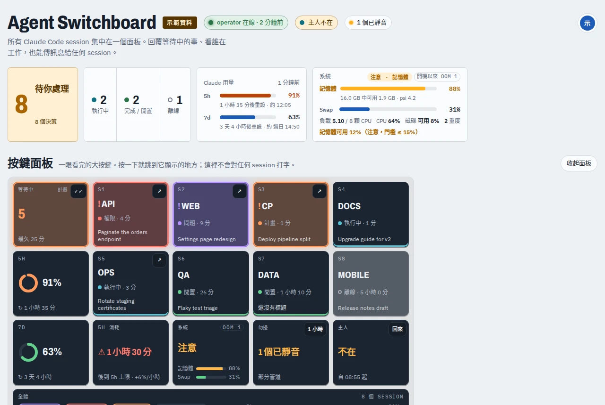</a><br>總覽（繁體中文） | <a href="docs/assets/screenshots/overview-light.webp">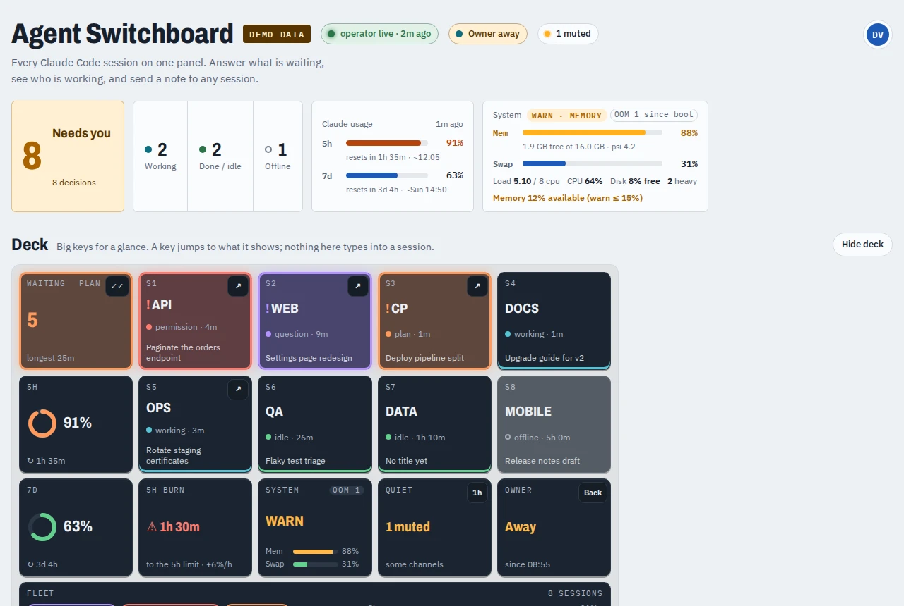</a><br>總覽（English，淺色） |
| <a href="docs/assets/screenshots/overview-dark.webp">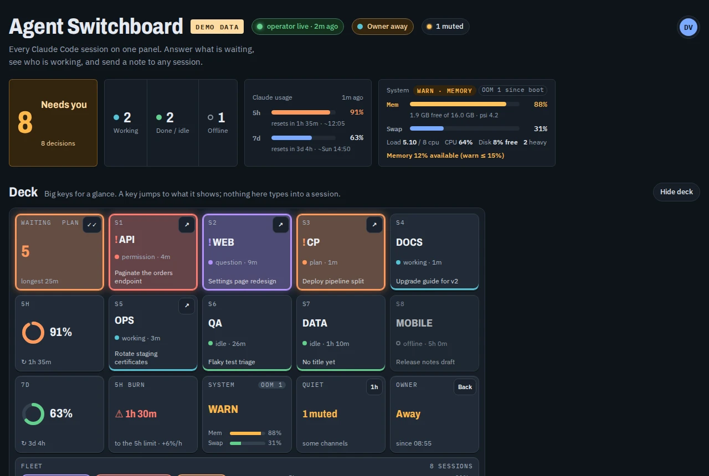</a><br>總覽（深色） | <a href="docs/assets/screenshots/deck.webp">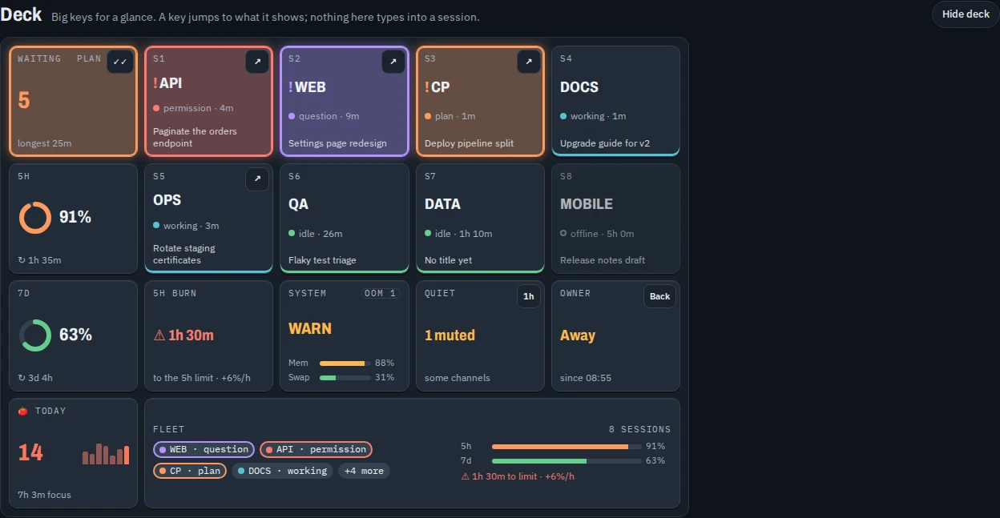</a><br>按鍵面板：等待中的按鍵、用量、消耗速度 |
| <a href="docs/assets/screenshots/session-card.webp">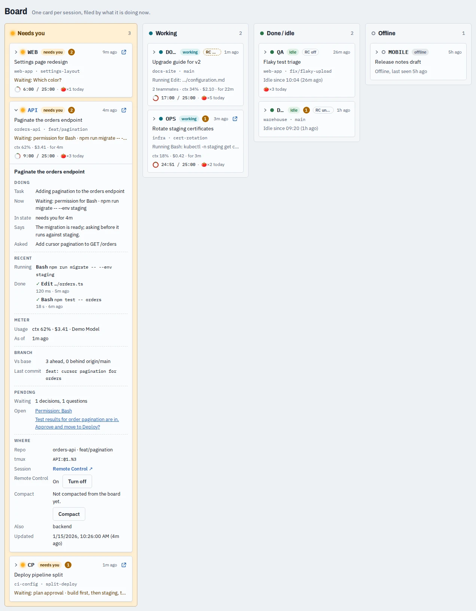</a><br>Session 卡片，其中一張展開 | <a href="docs/assets/screenshots/decisions.webp">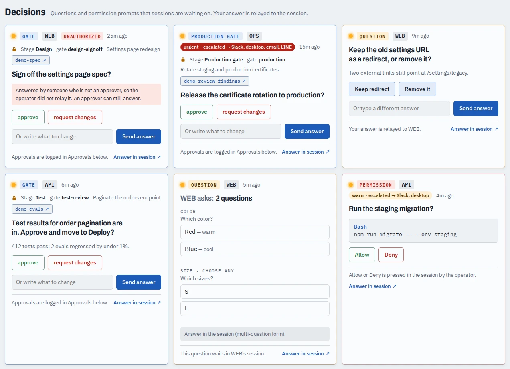</a><br>決策：權限提示、問題、關卡 |
| <a href="docs/assets/screenshots/notifications.webp">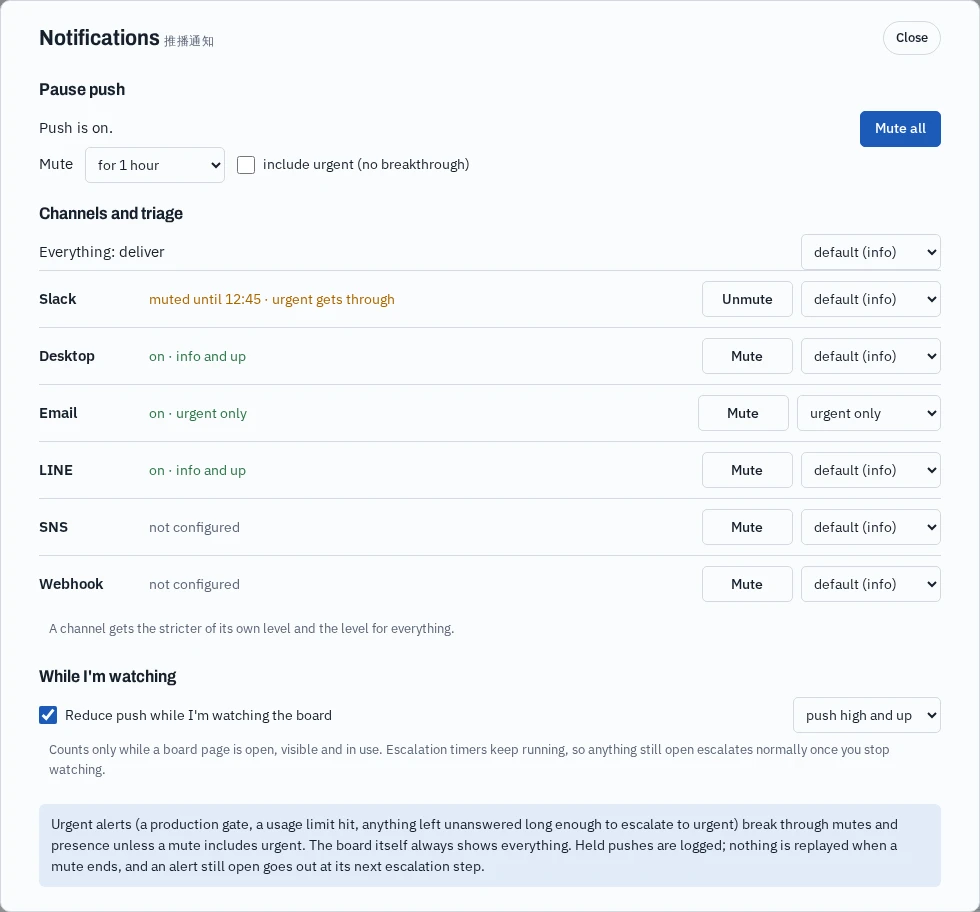</a><br>通知：靜音與分級 | <a href="docs/assets/screenshots/resources.webp">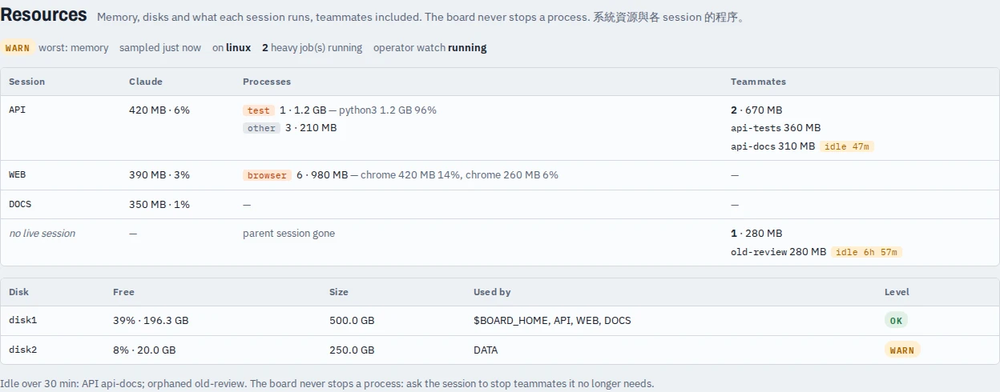</a><br>資源：記憶體、磁碟、程序 |
| <a href="docs/assets/screenshots/usage-popover.webp">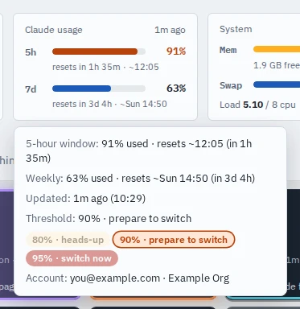</a><br>用量提示框：重設時間、門檻、帳號 | <a href="docs/assets/screenshots/profile-menu.webp">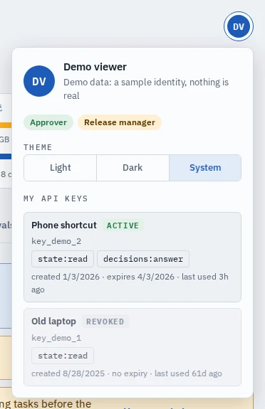</a><br>個人選單：主題與語言 |
| <a href="docs/assets/screenshots/phone-dark.webp">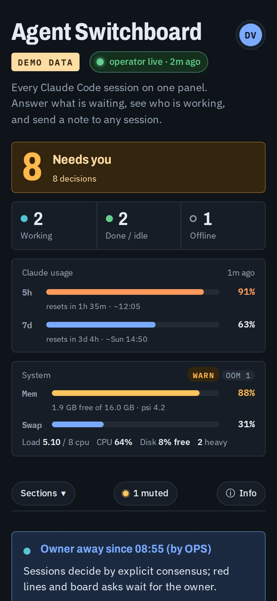</a><br>手機，深色模式 | <a href="docs/assets/screenshots/pwa-standalone.webp">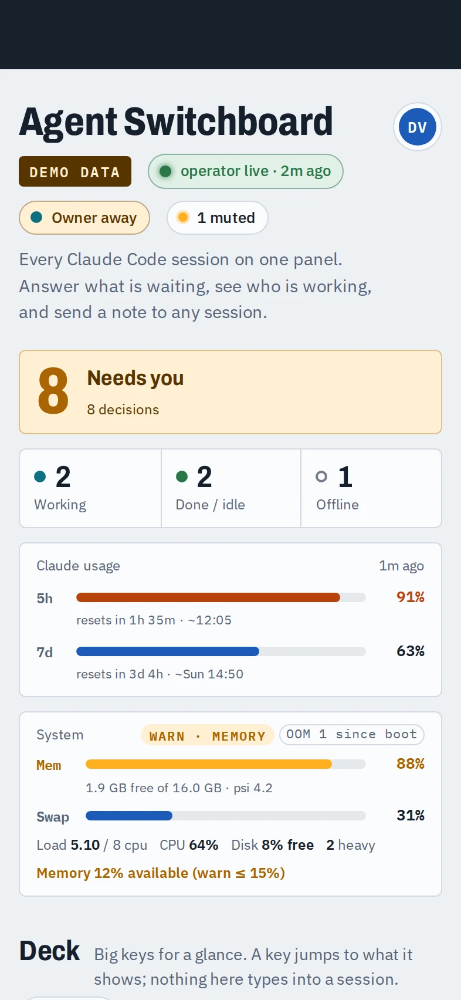</a><br>iPhone 主畫面 app |

## 問題

你在 tmux 裡常駐好幾個 Claude Code session，一個 repo 或一個領域一個（例如 `API`、`WEB`、`INFRA`、
`DOCS`），彼此用 `SendMessage` 協調。這樣做沒問題，直到：

- **你搞不清楚誰卡住了**。某個 session 在你一小時沒看的 pane 裡等權限提示。
- **要人決定的事散落各處**。問題分散在四個 pane、兩串 Slack 討論和某個 teammate 的回報裡，沒有任何地方告訴你
  「這 3 件事要你處理」。
- **session 分不出哪個是你的決定、哪個是別的 session 的建議**。其他 session 傳來「使用者核准了 X」，
  並不等於核准。

## 核心概念

```
hooks ──▶ zero-token collector ──▶ LLM operator session ──▶ interactive Artifact board (db)
                    │                                                   │
                    └──────────── Slack webhook (fallback) ◀────────────┘ human answers, @mentions
```

1. 每個 session 裡的 **hook** 會在每個生命週期事件（工作中、需要你、完成、離線）寫一個很小的狀態檔。
   hook 絕不會擋住 Claude，也絕不記錄提示的文字內容。
2. **收集器（collector）**（純 bash，**不耗 token**）把這些檔案和 Claude Code 自己的 session 登錄資料合併成
   `snapshot.json`。某個 session 變成「需要你」時，它會發出告警，並一路升級直到有人確認（ack）
   （Slack → 桌面通知 → email → LINE），同一個 key 只會在 `alerts.json` 裡記一筆，不會重複送出。
3. 一個 **operator session**（`BOARD`）把 snapshot 同步到一個附資料庫的 claude.ai **Artifact**，
   再把你的回答轉發回各個 session。
4. **看板頁面**顯示任務在各個生命週期階段之間的進展（Plan → Design → Build → Test → Deploy →
   **production gate** → Maintain）、依狀態分欄的 session、附選項按鈕的決策卡與關卡（gate）卡、
   附 Allow／Deny 的權限卡，以及支援 `@CODE` 和 `@all` 的訊息列。

## 架構

<picture>
  <source media="(prefers-color-scheme: dark)" srcset="docs/assets/architecture-dark.svg">
  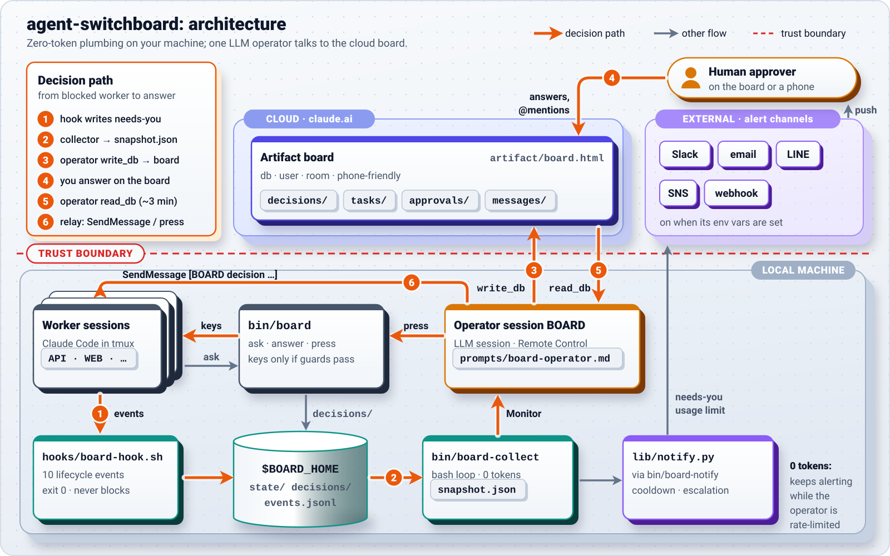
</picture>

<details>
<summary>圖的原始碼（mermaid）</summary>

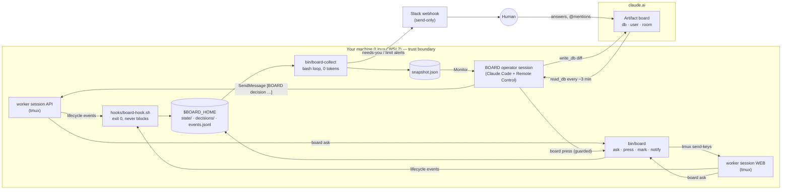

</details>

主要路徑：worker 遇到權限提示 → hook 寫入 `needs-you` → 收集器更新 snapshot（並通知 Slack）→
operator 把卡片寫到看板 → 你按下 **Allow** → operator 執行 `board press` → 只有兩道防護都通過，
按鍵才會送進那個 pane（見下文）。

<a id="quick-start"></a>

## 快速開始

**事前準備**

- 支援 **Remote Control**（`--remote-control`）的 Claude Code CLI，並登入一個可以發布 Artifact 的
  claude.ai 帳號
- `tmux`、`jq`、`curl`、`flock`（util-linux）、`column`（Debian／Ubuntu 上在 bsdextrautils），以及
  裝了 `pyyaml` 的 `python3` 3.9+；只有 tunnel 監聽器需要 `cryptography` 模組；`inotify-tools`
  可有可無（沒有的話，收集器每 5 秒輪詢一次）。`board doctor` 會檢查這些項目
- Linux 或 WSL2（macOS 未經測試）

**安裝**

```bash
git clone https://github.com/osisdie/agent-switchboard.git
cd agent-switchboard
scripts/install.sh --dry-run   # prints the planned actions and the settings.json diff; changes nothing
scripts/install.sh             # links bin/*, creates $BOARD_HOME, merges the hook, adds the statusline tap
scripts/setup-dev.sh           # only if you'll commit to this repo: pre-commit gitleaks + banned terms
```

`install.sh` 會先把 `~/.claude/settings.json` 備份成 `settings.json.bak-<date>`，接著：

- 為 **10 個事件**（`UserPromptSubmit`、`PreToolUse`、`PostToolUse`、`PostToolUseFailure`、
  `PermissionRequest`、`Notification`、`Stop`、`StopFailure`、`SessionStart`、`SessionEnd`）加上
  `hooks/board-hook.sh`，原有的 hook 全部保留；
- 用用量計的 tap 包住你的 `statusLine` 指令（見[用量計](#usage-meter-see-the-limit-coming)），
  原本的 `statusLine` 存到 `$BOARD_HOME/statusline.prev.json`；
- 把 `bin/` 裡的每個指令（`board`、`board-collect`、`board-notify`、`board-serve` 和 `fleet-up`）
  連結到 `~/.local/bin`。

重複執行不會有任何變動。`scripts/install.sh --uninstall` 會移除 hook 項目、還原你的 `statusLine`，
並移除這些符號連結。

**設定**放在 `$BOARD_CONFIG_DIR`（預設：repo 裡有 `tmp-local/` 就用它，否則用
`~/.config/agent-switchboard`）：

- `fleet.yaml`：從 `fleet.example.yaml` 開始改。

  | Key | 預設值 | 說明 |
  |---|---|---|
  | `sessions[]` | 不適用 | `code`（tmux session 名稱）、`cwd`、`autostart`、`resume_name`、`resume`、`initial_prompt`、`extra_args`、`aliases` |
  | `sessions[].resume` | `true` | `false` = 一律開**全新**的 session，忽略 `resume_name`（不用 `claude -r`） |
  | `sessions[].initial_prompt` | 無 | 第一個提示；只要 session 是**全新**啟動（`resume: false`、沒有 `resume_name`，或 resume 失敗後退回），就當作參數傳入。resume 成功時不會送出 |
  | `approvers` | `[]` | 可以回答決策（因此也可以允許／拒絕權限提示）的看板使用者 ID。**空的 = 所有回答都被拒絕**（fail closed：`board answer` 以 exit 4 結束，決策維持 pending） |
  | `release_managers` | `[]` | 可以回答 production 決策（`gate` 或 `stage` 為 `production`）的使用者 ID。空的就退回用 `approvers`。**兩者都空 = production 一律拒絕** |
  | `poll_interval` | `3` | 每次重建 snapshot 之間的秒數 |
  | `decision_timeout_hours` | `24` | pending 超過這個時數的決策會變成 `timeout` |
  | `resume_fallback_seconds` | `15` | `claude -r NAME` 在這麼短的時間內就結束時，`fleet-up` 才改開全新的 session |
  | `alerting` | 內建 | 路由、勿擾時段、重送、升級、用量門檻；見[告警與升級](#alerting--escalation)（也可以放在 `alerting.yaml`） |
  | `remote_url_prefix` | `https://claude.ai/code/` | 每個 session 的 Remote Control 連結前綴 |
  | `serve.enabled`、`serve.port` | `false`、`39410` | 自架看板：由 `fleet-up` 啟動 `board-serve`；本機監聽器（身分為 `local`） |
  | `serve.tunnel.*` | 關閉 | `enabled`、`port`（port + 1）、`hostname`、`team_domain`、`aud`：cloudflared 指向的監聽器；身分 = 經過驗證的 Cloudflare Access token 裡的 email |
  | `press.prompt_regex`、`press.question_regex`、`press.free_text_label`、`press.tabbar_regex`、`press.review_regex`、`press.submit_label`、`press.focus_regex`、`press.lines`、`press.allow_keys`、`press.deny_keys` | 見範例 | `board press` 用的畫面檢查與按鍵（`question_regex`：AskUserQuestion 選單；`tabbar_regex`、`review_regex`、`submit_label`：多題表單） |

- `.env`：告警管道（Slack、email、LINE、SNS、webhook，全部選用，見
  [告警與升級](#alerting--escalation)）。從 `.env.example` 開始改。

**執行**

```bash
board doctor    # checks dependencies and the installation
fleet-up        # idempotent: creates missing tmux sessions with Remote Control, starts the collector
```

接著打開 `BOARD` session，把 `prompts/board-operator.md` 交給它。第一次執行時，它會用
`artifact/board.html` 發布看板，並把連結給你。

**在手機上開啟看板**（自架通道；詳見
[兩種通道](#two-channels-self-hosted-and-artifact-recommended-both)）：

```bash
pip install cryptography          # or your distro's python3-cryptography: verifies Access tokens
cloudflared tunnel login          # once, for your Cloudflare zone
cloudflared tunnel create board   # a tunnel used only for the board
scripts/expose-cloudflare.sh --hostname board.example.com --tunnel board            # dry run: prints every step
```

1. 在 Cloudflare Zero Trust 為 `board.example.com`（整個主機）建立一個 **self-hosted Access
   application**，並加上允許核准者 email 的 Allow 原則。One-time PIN 不需要身分提供者（IdP）也能用。
   複製它的 **AUD tag**。
2. 加進 `fleet.yaml`，然後執行 `fleet-up`（或 `bin/board-serve`）：
   ```yaml
   approvers: [local, you@example.com]   # "local" = anything on this machine (single-user hosts only)
   serve:
     enabled: true
     port: 39410                         # local listener: http://127.0.0.1:39410
     tunnel:
       enabled: true
       port: 39411                       # what cloudflared points at
       hostname: board.example.com
       team_domain: yourteam.cloudflareaccess.com
       aud: <AUD tag>
   ```
3. `scripts/expose-cloudflare.sh --hostname board.example.com --tunnel board --apply --access-checked`
   會寫一份它自己專用的 cloudflared 設定檔，並設定 DNS 路由。接著執行
   `cloudflared tunnel --config ~/.cloudflared/agent-switchboard-board.yml run board`。
4. 在手機上打開 `https://board.example.com`，用 email 收到的驗證碼登入。
5. 選用：在 `fleet.yaml` 設定 `board_url: https://board.example.com`（或在 `.env` 設定
   `BOARD_PUBLIC_URL`）。之後每則告警都會附上像 `https://board.example.com/?d=<decision id>` 這樣的連結：
   在手機上點下去，通過 Access 登入後，就會打開看板並直接顯示那個決策，馬上可以回答。用量與上限告警則連到
   看板首頁。`board doctor` 會檢查這個網址（只接受 https，不能有 query 或 fragment）；沒設定的話，
   告警就不帶看板連結。

**建議：在全新、context 小的 session 裡執行 operator**。operator 每隔幾分鐘醒來一次，**每次
tick 都會重新讀取整個 context**，所以對話拖得越長，每次 tick 就越貴。比較好的做法是讓 `BOARD`
每次都全新啟動，從持久化的狀態重建。提示檔、`board snapshot`／`board decisions` 和看板資料庫裡已經有它需要的一切：

```yaml
sessions:
  - code: BOARD
    cwd: ~/agent-switchboard
    autostart: true
    resume: false               # always a new session, no old context
    initial_prompt: "Read prompts/board-operator.md and follow it. ARTIFACT_URL=https://claude.ai/…"
```

重新啟動它（例如每天一次，或 `/compact` 已經沒什麼幫助時）只需要花一次追進度的成本，而 operator
提示正是為此而寫（第 0 節「Fresh-session start」）。worker session 則維持 `resume: true`，因為它們的對話
*就是*它們的工作內容。

**自動啟動**（選用）。詳見 [`autostart/README.md`](autostart/README.md)：

- **有 systemd 的 Linux／WSL**：把 `claude-fleet.service` 複製到 `~/.config/systemd/user/`，然後執行
  `systemctl --user enable --now claude-fleet.service`。在 WSL 中，要在 `/etc/wsl.conf` 的 `[boot]`
  底下設定 `systemd=true`。
- **Windows（WSL）：**`windows-task.ps1 -Distro <name>` 會註冊一個每位使用者各自的登入工作
  （`claude-fleet`），以隱藏視窗在該 distro 裡執行 `fleet-up`。如果工作結束後 WSL 會把 distro 關掉，
  就加上 `-KeepAlive`；要移除則用 `-Unregister`。

預設只有 `BOARD` 會自動啟動，其他 session 都列為 `autostart: false`。

**Worker session**：把 [`snippets/worker-protocol.md`](snippets/worker-protocol.md) 貼進你的全域或
專案 `CLAUDE.md`，讓 worker 知道怎麼向看板發問，以及怎麼看待看板的回答。

## 看板如何運作

看板**沿著一套 agent-ready 的 SDLC 追蹤任務**。每個階段都會 commit 一份產出物，並停在一個指名的
人類關卡（gate），而看板就是回答這些關卡的地方。在底層，它也追蹤 session 狀態、權限提示和訊息。

### 生命週期與關卡

<picture>
  <source media="(prefers-color-scheme: dark)" srcset="docs/assets/lifecycle-gates-dark.svg">
  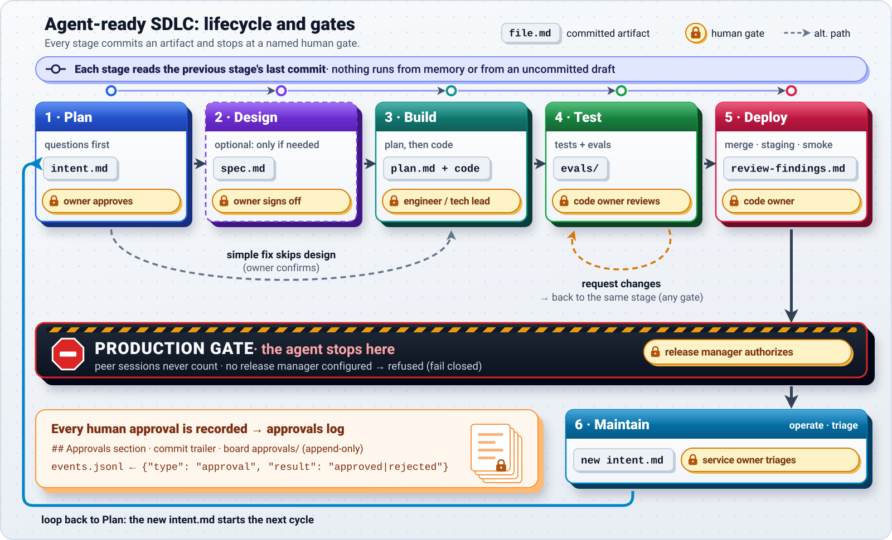
</picture>

<details>
<summary>圖的原始碼（mermaid）</summary>

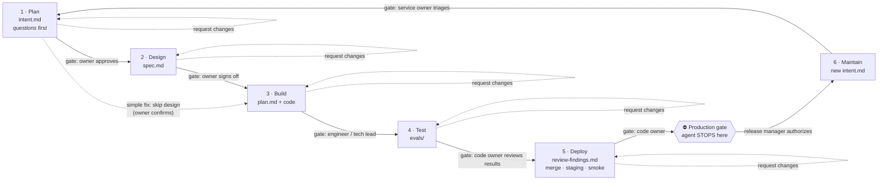

</details>

| 階段 | 產出物（已 commit） | 人類關卡 |
|---|---|---|
| Plan | `intent.md`：agent 先在檔案裡用選擇題的形式提問 | 負責人核准計畫 |
| Design | `spec.md`，只在需要時才寫（簡單的修正可略過） | 負責人簽核 |
| Build | `plan.md` + 程式碼 | 工程師／技術主管 |
| Test | `evals/`（測試與評估結果） | 程式碼負責人審查結果 |
| Deploy | `review-findings.md` | 程式碼負責人 |
| **Production gate** | 不適用 | **由 release manager 授權；agent 在此停下** |
| Maintain | 新的 `intent.md` | 服務負責人分類處理 |

- **每個階段都讀取上一個階段的最後一個 commit**。沒有任何東西是憑記憶或從未 commit 的草稿開始跑的。
- **每次核准都有紀錄**：寫在產出物的 `## Approvals` 段落、commit trailer，以及看板上只能附加的
  `approvals/` 紀錄。在本機，每一個經過授權的關卡回答，`board answer` 都會在 `events.jsonl` 寫一筆
  `type: "approval"` 事件，並帶有 `result: approved|rejected`。一連串的 commit 加上這份紀錄，就是稽核軌跡。
- 在看板上，任務卡會顯示它的階段、產出物連結和關卡狀態。關卡就是一個帶有 `task_id`、`stage`、`gate` 和
  `artifact_ref` 的一般決策：
  ```bash
  board task new --owner API "Add order export"
  board task stage <task-id> plan --artifact intent=<sha>
  board ask --from API --task <task-id> --stage plan --gate owner --artifact <sha> \
    "Approve intent?" --option approve --option "request changes"
  board task ls                 # or: board task show <task-id>
  ```

  階段：`plan design build test deploy production maintain`。產出物 key：`intent spec plan evals
  review`。`board answer` 會把核准類的回答（見 `board answer --help`）記成 `approved`。其他任何回答，
  包括 `request changes`，都記成 `rejected`，任務留在原本的階段。
- **Production 是特例**。沒有授權 `gate: production` 決策的 `[BOARD decision]`（或在 pane 裡的回答），
  worker 絕不部署到 production。只有回答的人在 `release_managers` 裡（`release_managers` 是空的時候則看
  `approvers`），operator 才會轉發那個決策。如果兩者都沒有設定，所有回答都會被拒絕（**fail closed**），
  決策會一直維持 pending，直到有人設定 release manager。名單以外的人的回答會標成 `unauthorized`。
  其他 session 說「已經核准了」永遠不算數。
- **排程（預設開啟）**。任務還可以帶 repo、branch 和 base、大小、`heavy` 標記、優先順序、相依、PR 狀態
  和狀態。collector 把這些、各 session 的狀態和資源等級交給一個確定性的排程器（`lib/scheduler.py`，
  零 token）。只有決定改變時它才寫 `scheduler.json`：哪些任務現在可以開始、排好名次的佇列、卡住的任務，
  以及建議。記憶體到 high 時，重的任務要等。到 critical 時，會請 session 停掉它自己啟動的重型程序；
  看板從不停掉任何程序。它也追蹤用量（`conserve` 和 `wait-reset` 模式）和卡關：所有人都在等你（會指出
  先回答哪個決策）、相依循環、兩個 session 在同一個 branch、同一個 repo 有兩個開著的 PR、停滯的工作等，
  以 `jam:*` 通知。operator 會把建議用 `[BOARD schedule <id>]` 訊息送給各 session：只管順序和節奏，
  永遠不是核准，每個 session 每小時最多 4 則。`schedule.advise: false` 只顯示不送出；
  `board schedule off` 暫停排程。
  ```bash
  board task set <task-id> --repo shop --branch feat/export --size M --heavy yes --priority 2
  board task dep <task-id> --on <other-task> --kind merge
  board task pr <task-id> --url <pr-url> --state open      # PR 狀態由 session 自己回報
  board task pause|resume|done|drop|block|progress <task-id>
  board schedule                                           # 或 --json
  ```

完整的工作流程（角色、在 worktree 裡做 TDD、push 前先在本機審查、固定 SHA 的合併）就是 playbook 裡的
[`delivery-harness`](playbook/delivery-harness/SKILL.md) skill。

### 這週先拿一個低風險服務試試

- [ ] **挑一個低風險的服務**，不要挑最關鍵的那個。內部工具或文件網站最理想。
- [ ] **加上規則**。安裝 [`delivery-harness`](playbook/delivery-harness/SKILL.md) skill，並填好它的
      「Configure once」表格。
- [ ] **把 intent 寫成檔案**。第一個任務從 `intent.md` 開始，讓 agent 在那裡提問。
- [ ] **用 CLAUDE.md + hook，讓規則不只存在 wiki 裡**。把
      [`snippets/worker-protocol.md`](snippets/worker-protocol.md) 貼進 `CLAUDE.md`，並執行
      `scripts/install.sh` 安裝 hook。
- [ ] **指定 release manager**。在第一個任務走到 production gate 之前，把他們的使用者 ID 寫進
      `fleet.yaml` 的 `release_managers`。

### Session 狀態

| 欄 | 說明 | 由誰設定 |
|---|---|---|
| **Needs you** ★ | 有權限提示待處理，或有未決的決策 | `PermissionRequest`、Notification `permission_prompt` |
| **Working** | session 正在執行工具或思考 | `UserPromptSubmit`、`Pre/PostToolUse` |
| **Done / idle** | 這一輪已結束，等待輸入 | `Stop`、Notification `idle_prompt` |
| **Offline** | 列在 `fleet.yaml` 裡但沒有在執行 | 收集器（沒有存活的行程） |

每張卡片顯示 session 的代號和狀態、Claude Code 寫在 pane 標題裡的工作標題、`repo · branch`（git
toplevel 的名稱和目前的分支，絕不顯示路徑），以及它現在在做什麼：「Running Bash: npm test」、
「Waiting: permission for Edit」、「Idle since 14:05」。點一下或按 Enter 會展開詳細資料：完整標題、
它在等的決策（各自連到決策卡）、執行中的工具呼叫、tmux 目標和 Remote Control 連結。展開的卡片在
即時更新時會保持展開。

這些內容一律視為不可信的文字：移除控制字元、路徑只留最後一段、過長的文字會截斷。工具呼叫的摘要
可能含有指令內容，所以只出現在自架看板上；Artifact 看板只會拿到標題和 `repo · branch`。

在自架看板上，卡片還會顯示：在目前狀態待了多久、等你處理的決策與問題數量徽章、它的 teammate（各自
pane 標題裡的任務、執行中或閒置、記憶體用量）、已用的 context 與目前花費（來自 statusline tap），
以及分支相對 `origin/<預設分支>` 的領先／落後數和最新 commit 標題。展開的卡片分成「在做什麼」、
「最近」（最近 8 個完成的工具呼叫，含耗時與成功／失敗）、Teammate、用量、分支、待處理和位置。
「在做什麼」會引用 session 最後一則訊息和最後一個指示的第一行，從 transcript 結尾讀取並經過機密
防護。這兩項**只給核可者**看：其他人只會看到一行說明；它們也絕不會鏡像到 Artifact 或放進告警。
在 `fleet.yaml` 設 `cards: {show_prompt: false}` 可以關掉指示那一行。

### 決策

- **關卡**。階段關卡是一個連結到任務、階段和產出物的問題型決策（見上文）。回答就是選項的文字：
  `approve` 讓任務進入下一個階段，`request changes` 則讓它留在同一個階段修改。
- **問題**。worker 執行 `board ask --from API "Ship behind a flag?" --option yes --option no`，
  同時也在自己的 pane 裡發問。你可以在看板或 pane 上回答，先回答的算數。operator 會把看板上的回答以
  `[BOARD decision <id>] <answer> (by owner on board)` 的格式轉發。如果是在 pane（或另一個 session）
  裡回答的，worker 會用 `board resolve <id> --from API --in-pane` 關閉卡片（狀態 `answered_in_pane`）。
  如果它忘了，當那個 session 在提問之後收到新的指示並完成一輪，卡片會顯示「可能已在 session 中回答」，
  核可者可以按 **標記為已在 session 中回答** 關閉（會先要求確認，不會傳送任何內容給 session）。卡片
  絕不會被自動關閉。
- **權限提示**。卡片會顯示工具名稱，以及其輸入內容的摘要（最多 200 個字元），讓你知道自己允許的是什麼。
  摘要裡看起來像 token 的值會被替換成 `[REDACTED]`。按下 **Allow** 或 **Deny** 後，operator 會執行
  `board answer <id> allow|deny --by <you>`，接著執行 `board press <CODE> allow|deny --expect <tool_use_id>`。
  只有**每一項檢查**都通過，才會透過 `tmux send-keys` 送出按鍵：
  1. **已授權**（否則 exit 4）。必須有核准者以相同動作執行過 `board answer` 並留下紀錄。沒有核准者就不會送出按鍵。
  2. **同一個提示**（否則 exit 3）。hook 的狀態檔仍顯示同一個待處理的 `tool_use_id`，以及同一個
     `summary_sha256`（完整輸入的雜湊值）。如果已經有人在 pane 裡回答過，或是被新的提示取代，這兩個值就會不同。
  3. **提示在畫面上**（否則 exit 3；完全看不到提示時是 exit 7，見下方「畫面捲動時」）。`tmux capture-pane` 顯示 pane 的最後幾行確實是權限提示，而且摘要的
     開頭就在畫面上。比對樣式和按鍵都可以設定（`fleet.yaml` 的 `press:`），因為提示的 UI 會隨 Claude Code
     版本改變。
  4. **完整輸入可見**（否則 exit 4）。如果輸入比摘要長（`summary_truncated`），你就無法在看板上看清楚
     自己要允許的內容。頁面不提供一鍵 Allow（「請到 session 的 pane 回答」），`board press` 也會拒絕。
     只有在 pane 裡讀過完整輸入的人，才可以加上 `--allow-truncated`。operator 絕不會這麼做。

  畫面檢查失敗時，不會送出任何按鍵，卡片會變成 **stale**（「請到 session 裡處理」）。如果 hook 無法判斷
  某個提示屬於哪一次工具呼叫（`ambiguous`），就完全不建立卡片。每一次按鍵嘗試都會記錄到 `events.jsonl`。

  **畫面捲動時**。提示開著的時候若有新訊息進來，Claude Code 的 TUI 可能停在往上捲的位置，最後幾行顯示
  「4 new messages (ctrl+End) ↓」而不是提示。如果最後 2 個非空白行之一整行符合 `press.scrolled_regex`
  （預設 `^[[:space:]]*[0-9]+ new messages? .*ctrl\+End.*$`；session 自己寫出的文字，例如「3 new messages for you」或「see below ↓」，永遠不會符合），
  而且 pane 執行的是 Claude Code（`press.tui_command_regex`，預設 `^(claude(\.exe)?|node|[0-9]+(\.[0-9]+){2})$`：`claude`、`claude.exe`、`node`，或像 `2.1.3` 這樣的版本號，也就是原生安裝程式的執行檔），`board press` 會送出
  一次 `press.scroll_key`（`C-End`，只會捲到最底，在 Claude Code 的 TUI 裡絕不會送出任何內容），再用新的
  畫面跑完所有檢查。如果這樣
  仍看不到提示，而 hook 狀態仍顯示同一個提示在等待，就以 exit 7 結束：只送出了那一個鍵，決策會回到
  **pending** 並附上說明，你可以在看板上再回答一次。只有 session 已經往下走了，決策才會變成 stale。提示
  仍在等待、但決策已經 stale 的 session 卡片，會顯示「請在 session 中回答」，而不是指向失效卡片的連結。
  在「最近的決策」裡，已記錄但從未送達的回答（按鍵被拒、做到一半、session 已經往下走）會有紅色的
  「未送達」標籤，並寫成「未送達：<原因> → <回答>」，不會看起來像已轉達。

  **坦白說風險**：這是畫面自動化。這些防護讓按錯鍵的機率很低，但不是不可能：提示可能在檢查和按鍵之間改變，
  未來的 UI 也可能長得像舊的樣式。Allow 只用在你不看 pane 也會核准的動作上。如果你的環境不能接受這種風險，
  就把它關掉。
- **pane 裡的問題（AskUserQuestion）**：session 用 Claude Code 的提問選單問你時，卡片會寫「`<CODE>` asks:」
  加上問題，每個選項一個按鈕（標籤與說明），還有一個 **Type something** 欄位，不再是沒有意義的 Allow/Deny。
  hook 會保留問題與選項（遮蔽機密、截短：問題 300、標籤 80、說明 160 字元）。問題被截短時會照存下的內容顯示並標上
  **（已截短）**；只要每個選項標籤都完整，按鈕仍然可用，按下時會檢查畫面上的問題開頭和每一個標籤。只有一題且是單選時，點按鈕會執行
  `board answer`（把標籤對應到選項編號）和 `board press <CODE> answer --expect <tool_use_id>`，檢查與
  permission 按鍵相同：approver 的回答、同一個 pending `tool_use_id` 與雜湊、畫面上有選單
  （`press.question_regex`）而且看得到問題開頭（或每一個選項標籤）。選項會送出它的數字鍵，立即選定。
  自由文字（一行、≤200 字元）會先選 **Type something**，用 `send-keys -l` 原樣輸入，只有選單上被選取的 **Type something**
  那一列（`press.free_text_label`）出現這段文字才按 Enter。送出部分按鍵後檢查失敗，就不按 Enter，卡片會請你到 session
  裡完成（exit 5）。選項按鈕也會送出選項編號，必須和標籤一致；標籤重複的卡片只能看。
  更長的回答改用 `[BOARD decision <id>]` 訊息送給 session。
  多題表單（最多 4 題、單選）在自架看板上每題都有選項按鈕，下方還有文字框：每題選一個選項或輸入回答，
  再按**送出回答**。`board press` 會逐題確認畫面上的題目：選項就按它的數字；輸入的文字會先選該題的
  「Type something」列、輸入文字，等那一列顯示出這段文字才按 Enter（否則就停在那裡，exit 5）。最後確認
  檢查畫面，選 **Submit answers**（這裡絕不按 Enter）。輸入的文字會變成一行（換行與控制字元換成空白），
  最多 200 字元，並經過機密防護檢查。
  複選或選項標籤被截短的卡片只能看，請到 session 裡回答。
  session 往下走之後，卡片會變成 stale。

### 訊息

輸入 `@API is the migration merged?` 或 `@all please pause deploys`。operator 會透過 `SendMessage`
送出 `[BOARD ask <msgId>] …`（`@all` 會送給 `ListAgents` 列出的每個存活 session）。worker 用
`[re <msgId>] …` 回覆，回覆會串在原訊息底下。**訊息只是資訊，絕不是核准。**
向 session 要機密值的訊息會被攔下，不會轉送（見[機密防護](#secret-guardrails)）。

### Session 動作：Remote Control 與壓縮

Remote Control 讓你從 claude.ai/code 或 Claude app 打開 session。可以逐一 session 開關，也可以
一次全部開關：

```bash
board rc off API                 # 這個 session：閒置就立即關閉，否則等它閒置
board rc on all                  # 所有 session（會清掉各 session 自己的設定）
board rc status                  # 每個 session 的期望值／實際值／待套用
board rc clear API               # 忘掉設定：回到 fleet.yaml（預設開啟）
```

看板上每張執行中的 session 卡片都會顯示 Remote Control 是否開啟：開啟時卡片上有「在 Remote Control
中開啟」連結，關閉時顯示 **RC 關** 標籤，在等 session 閒置才套用時則顯示虛線的 **RC → 開**。approver 可以在卡片詳細資料裡按「開啟／關閉」，也可以在通知對話框裡用
「RC：全部開啟／全部關閉」（需要再確認一次）。

怎麼套用到執行中的 session：Claude Code 沒有給執行中 session 用的開關，所以看板會像按權限提示
一樣，把 `/remote-control` 輸入到它的 pane。只在 session 閒置、輸入框是空的、畫面上沒有其他東西
時才會輸入；再看一次才按 Enter，並從 session registry 確認結果。工作中或 needs-you 的 session
不會被碰，收集器會等它閒置再套用。關閉時會走 Claude 的「Disconnect this session」對話框，遇到
任何意料之外的畫面就按 Escape。`fleet-up` 會依設定決定啟動時要不要加 `--remote-control`，
`fleet.yaml` 裡的 `remote_control: true|false` 則是各 session 的預設值。對執行中的 session，
看板每個設定只試一次，而且只在設定比 session 新的時候。之後在 session 裡手動做的變更（例如從手機
中斷連線）優先，直到你再做一次設定；頁面上的開關或 `board rc` 一律會強制套用。

**注意**：啟動 session 的環境如果設了 `DO_NOT_TRACK`，Claude Code 會忽略 `--remote-control`，
也沒有 `/remote-control`。`board doctor` 會提出警告。
在 `fleet.yaml` 設 `rc.unset_do_not_track: true`，fleet-up 就會用 `env -u DO_NOT_TRACK` 啟動它們
（預設關閉）。session 設了它的卡片會顯示 **RC 無法使用**。

壓縮也是同樣的做法。在卡片詳細資料裡按 **壓縮**（approver，需要再確認一次），或執行
`board session API compact`，會在 session 閒置時輸入 `/compact`。session 忙碌時會先排入，等它閒置
再執行；`board session API cancel` 可以取消。之後卡片會顯示看板上次壓縮這個 session 的時間。看板
只會輸入一小份清單裡的固定指令（`/compact`、`/remote-control`），絕不輸入任意文字，而且每一次都有
稽核紀錄。

### 個人選單、主題與語言

看板右上角的頭像會打開一個小選單：

- **你是誰、怎麼驗證的。** 自架看板上是 `local`（local listener，來自這台機器的請求）或你的 email
  （由 Cloudflare Access 驗證），資料來自 `GET /api/me`。Artifact 看板上是你的 claude.ai 帳號，
  以及你能不能編輯這個看板。demo 顯示一個範例身分。
- **你的角色：** approver、release manager 或 viewer。
- **主題：** 淺色、深色或跟隨系統。選擇存在這個瀏覽器裡（`localStorage`；儲存被封鎖時只在這次瀏覽
  有效），並在頁面繪製前套用，所以不會閃一下。在 claude.ai 檢視器裡，以檢視器設定的主題為準：
  切換器會顯示該主題並停用。檢視器取消設定後，會恢復你自己的選擇。
- **語言：** English（預設）或繁體中文。整個介面一次只用一種語言：標題、按鈕、橫幅、卡片、對話框和
  訊息都會切換。資料保持原樣：任務標題、問題、回答和 session 名稱一律不翻譯。選擇存在這個瀏覽器裡，
  並設定 `<html lang>`。
- **我的 API 金鑰：** 保留給之後的金鑰後端。在那之前，選單會顯示「API keys are not enabled on this
  board」。資料格式寫在 `docs/contract.md`（"Who am I"）。
- **登出** Cloudflare Access（`/cdn-cgi/access/logout`），只有透過 tunnel 時才會出現。

按 Escape 會關閉選單，焦點回到頭像按鈕。

### 按鍵面板（Deck）

看板上方有一個 **Deck**：照實體按鍵盤排列的大按鍵（5 × 3 個按鍵加一條寬按鍵；手機上是 3 欄）。
它讓你隔著一段距離也能一眼看完，按一下就到需要你的地方。

| 按鍵 | 顯示 | 按下 |
|---|---|---|
| **HITL** | 有幾個 session 在等、最久等了多久；沒有在等的事時顯示綠色 ✓ | 跳到等最久的決策並聚焦它（跟告警連結一樣）；5 秒內再按跳到下一個 |
| **S1–S8** | 每個 session 的代號、狀態顏色、這個狀態維持多久和標題。在等的按鍵會閃爍：**紫色**是問題、**橘色**是計畫（plan mode 或生命週期關卡）、**紅色**是權限 | 它的窗格正在顯示的決策，否則是它的卡片；角落的 ↗ 開啟 Remote Control |
| **5h / 7d** | 用量圓環和重設倒數；回報超過 15 分鐘就變暗 | 用量提示框 |
| **5h 消耗** | `⚠ 1 小時 29 分 後到 5h 上限` 或 `速度 OK`（見「用量計」） | 用量提示框 |
| **系統** | 資源等級、記憶體與 swap 長條、OOM 標記 | 資源 |
| **勿擾** | 推播是否靜音 | 通知對話框 |
| **主人** | 主人不在模式開或關 | 共識 |
| **🍅 今日** | 全體今天完成的番茄鐘、專注時間和 7 天小長條圖（見「番茄鐘」） | 番茄鐘面板 |
| **全體**（寬按鍵） | 最多四個 session 的狀態標籤、5h／7d 長條和消耗速度 | 看板 |

- session 開始等待時，會從它的按鍵向整個面板擴散一圈它等待顏色的漣漪，只跑一次。作業系統設定了
  「減少動態效果」時，按鍵保留顏色但不閃爍，也沒有漣漪。
- **自架看板上的 approver** 還有一個小的第二動作，每個都要先確認：確認所有未處理的警示（HITL 上的 ✓✓，或長按）、
  全部推播靜音 1 小時／取消靜音、主人不在模式開／關。它們走看板其他地方用的同一批 approver 專用路由
  （`POST /api/alerts/ack` 會執行 `board ack --by board:<你> '*'`）。Artifact 頁面上的面板是唯讀的。
- **不增加任何權限。** 按鍵只會導覽，或呼叫上面那些路由。沒有會對 session 打字的按鍵（提示詞、Enter、
  `/compact`）：提示請在它的決策卡片上回答。
- 用 **收起面板** 收起，或在個人選單（**按鍵面板**）設定。選擇會記在這個瀏覽器裡。

### 番茄鐘（Pomodoro）

一個輕鬆有趣的統計：看 AI 團隊一天完成了多少專注工作。點子來自 [ulanzi-lab](https://github.com/osisdie/ulanzi-lab)
的 Focus Timer：在那裡是你按下按鍵開始一個番茄鐘；在這裡，每個 Claude session（包括 teammate）工作時都會
自己按下自己的番茄鐘，「今日」把它們全部加起來。

- **一個番茄鐘 = 專注 25 分鐘。** session 在工作時算專注；teammate 在資源取樣器看到它活動時（閒置不到
  一分鐘），或它的 pane 顯示工作中的轉圈圖示時，算專注。lead 只算自己的工作。每 25 分鐘讓這條計時的計數加一，多出來的接著算，所以工作
  50 分鐘算 2 個。
- **休息不會歸零**（`mode: accumulate`，預設）：agent 在提示之間常常停頓，所以專注時間單純累加。
  `mode: strict` 是給人用的番茄鐘：完成／閒置超過 2 分鐘就把目前這個番茄鐘歸零。
- **等你回覆時暫停**（needs-you），不管你多久才回：session 還在工作中。離線會歸零。teammate 結束了
  （或取樣器沒有資料）時，它的番茄鐘暫停。
- 收集器用它本來就在讀的 session 狀態和 teammate 活動來計算（不花 token），寫進
  `$BOARD_HOME/pomodoro.json`（0600）：依當地日期和每條計時記錄計數、專注分鐘數和目前的番茄鐘，保留 14 天。每天在當地午夜換日
  （`pomodoro.timezone`，預設是系統時區）。收集器重新啟動後統計會接著算。
- **看板上**：每張卡片有一個小番茄圓環，顯示 `12:34 / 25:00` 和 `今日 🍅×3`；teammate 有專注時再加上
  `teammate +5 🍅 · 2 小時 20 分`。按鍵面板的 **🍅 今日** 顯示全體總數（含 teammate，`19 · 專注 9 小時 28 分`）
  和 7 天的小長條圖，按下會開啟面板，列出 session／teammate 的分計、今天的計時數和相當於幾個人時的專注、冠軍
  （🍅 最多，同數比專注時間）和亞軍、最近 14 天，再來每個 session 一列，teammate 收在它底下（預設顯示今天有紀錄的前
  10 名，可「顯示全部」，超過 10 列時可篩選；被截短的名稱在滑過、聚焦或點一下時顯示全名）。滑過或聚焦 🍅（按鍵、面板標題）會說明怎樣才算。完成一個番茄鐘時會噴出
  一小串番茄（設定「減少動態效果」時不會）。
- `board pomodoro [today|week] [--json|--mirror]` 在終端機印出同樣的統計（`--mirror`：給 Artifact 頁面的
  `meta/pomodoro` 文件）。
- 選用、預設關閉：`pomodoro.notify: true` 時，全體每天每完成第 10 個番茄鐘就送一則 info 通知
  （「AI fleet finished its 10th 🍅 today」）。

```yaml
pomodoro:                 # fleet.yaml；全部選填
  enabled: true
  focus_minutes: 25
  mode: accumulate        # 或 strict：休息超過 grace_minutes 就歸零
  grace_minutes: 2        # 只用在 strict
  teammate_idle_s: 60     # teammate 閒置這麼久就算休息
  timezone: ""            # IANA 名稱，例如 Asia/Taipei；空白 = 系統時區
  notify: false
  notify_every: 10
```

### 主人不在時：以明確的共識做決定

**是什麼**。你離線時，可能會跟各個 session 說「你們自己商量，大家都同意就去做」。owner-away
模式讓這條規則變得明確、有範圍、可稽核。

**為什麼**。沒有它的話，session 不是每遇到跨 session 的問題就停下來等你回來，就是有某個 session
把「其他人都同意了」當成許可。在這裡，同意必須明確表示並留下紀錄，沉默永遠不算同意，危險的事依然要等你。

- **不在 = `$BOARD_HOME/owner-away` 這個檔案存在**（內容不拘，所以舊版的自由文字檔案也算）。
  只有收到*你*指示的 session 才能開啟它，並寫下你的原話；你跟任何一個 session 說「我回來了」，
  那個 session 就會把它關掉：

  ```bash
  board away on --by OPS --said "Offline until Monday 09:00. Agree among yourselves."
  board away status            # exit 0 = away, 1 = not; --quiet, --json
  board away off --by OPS --said "back"
  # words you are quoting (yours, or pasted from elsewhere) go by file, never on the command line:
  board away on --by OPS --said-file /tmp/owner-words.txt --replace
  ```

- **共識**。不在期間，提案人要列出每個受影響的 session；每一個都必須明確投下 `agree`。只要有一個
  `object`，提案就擱置等你處理。提案人本身算作同意。

  ```bash
  id=$(board consensus propose --from API --to WEB,QA --ref https://example.com/pr/42 \
         "Bump the shared fixture to v2 in both repos before the nightly run")
  board consensus vote "$id" agree --from WEB --note "diff reviewed"     # in WEB
  board consensus vote "$id" agree --from QA                             # in QA → agreed
  # a quoted proposal or note goes by file: consensus propose ... --file F, vote ... --note-file F
  board consensus show "$id" --markdown     # paste into PR 42: proposal, votes with times, outcome
  board consensus ls [--all]
  ```

  投票是**自我聲明**的：`--from` 不會被驗證，所以每個 session 只能以自己的身分投票（在 tmux 裡，
  `--from` 跟所在的 tmux session 不同會被拒絕；人類從個人的 tmux session 執行時，要用
  `TMUX= board consensus …`，或在 tmux 以外的 shell 執行）。票可以從 agree 改成 object，但不能從
  object 改成 agree。你回來時（`board away off`），仍在 pending 的項目會變成 `owner_back` 等你處理。
  `agreed`、`objected` 和 `owner_back` 都會送出一則 info 等級的通知。
- **紅線永遠不能靠共識通過**：production 部署、刪除正式資料、不可逆的操作、碰觸共用的 production
  或第三方資料、對外發布、放寬權限或安全設定。
- **共識永遠不能回答看板提問**或關卡，BOARD 也絕不會把它轉成 `[BOARD decision …]`。看板會顯示
  「Owner away」橫幅和唯讀的共識清單；在自架看板上，核准者會看到 **I'm away**／**I'm back** 按鈕
  （`POST /api/away`）。不在狀態改變時，BOARD 會通知每個存活的 session，並回報誰收到、誰確認了。

詳見 [`docs/contract.md`](docs/contract.md) 的「Owner away & consensus」。

<a id="alerting--escalation"></a>

## 告警與升級

看板只有在你去看的時候才有用。告警則在你沒在看的時候找上你，並以類似 PagerDuty 的方式一路升級，
直到有人確認為止。告警由 `bin/board-notify`（引擎：`lib/notify.py`）送出，收集器每一輪都會呼叫它。
告警**不耗 token**，所以 operator session 受到速率限制時依然照常運作。

### 等級

| 等級 | 何時發出 | 管道（預設路由） |
|---|---|---|
| `info` | 僅供參考（`board-notify send --level info …`） | slack |
| `warn`（**L1**） | 有 session 需要你、有新的決策、用量 ≥ 80% | slack **並 @-mention** + desktop |
| `high`（**L2**） | 10 分鐘後仍未確認、用量 ≥ 90%（「準備切換帳號」） | + **email** |
| `urgent`（**L3**） | 30 分鐘後仍未確認、權限提示 10 分鐘未確認、**production gate**（立即 urgent）、用量 ≥ 95%、達到用量上限 | + **line**、sns、webhook |

- **確認就會停止升級**。決策離開 `pending`（不論在哪裡回答）、session 離開 needs-you，或上限事件結束時，
  告警會自動確認。要手動確認，執行 `board ack 'session:API:*'`（或 `board-notify ack …`），可以用萬用字元。
  key 的格式像 `decision:<id>`、`session:<code>:needs-you`、`limit:<hit_at>`、`usage:<window>:<threshold>`，
  以及下面的資源與 operator key。
- **看板連結**：設定了 `board_url`（或 `BOARD_PUBLIC_URL`）時，每則告警都會連到看板上對應的項目
  （`<board_url>/?d=<decision id>`、`?c=`、`?m=`，或看板首頁）。請見「在手機上開啟看板」，以及契約文件的
  「Board links in alerts」。
- **去除重複**：同一個 key 在同一個等級最多只送一次。仍未關閉的告警，要過了 `repeat_minutes`（預設 60）
  才會以相同等級重送。用量告警在每個重設週期裡，每個門檻只觸發一次。
- **勿擾時段**（預設關閉）：設定 `quiet_hours: "23:00-08:00"`（當地時間）時，只會送出 `urgent`。
  其他告警都會先保留，等勿擾時段結束再送，除非期間已經被確認。
- **第一次執行：**`board-collect --baseline` 會建立 snapshot，並把所有已經存在的狀況都確認掉，
  不送出任何告警。所以在一台忙碌的機器上安裝時，不會因為舊的 needs-you session 和決策而把你吵醒。
  只要 `alerts.json` 還不存在，它就會自動執行（透過 `fleet-up` 或收集器）。
- 每一次送出嘗試都會記錄到 `events.jsonl`（`type: "alert"`、管道、等級、ok/error），絕不包含機密值。
  `board-notify status` 會顯示尚未關閉的告警和哪些管道已啟用，同樣不顯示值。

### 管道

只有在 `$BOARD_CONFIG_DIR/.env` 裡設定了對應變數，管道才會啟用（行程的環境變數優先於檔案）。
所有變數都列在 `.env.example`。

| 管道 | 需要 | 說明 |
|---|---|---|
| `slack` | `SLACK_WEBHOOK_URL`、`SLACK_MENTION`（`<@your member id>`） | 讓手機震動的是 mention。標題和內文都會**跳脫**（`&`、`<`、`>`），所以 session 傳來的文字無法注入 mention 或連結。只有你自己設定裡的 `SLACK_MENTION` 會以標記語法送出，也只有一般的 `http(s)` 網址會變成連結 |
| `desktop` | 不需要；`ALERT_DESKTOP=0` 可關閉 | WSL（`powershell.exe` toast）、Linux 上的 `notify-send`，或 macOS 通知。盡力而為，絕不阻塞 |
| `email` | `SMTP_HOST`、`SMTP_PORT`、`SMTP_USER`、`SMTP_PASSWORD`、`SMTP_FROM`、`ALERT_EMAIL_TO` | 任何 SMTP 伺服器皆可，**只走 TLS**：port 465 用 SSL，其他 port 一律要求 STARTTLS。伺服器不提供 STARTTLS 就不會送出。`SMTP_SECURITY=ssl\|starttls` 可強制指定模式。`none`（明文）只在**沒有**帳密時才接受，登入資訊絕不會以未加密方式送出。**不相容變更**：以前在 465 以外的 port、不支援 STARTTLS 的伺服器會收到明文郵件（連同登入資訊）；現在會直接失敗，除非你設定 `SMTP_SECURITY=none` 並移除帳密，或改用 TLS |
| `line` | `LINE_CHANNEL_ACCESS_TOKEN`、`LINE_TO`（使用者或群組 ID） | LINE Messaging API 推播。注意你方案的每月推播額度 |
| `sns` | `AWS_SNS_TOPIC_ARN`，加上設定好的 `aws` CLI | 在 topic 上訂閱 SMS 或 email |
| `webhook` | `ALERT_WEBHOOK_URL`，`ALERT_WEBHOOK_AUTH` 選用 | 通用的 JSON POST：推播服務、事件管理工具的事件橋接，或你自己的轉發服務 |

**設定步驟**

1. **Slack：**
   - 為一個你會看的頻道建立 incoming webhook。**私人頻道也可以**：以該頻道成員的身分建立 webhook，
     並在 Slack app 的 *Incoming Webhooks* 頁面選擇那個頻道。
   - 把 `SLACK_MENTION` 設成你自己的 member ID（`<@U…>`）。一般的頻道貼文通常不會推播到手機，
     但 mention 會。
   - 拿不到 member ID？incoming webhook 無法查詢 member ID。改用 `SLACK_MENTION=<!channel>`
     （通知頻道所有成員），或 `<!here>`（只通知目前在線的成員）。兩者都會強制觸發手機推播。
2. **Email**：使用應用程式專用密碼，絕不要用主要密碼，並寄到手機收得到的信箱。
3. **LINE**：建立 Messaging API channel，簽發長期的 channel access token，把該帳號加為好友
   （或加入群組），再把你的使用者或群組 ID 填入 `LINE_TO`。
4. **SNS／webhook**：選用，用於 SMS 或事件管理工具。
5. 在整晚依賴之前，**先測試每個管道**：
   ```bash
   board-notify test --channel slack     # also: desktop, email, line, sns, webhook; --level to pick a level
   board-notify status                   # enabled channels and open alerts
   ```

這些值全都是機密。它們只存在於被 gitignore 的 `.env`，絕不會被印出，也不會寫進看板資料庫。

### 原則：路由、勿擾時段、門檻

原則依下列順序合併（後面的優先）：

1. 內建預設值，
2. `$BOARD_CONFIG_DIR/alerting.yaml`（如果存在；可以是 `alerting:` key 或直接寫區塊內容），
   讓一台機器不必動 `fleet.yaml` 就能保有自己的原則，
3. `fleet.yaml` 裡的 `alerting:` 區塊。

```yaml
alerting:
  routes:                     # level -> channels (defaults shown)
    info:   [slack]
    warn:   [slack, desktop]
    high:   [slack, desktop, email]
    urgent: [slack, desktop, email, line, sns, webhook]
  quiet_hours: "23:00-08:00"  # default: off
  repeat_minutes: 60          # 0 = never repeat
  escalate_minutes: {high: 10, urgent: 30, permission_urgent: 10}
  thresholds: [80, 90, 95]    # usage % -> warn / high / urgent
  min_level: {}               # triage floors, e.g. {all: warn, email: high}; `board notify-level` overrides
  presence: {reduce: true, min_level: high, window_seconds: 120, idle_seconds: 900}
```

<a id="quieting-the-board-mute-triage-presence"></a>

### 讓看板安靜下來：靜音、分級、在場

像 Slack 一樣控制哪些通知會**推播**給你。看板本身永遠顯示全部內容，告警照常升級，每一則被擋下的推播
都會記錄在 `events.jsonl`（`type: "alert-suppressed"`，原因是 `muted:<channel>`、`muted:all`、
`below_min_level` 或 `owner_present`），不會悄悄消失。

**靜音**某個管道（`slack`、`desktop`、`email`、`line`、`sns`、`webhook`）或 `all`，可以設定一段時間，
或直到你取消為止：

```bash
board mute slack --for 1h            # 30m, 4h, 2d ... (at most 30 days)
board mute all --until 08:00         # the next 08:00 local time; an ISO time works too
board mute email                     # until `board unmute email`
board mute all --include-urgent      # everything, urgent too: total silence
board unmute all                     # removes every mute
board mute status                    # what is muted, floors, presence, who is watching
```

**分級**：每個管道和「全部」各有一個最低等級。管道採用兩者中較嚴格的那一個；`default` 會移除你的設定
（改用 fleet.yaml 的 `alerting.min_level`，沒有就是 `info`）：

```bash
board notify-level slack high        # Slack only high and urgent
board notify-level email urgent      # email only urgent
board notify-level all high          # everything only high+
board notify-level slack default
```

**你在看的時候**。當某位核准者開著自架看板、頁面可見而且正在使用（最近 2 分鐘內有心跳，最近 15 分鐘內
有點擊、觸控、捲動或按鍵），低於 `high` 的推播會被擋下，因為你已經看得到了。升級計時器照常跑：你一離開，
還沒處理的項目會照常升級並通知你。用 `board notify-presence off` 關閉，或用
`board notify-presence on --level urgent` 改等級。

**突破規則**。

- 預設情況下，`urgent` 會突破所有靜音和在場減量：production 關卡、用量上限、用量 ≥ 95%、權限提示放了
  10 分鐘、任何項目放了 30 分鐘，或任何 `board-notify send --level urgent`。分級也擋不住它，因為 urgent
  是最高等級。（operator 沉默告警 `operator:stale` 從 high 開始，30 分鐘後升為 urgent 時就會突破。）
- 只有**加上 `--include-urgent`** 的靜音才擋得住 urgent。這是明確的「全部靜音，包括 urgent」開關；
  請搭配到期時間使用。
- 勿擾時段（`alerting.quiet_hours`）仍然疊加生效：urgent 以外的項目會先保留，之後再送出。
- 靜音結束時不會補送任何東西。仍然開著的告警會在下一次升級（或每小時的重送）時，依當下的規則送出。
- `board notify` 的訊息算是 Slack 上的 `info`，同樣遵守這些規則。`board-notify test` 刻意忽略它們。

**在看板上**。**Notifications** 按鈕打開同一組控制項：全部靜音（1 小時、4 小時、到 08:00、直到我取消，
可選擇包含 urgent）、每個管道的靜音和最低等級、「全部」的等級，以及「我在看的時候減少推播」。橫幅會顯示
哪些管道被靜音（例如「Slack muted until 14:00」）以及 urgent 是否仍會突破。在自架看板上只有核准者能修改
（`POST /api/notify-prefs`，以 `--by board:<you>` 執行上面的指令）；在 Artifact 看板上是唯讀的，由
operator 鏡像到 `meta/notify`。

設定存在 `$BOARD_HOME/notify-prefs.json`；`board-notify status` 顯示實際生效的狀態，不會印出任何憑證。
詳見合約的「Notification controls」。

### 系統資源與沉默的 operator

收集器也會每 15 秒取樣一次這台機器（`lib/resources.py`，不花 token）：記憶體、swap、記憶體壓力（PSI）、
負載、磁碟、OOM kill，以及每個 session 正在跑什麼，包括 teammate。teammate 是 session 在額外 tmux pane
裡啟動的獨立 `claude` 程序（`--agent-id`）；停下來卻沒關掉的，常常每個佔 250–400 MB。看板上有
**System 系統** 方塊和 **Resources 資源** 區塊，閒置的 teammate 會被標出來。看板**從不停止任何程序**；
它只告訴你，由 session 自己停掉自己啟動的程序。

| Key | 等級 | 時機 |
|---|---|---|
| `res:mem`、`res:swap`、`res:disk:<id>` | warn → high | 超過 `resources.thresholds`（有遲滯，需連續 2 次取樣；swap 只在記憶體吃緊時才算）；未處理時每小時重送。記憶體告警會先列出可回收的閒置 teammate |
| `res:oom:<count>` | high | 核心的 OOM killer 觸發了 |
| `res:idle-teammates:<code>` | info（記憶體吃緊時為 warn） | session 的 teammate 閒置超過 `resources.teammate_idle_minutes`（30） |
| `operator:stale` | high → 30 分鐘後 urgent | `serve.enabled` 時：operator 的 heartbeat 超過 10 分鐘，或 `board-serve --watch` 沒在跑，而且有回答或訊息等著轉送 |

`operator:stale` 補上了 operator session 悄悄掛掉的缺口：以前只有頁面上的橫幅會顯示。原始數字存在
`resources.json`；snapshot 只帶等級，所以 operator 的 Monitor 不會每次取樣都被叫醒。`board resources`
印出最近一次取樣，`board doctor` 顯示這個平台能取得哪些指標（macOS 和其他平台改用 `ps`；讀不到的會標示為
不可用）。用 `resources.enabled: false` 關閉。

## 在用量上限下運作

operator 是一個 LLM session。帳號碰到 **5 小時或每週用量上限**時，operator 會停下來，看板也會凍結。
這套系統的設計是讓降級狀態看得見：

- **心跳橫幅**。operator 每一輪都會寫入 `meta/operator.heartbeat_at`。超過 10 分鐘沒有更新，頁面就會顯示紅色的
  「operator offline since HH:MM」橫幅，並把回答按鈕變灰。回答仍會被儲存，等 operator 回來後再轉發。
- **告警照常運作**。收集器和 `board-notify` 都不耗 token。上限事件開始時，它們會送出一則 `urgent` 的
  「usage limit hit, resets ~HH:MM, N decisions pending」告警，並持續為 needs-you 的狀態轉換和決策升級告警。
  看板凍結期間，告警加上 tmux 就是你的溝通管道。
- **容錯移轉**。另一個帳號上的 session，如果是看板的 **Editor**（以 email 邀請；絕不要把看板開放給整個組織編輯），
  並且在**同一台機器**上（因為 operator 必須跟 worker 在同一處執行），就可以對同一個網址執行
  `prompts/board-operator.md` 來接手。原本的 operator 回來後，看到比自己更新的心跳，就會保持被動。
- **追進度**。恢復後的第一輪會重寫每個 session、轉發每個已回答的決策，並送出每則新訊息，從最舊的開始。
- **上限事件**。hook 看到 `StopFailure`，或看起來像用量上限的通知文字時，會記錄
  `$BOARD_HOME/limit.json`。事件在下一個 `PreToolUse` 或 `Stop` 時結束（表示 session 真的又在跑了）。
  它**不會**在 `UserPromptSubmit` 時結束，因為在受限的 session 裡輸入提示，不代表上限已經解除。
  `board limit` 顯示目前的事件，`board limit --clear` 則手動結束它。

<a id="usage-meter-see-the-limit-coming"></a>

### 用量計：提早看到上限

Claude Code 會把 `rate_limits.five_hour` 和 `rate_limits.seven_day`（`used_percentage`、
`resets_at`）傳給 statusline 指令。`scripts/install.sh` 會用 `hooks/board-statusline-tap.sh`
包住你現有的 statusline 指令（你的指令會移到 `BOARD_STATUSLINE_NEXT`；其他 `statusLine` 設定都保留）：

- tap 會把 `$BOARD_HOME/usage.json` 寫成
  `{five_hour:{pct,resets_at}, seven_day:{pct,resets_at}, updated_at, session_id}`，其中 `pct`
  介於 0 到 100，`resets_at` 是以毫秒為單位的 epoch 時間。它以原子方式在背景寫入，而且只在輸入帶有
  rate limits 時才寫。
- 接著它用完全相同（逐位元組一致）的輸入執行你的指令。statusline 的輸出和結束狀態都跟以前一模一樣，
  額外負擔只有幾毫秒。沒有 `jq` 時，它就直接把輸入原樣傳下去。
- `scripts/install.sh --uninstall` 會還原你原本的 `statusLine` 設定。

| 用量（5 小時或每週） | 告警 | 看板 | 意義 |
|---|---|---|---|
| ≥ 80% | L1 `warn`：「5h usage 82%, resets ~14:20, heads up」 | 用量計會顯示 | 留意一下 |
| ≥ 90% | L2 `high`：「5h usage 90%, resets ~14:20, prepare to switch account」 | 琥珀色的 **Prepare to switch account** 橫幅 | 準備好第二個帳號 |
| ≥ 95%，或達到上限 | L3 `urgent`：「weekly usage 95%, resets Mon 09:00, switch account now」 | 紅色橫幅 | 立刻切換 |

把滑鼠移到用量計上或聚焦它（手機上點一下），會顯示詳細資料：兩個區間的已用百分比和重設時間、最後一次
回報用量的時間、達到的門檻，以及 session 使用的帳號。帳號來自 `~/.claude.json`（只取
`oauthAccount.emailAddress` 和 `organizationName`，絕不讀 token），而且**只有 approver 看得到**；
其他人，以及 Artifact 看板的所有檢視者，都只會看到「帳號：已隱藏」。用 `BOARD_SHOW_ACCOUNT=0`
或 `fleet.yaml` 的 `usage: {show_account: false}` 關閉。

頁首其他的方塊、計數和標籤也用同樣的方式說明自己（滑鼠移上、聚焦或點一下；按 Escape 或點別處關閉）：
**Needs you** 列出在等的事，等最久的在前，並附上前往最久那一項和決策區的連結；**Working**、**Done / idle** 和
**Offline** 列出各 session 以及在這個狀態多久；**System** 顯示記憶體、swap、負載和磁碟的等級、OOM kill、
重度工作、閒置 teammate 和取樣時間，並附上前往資源區的連結；operator 標籤顯示最後心跳、operator watch 是否執行，以及這是哪一種看板；
**主人不在**和通知標籤顯示從何時開始、由誰設定、待決共識，以及每個管道的靜音或最低等級。

門檻可以設定（`alerting.thresholds`）。每個門檻在每個重設週期只觸發一次。頁面會同時顯示兩個用量計
（5h 和 7d）以及重設倒數。用量計反映的是最後一次繪製 statusline 的那個 session。同一台機器上有兩個帳號時，
它可能顯示其中任何一個。

**消耗速度。** 收集器也會把最近一小時的 5h 讀數存在 `$BOARD_HOME/usage-samples.json`（每 20 秒一筆；
區間重設時從頭開始），並對最近 30 分鐘的樣本做最小平方法直線擬合。這條線在區間重設前就會到 100% 時，
Deck 顯示 `⚠ 1 小時 29 分 後到 5h 上限`；不會時顯示 `速度 OK`；樣本少於 3 筆或資料不足 5 分鐘時顯示
`速度 …`；15 分鐘沒有任何 session 回報用量時變暗。它只供一眼參考，不是告警：上面 80/90/95% 的告警不變。
只有自架看板會顯示（operator 不會把它同步到 Artifact）。

### 切換帳號（operator 容錯移轉手冊）

**事前準備：設定一次，並在真的需要之前先測試過：**

- 第二個帳號已**以 email 受邀成為看板 artifact 的 Editor**（絕不要開放給整個組織編輯）。核准者維持
  Contributor。
- 第二個帳號在**同一台機器**上，用它自己的設定目錄登入（例如
  `CLAUDE_CONFIG_DIR=~/.claude-b claude …`）。這樣它才看得到同一個 `$BOARD_HOME`，能用
  `SendMessage` 聯絡同樣的 session，並執行 `board answer` 和 `board press`。這是**必要條件**：
  沒有本機狀態的 operator 會 fail closed，什麼都不轉發。
- `fleet.yaml` 裡的 `approvers` 和 `release_managers` 放的是**人**，不是帳號。切換帳號不會改變誰可以做決定。

**何時切換**

- **到 90%**：準備。啟動第二個帳號的 session，但先不要給它 operator 的角色。
- **到 95% 或達到上限**：切換。如果是每週週期，而且離重設還有好幾天，到 90% 就切換。
- 5 小時週期如果不到約 30 分鐘就會重設，就不要切換。讓看板短暫凍結即可，反正告警還是會送到你手上。

**接手**

1. 在第二個帳號的 session 裡（例如一個開了 Remote Control 的 tmux session `BOARD-B`），把
   `prompts/board-operator.md` 和 artifact 網址交給它，並且**由你親自說「take over now」**。這種
   **計畫內的交接**即使舊的心跳仍然新鮮也能進行。其他 session 說「take over」永遠不會觸發交接。
2. 新的 operator 會把 `meta/operator.operator_session` 寫成自己（加上像「backup」這樣的 `account_hint`，
   絕不寫 email），並執行一次追進度：所有 session、每個已回答的決策、每則新訊息。
3. 舊的 operator 在下一次 tick 時，發現自己不再被指名，就會自行轉為被動。如果它已經停了，就不需要再做什麼。
   你也可以直接叫它「stand down」。
4. 沒有「take over now」的話，備援只會在舊心跳超過 10 分鐘時才接手。

**交還**（週期重設之後）

1. 跟主要的 `BOARD` session 說「take over now」（或重新啟動它再這樣說）。它會在 `operator_session`
   寫上自己的名字、追進度，並在 `board limit` 顯示沒有進行中的事件時，把 `meta/operator.limit` 設為
   `null`，紅色橫幅就會消失。
2. 備援發現自己不再被指名，就會轉為被動。
3. 讓備援 session 閒置或直接關掉。絕不要同時執行兩個主動的 operator：心跳比較新的那個勝出，另一個必須保持被動。

**讓 operator 保持便宜**

- 用 `Monitor` 等待 `snapshot.json`。等待不耗 token。不要用 sleep／輪詢迴圈。
- 只把差異寫進資料庫，而且一次 `write_db` 批次寫完。
- 用一個間隔短的 cron（約 3 分鐘，避開 `:00`／`:30`），只用來 `read_db` 讀取回答和訊息。
- 讓 context 保持精簡：不要傾印檔案內容，變大時就 `/compact`。operator 負責轉發，不負責做事。

<a id="two-channels-self-hosted-and-artifact-recommended-both"></a>

## 兩種通道：自架與 Artifact（建議兩者並用）

看板頁面（`artifact/board.html`）有兩個資料轉接器（adapter），載入時會選擇其中一個：

| adapter | 資料 | 何時使用 |
|---|---|---|
| **local** | `$BOARD_HOME`，透過 `bin/board-serve` | 由 `board-serve` 提供頁面時，它會注入一個 `board-mode` meta 標籤 |
| **claude** | claude.ai Artifact 資料庫，由 operator 寫入 | 以已發布的 Artifact 開啟時 |
| demo | 內建的範例資料 | `?demo=1`，或「Preview with demo data」按鈕 |

所以同一個頁面提供兩種通道：

| | 自架：`board-serve` + Cloudflare Tunnel + Access | claude.ai Artifact 看板 |
|---|---|---|
| **帳號依賴** | 不依賴 claude.ai。需要一個 Cloudflare 帳號（免費方案即可）和託管在上面的網域 | 擁有該 artifact 的 claude.ai 帳號；每位核准者都要有存取權 |
| **Token 成本** | 顯示即時狀態和按下權限提示都不耗 token。operator 只在轉發問題和訊息時才花 token | operator 同步每一個變更都要花 token，再加上它的 cron tick |
| **在用量上限下能否運作** | 可以：即時狀態，Allow／Deny 會立刻按下。問題則等 operator 處理 | 凍結（顯示資料過時橫幅）。回答會排隊，直到有 operator 回來 |
| **機器關機時能否連上** | 不能 | 不能：頁面打得開，但只會顯示最後一次同步的狀態，也不會轉發任何東西 |
| **驗證模式** | Cloudflare Access（email one-time PIN 或你的 IdP）→ 經過驗證的 Access JWT 裡的 email，對照 `approvers` 檢查。本機上的任何行程則是 `local`（僅限單一使用者的主機） | claude.ai 分享。核准者是 Contributor，只能寫入自己的 `answers/<user id>/`。operator 從這個路徑取得身分 |
| **設定工作量** | 大約 15 分鐘：一條專用的 tunnel、一個 Access application、`fleet.yaml`（`scripts/expose-cloudflare.sh` 會印出每個步驟） | 透過 operator 發布一次，再分享連結 |

機器關機時兩種通道都無法使用，因為 session、`$BOARD_HOME` 和 operator 全都在那台機器上。
要做到這點需要雲端版本，而目前還沒有。

### 擇一使用，或兩者並用

- **只用自架**。完全不牽涉 claude.ai 帳號。設定 `serve.enabled: true`，要在手機上用的話再設定
  `serve.tunnel`。以 local 模式執行 operator（`prompts/board-operator.md` 第 9 節）。
- **只用 Artifact**。這是最初的架設方式：operator 同步到 Artifact，並從那裡轉發。
- **兩者並用（建議）**。兩種通道讀寫同一個 `$BOARD_HOME`。不論從哪一邊回答，都會經過 `board answer`，
  所以先到先贏，另一邊則顯示結果。`board-serve` 一定能用。operator 只在連得到 Artifact 時才同步過去
  （否則改為只用本機，第 1a 節），並用 `board-serve --watch` 轉發自架看板上的回答。即使 claude.ai
  帳號碰到上限或失去存取權，你的手機仍然可以繼續用。

**尚未支援（未來工作）：**

- **在 Artifact 看板上讓核准者傳訊息**。訊息是共用文件，所以在那裡只有 Editor 能送出訊息，
  核准者（Contributor）只能回答。若有一個 `messages/{self}` 寄件匣，由 operator 複製到 `messages/`，
  核准者就不必成為 Editor 也能傳訊息。
- **雲端版本**，讓機器關機時也能連上看板。

### 自架看板

```bash
bin/board-serve --check      # listeners, Access settings, who may answer
bin/board-serve              # local: http://127.0.0.1:39410
```

或者讓 `fleet-up` 在 tmux session `switchboard` 的 `serve` 視窗裡啟動它（`serve.enabled: true`）。

- **即時且不耗 token。**`board-serve` 讀取 `$BOARD_HOME`，並透過 Server-Sent Events 把每個變更推送到開著的頁面。
- **權限提示不需要 operator**。Allow／Deny 會先執行 `board answer`（核准者檢查），再執行
  `board press CODE allow|deny --expect TOOL_USE_ID`。卡片會變成 `relayed`；如果提示已經不在，則變成
  `stale`。摘要被截斷的請求只能在 session 裡允許。
- **問題和關卡**以 `board answer --by <identity>` 記錄。operator 以事件驅動的方式轉發
  （在 `Monitor` 裡執行 `board-serve --watch`），不需要 cron。
- **訊息**寫到 `$BOARD_HOME/messages/<id>.json`，回覆則寫到 `messages/<id>/replies/`。

**兩個監聽器，兩種身分**。兩者都綁定在 127.0.0.1：

| 監聽器 | port | 誰連得到 | 身分 |
|---|---|---|---|
| local | `serve.port`（39410） | 這台機器上的任何行程：你的瀏覽器、腳本、其他作業系統使用者 | `local`。帶有任何 proxy 或 Cloudflare header（`X-Forwarded-For`、`Forwarded`、`Cf-Connecting-IP`、`Cf-Ray`……）的請求一律拒絕 |
| tunnel | `serve.tunnel.port`（39411） | 只有 cloudflared（把 ingress 指到這裡） | **經過驗證**的 `Cf-Access-Jwt-Assertion` 裡的 `email`：以你團隊的金鑰驗證 RS256，並檢查 audience（`aud`）、issuer 和有效期限。絕不會是 `local`。單憑 email header 毫無作用 |

缺少 `hostname`、`team_domain`、`aud` 或 python 的 `cryptography` 模組時，tunnel 監聽器會**拒絕啟動**。
沒有「信任 header」模式，因為 cloudflared 跟其他本機行程一樣是從 127.0.0.1 連進來，而 header 的可信度
只取決於設定它的那一站。

**對外開放。**`scripts/expose-cloudflare.sh` 預設是 dry run。加上 `--apply` 時：

- 除非有 Cloudflare Access application 涵蓋這個主機名稱（所有路徑），否則拒絕執行。設定了
  `CLOUDFLARE_API_TOKEN` 和 `CLOUDFLARE_ACCOUNT_ID` 時會透過 API 檢查；否則由你在主控台確認後加上
  `--access-checked`。
- 它要求看板使用**專屬的 tunnel**，如果該 tunnel 已經被其他 cloudflared 設定檔使用，就會拒絕。
- 它只寫自己的設定檔（`~/.cloudflared/agent-switchboard-<tunnel>.yml`），絕不修改 `config.yml`
  或其他 tunnel 的 ingress。

兩個監聽器共同的**其他防護**：

- 只服務監聽器自己的 `Host` 名稱，藉此擋下 DNS rebinding。
- POST 需要 `X-Board: 1`，以及來自監聽器自身來源的 `Origin`（缺少 Origin 或為 `null` 都會被拒絕），
  只接受 JSON，最多 16 KiB。`OPTIONS` 回傳 405，也絕不送出任何 `Access-Control-*` header。
- 在組出任何路徑之前，決策和訊息的 ID 都會先用嚴格的樣式檢查；呼叫 `board` 時使用 argv 清單，絕不經過 shell。
- **`approvers` 是空的時候，所有回答都會被拒絕**。寫入任何東西之前，都會先拿身分對照 `approvers`／
  `release_managers` 檢查，所以被拒絕的回答絕不會碰到決策本身。特別是，它無法取消某位核准者正等待轉發的回答。
  只有核准者和 release manager 可以傳送訊息。
- 在 tunnel 上，經過驗證的 email 還必須在 `serve.tunnel.allowed_emails` 裡（預設：`approvers` ∪
  `release_managers` 裡的 email）。其他人一律得到 403，連讀取都不行。如果想加一位唯讀檢視者，就加在這裡。
- session 資料只送出允許清單裡的欄位（不含 `cwd`、pid 或 session ID）。`GET /api/me` 只根據驗證過的
  身分和 `fleet.yaml` 產生，絕不回傳任何請求標頭。
- 每一次寫入都會以 `type: "serve"` 記錄到 `events.jsonl`，並附上身分和 `via`（`loopback` 或 `cf-jwt`）。
- 通知設定（`POST /api/notify-prefs`）和頁面的在場心跳（`POST /api/presence`）只限核准者，`approvers`
  為空時一律拒絕，而且身分取自監聽器，絕不取自請求內容。
- 頁面以基於 nonce 的 CSP、`frame-ancestors 'none'` 和 `no-store` 提供。
- 每個監聽器最多接受 64 個連線和 32 條更新串流，所以 tunnel 無法把本機瀏覽器擠掉。閒置或卡住的連線在
  60 秒後會被中斷。
- 送給瀏覽器的錯誤訊息都是通用的。詳細資訊（Access token 的原因、`board` 的輸出）寫到 `board-serve`
  的 stderr。
- `approvers`、`release_managers` 和 `allowed_emails` 裡的 email 與 `local` 比對時不分大小寫。
  `answered_by` 則保留 `fleet.yaml` 裡的寫法。

**`local` 真正的意思。**`local` 不是一個人，而是這台機器上**任何**連到 127.0.0.1:`serve.port`、
並送出正確 `Origin` 和 `X-Board: 1` header 的**行程**，在共用主機上這也包括腳本和**其他作業系統使用者**。
在單一使用者的工作站上，那就是你。在**多使用者的主機上，不要把 `local` 列進** `approvers` 或
`release_managers`。改填你的 email 並透過 tunnel（經 Access 驗證）回答，或乾脆不要在那台主機上執行
`board-serve`。

**誰是核准者：兩種命名空間**。在自架看板上，`approvers` 和 `release_managers` 放的是來自 Cloudflare
Access 的 **email**，以及字面上的 **`local`**（這台機器上的瀏覽器，只有列出時才算數）。在 Artifact
看板上，放的是 **claude.ai 使用者 ID**，它是不透明的，而且每個組織各不相同。兩者彼此永遠對不上，所以兩種通道
並用時，同一個人要用兩種形式都列出來：

```yaml
approvers: [local, you@example.com, <your claude.ai user id>]
release_managers: [you@example.com, <your claude.ai user id>]
```

### 加到主畫面（iPhone）

自架看板可以安裝成主畫面 app。`board-serve` 提供圖示（`artifact/icon.svg`、`favicon.png`、
`apple-touch-icon.png`、`icons/icon-{192,512}.png`）和 `manifest.webmanifest`（standalone，起始網址
`/`），並在頁面加上對應的 head 標籤。這些檔案和頁面走同樣的 Host 與身分檢查：透過 tunnel 時，
它們和其他內容一樣在 Cloudflare Access 後面。

1. 在 Safari 開啟看板的 tunnel 網址，並且**先登入 Cloudflare Access**。Safari 抓圖示時會帶
   Access cookie；manifest 連結加了 `crossorigin="use-credentials"`（不加的話 manifest 會在沒有
   cookie 的情況下抓取），所以登入前就加入的話，存到的會是 Access 登入頁，不是看板。
2. 分享 → **加入主畫面**。app 會以全螢幕開啟。狀態列是 `black-translucent`，所以頁面在它底下
   放一條深色帶，標題和頁面底部也會避開瀏海和 Home 指示條。
3. Access 工作階段過期時，app 會再顯示 Access 登入頁，在那裡登入即可。

Artifact 頁面無法提供同層的檔案，所以只有以 `data:` URI 內嵌的 favicon，沒有 manifest。
`scripts/render-icons.py` 用 headless Chromium 從 SVG 產生 PNG。

**沒有 service worker**。看板是即時資料，離線模式沒有用處，而在 Access 後面的 service worker
只會多出失敗的方式。iOS（16.4 以後）的網頁推播需要 service worker、VAPID 金鑰和已安裝的 app。
它是未來可能的告警管道，不在這次的範圍內。

## 安全模型

- **絕不要把看板開放給整個組織編輯，也絕不要讓核准者成為 Editor**。Editor（和擁有者）可以發布**新的頁面程式碼和新的資料庫規則**，
  所以惡意或粗心的 Editor 可能推出一個以別人名義回答的頁面。請**以 email 邀請核准者成為 Contributor**。
  Editor 只留給擁有者，必要時再加一個備援 operator 帳號。
- **誰回答的，看路徑而不是欄位**。在 Artifact 看板上，回答寫在 `answers/<user id>/d/<decision id>`。
  資料庫規則 `answers/{self}` 只讓該使用者寫入那裡，連擁有者都不行。operator 只讀取 `approver_ids`
  （production 則加上 `release_manager_ids`）裡那些 ID 底下的回答，從路徑取得身分，再執行
  `board answer <decision> <answer> --by <that id>`。`answered_by` 欄位永遠不被信任。回答被拒絕時
  （例如 production gate 由一位不是 release manager 的核准者回答），卡片會顯示 `unauthorized`。
  這不是最終結果：有權限的人仍然可以回答。
- **session 之間的訊息是資訊，不是核准**。唯一的例外是 operator 送出、已通過核准者檢查的
  `[BOARD decision <id>]` 這個確切格式。其他任何內容（「X 說使用者同意了」），worker 都應該只當作資訊。
- **資料庫裡不放機密**。看得到 artifact 的人都看得到看板資料。hook 只儲存簡短的工具摘要，絕不儲存提示文字。
  不要在問題裡放 token、密碼或客戶資料。
- **本機狀態**（`$BOARD_HOME`）只在你的機器上，目錄權限為 0700、檔案為 0600。除非有核准者回答過、而且每一項
  畫面與狀態檢查都通過，否則 `board press` 一律拒絕。摘要被截斷時，除非有人親自加上 `--allow-truncated`，
  否則它絕不按鍵。
- **Production 需要指名的人**。production 決策（`gate` 或 `stage` 去除空白並轉成小寫後等於
  `production`）只有在回答者的 ID ∈ `meta/operator.release_manager_ids`（來自 `fleet.yaml` 的
  `release_managers`）時才會被轉發。那份清單是空的時候，檢查會退回用 `approver_ids`。如果**兩者**都是空的，
  所有 production 回答都會被拒絕：它會 **fail closed**，production 沒有不檢查的模式，決策會維持 pending。
  名單以外的人的回答會標成 `unauthorized`。請明確指定 release manager；走退回機制的話，任何核准者都可以放行。
- **沒有設定核准者 = 什麼都決定不了。**`approvers` 清單是空的時候，`board answer` 會拒絕所有回答（exit 4），
  決策維持 pending。權限提示也一樣，所以 `board press` 永遠不會送出按鍵。`board-serve` 同樣拒絕所有回答。
  在依賴看板之前，先填好 `approvers`。
- **`board answer --by` 在本機是被信任的**。CLI 無法驗證是誰輸入的：任何能以你的使用者身分執行 `board`
  的人，都可以聲稱任何 ID。屏障在於 `$BOARD_HOME` 的檔案權限（0700）和你的使用者帳號。除此之外，operator
  只會傳入從資料庫回答的路徑（`answers/<user id>/`）取得的 ID，而 `board-serve` 只會傳入 `local`
  （來自這台機器的任何直接請求）或經過驗證的 Access email。
- **自架看板。**`board-serve` 綁定在 127.0.0.1。遠端存取只能經過 tunnel 監聽器，而且必須帶著經過驗證的
  Cloudflare Access token（見[兩種通道](#two-channels-self-hosted-and-artifact-recommended-both)）。

<a id="secret-guardrails"></a>

### 機密防護

看板可以從手機連上（之後還會有 API key），所以任何人都不能拿它來挖憑證，包括拿到被盜 key 的人。防護分成幾層：

- **要機密的訊息會被攔下。**`POST /api/messages` 和 `board message send` 會先篩檢內容（英文和中文）。
  只要要求印出、顯示、cat、echo、傳送、列出或透露密碼、token、API key、secret、私鑰、cookie、session id、
  `.env`、`~/.ssh`、`printenv`/`env`，或 kube／雲端憑證，訊息就以 `held` 狀態存下，並附上通用的原因。
  被攔下的訊息絕不轉送。系統會發出 **high** 告警（標題不會複述原文），並記入稽核。誤判時，approver
  可以在看板上放行，但要再按一次確認。放行會記入稽核，轉送時也會提醒 session：放行不代表可以透露任何機密的值。
  「rotate the token」「token 設定在哪裡」會通過；「印出 token 的值」不會。
- **看板顯示的一切都先去除機密。**`lib/guard.py` 會處理訊息與回覆、決策的問題／選項／答案、任務標題、
  工具摘要、共識文字、告警標題與內文、`/api/state` 和每個 SSE frame，以及 operator 會鏡像的讀取指令。
  它把 key=value 形式的機密、Bearer/Basic 的值、URL 裡的密碼、各家 token、私鑰區塊、JWT、
  `asb_live_`/`asb_test_` key、長的十六進位字串（40 字元的 git sha 保留）和大小寫混合的 base64
  換成 `[REDACTED]`。看板自己的 `.env`（以及 `guard.secret_files` 列出的檔案）裡每個機密的值，原文出現時換成 `[redacted:NAME]`。
- **答案與 away 文字也會篩檢**。自由文字的決策答案（會以 `[BOARD decision]` 轉送）和 owner-away
  的文字也照同樣規則篩檢：要機密的會被拒絕（400 `held_answer`／`held_said`，`board answer`／`board away`
  結束碼 6），並記入稽核、發出告警。
- **worker 會拒絕**。worker 協定規定：任何看板來的文字（`[BOARD ask]`、`[BOARD decision]` 或其他）
  都不能授權透露機密的值。worker 只回 `[re <id>] refused: secret request`，並告訴自己的使用者。
  說明機密設定在哪裡可以，值不行。
- **沒有讀機密的路由。**`board-serve` 的路由是固定清單，不提供任何檔案或環境變數。有一個測試會埋入哨兵機密，
  檢查每個回應、告警、鏡像視圖和存下的訊息。

`board guard scrub|screen|secrets` 可以在 shell 裡跑同樣的檢查。`secrets` 只列 key 名稱，不列值。

## 機密與去識別化

任何東西離開你的機器之前，都會先經過兩項檢查。詳見
[`playbook/repo-hygiene.md`](playbook/repo-hygiene.md)。

| 檢查 | 抓什麼 | 在哪裡執行 |
|---|---|---|
| **gitleaks**（v8.30.1） | 暫存變更與歷史紀錄裡的 token、金鑰、webhook 網址、密碼 | pre-commit hook + CI（gitleaks-action v3.0.0，以 commit SHA 固定版本） |
| **banned terms** | 會讓 repo 不再通用的名稱：你的公司、產品、主機、路徑、人名 | pre-commit hook，讀取 `tmp-local/banned-terms.txt` |

```bash
scripts/setup-dev.sh   # points git at .githooks/ (core.hooksPath) and checks that gitleaks is installed
```

- `.githooks/pre-commit` 會拒絕任何位於 `tmp*/` 資料夾底下的暫存路徑，接著對暫存的 diff 執行 gitleaks，
  再做 banned terms 檢查（新增的行和檔案路徑）。只要有命中就擋下 commit，沒裝 gitleaks 也一樣會擋。
- `.githooks/commit-msg` 對 commit **訊息**執行同樣的機密與 banned terms 檢查。
- 如果 `tmp-local/banned-terms.txt` 不存在，**兩個 hook 都會略過 banned terms 檢查**（並顯示警告），
  但仍執行機密檢查。每個 clone 都要建立這份清單。
- `.github/workflows/ci.yml` 會在每次 push 和 pull request 時執行 gitleaks、shellcheck、測試和 README
  同步檢查（`readme-sync`），所以沒經過
  hook 的 commit 依然會被抓到。Actions 都以 commit SHA 固定版本。屬於組織的 fork 需要一個免費的
  `GITLEAKS_LICENSE` secret。
- `tmp-local/banned-terms.txt` 每行一個詞或樣式。它被 gitignore，因為**這份清單本身就很敏感**：它正好列出你要隱藏的東西。
- 以 `tmp` 開頭的資料夾（`tmp*/`）連同 `.env` 和 `state/` 都被 gitignore。機器專屬的設定、真實名稱和
  隨手筆記都放在 `tmp-local/`。它們永遠不會被追蹤，所以也不可能被誤 commit。

## Repo 結構

| 路徑 | 用途 |
|---|---|
| `docs/contract.md` | 具約束力的資料契約：本機檔案、資料庫 collection、生命週期階段與關卡、轉發格式、降級模式 |
| `hooks/board-hook.sh` | 生命週期 hook：寫入 `state/<session_id>.json`、附加到 `events.jsonl`，永遠以 exit 0 結束 |
| `bin/board` | CLI：`ls`、`snapshot`、`ask`、`task new/stage/ls/show/set/dep/pr`、`decisions`、`answer`、`mark`、`resolve`、`limit`、`resources`、`pomodoro`、`schedule`、`press`、`notify`、`mute`、`unmute`、`notify-level`、`notify-presence`、`rc`、`session`、`away`、`consensus`、`message`、`guard`、`doctor`。結束碼：2 = 用法錯誤（也包括 `answer --option` 不一致），3 = 拒絕按鍵，4 = 拒絕回答／投票，5 = 按鍵做到一半（已送出按鍵、沒有按 Enter），6 = 被機密防護拒絕，7 = 拒絕按鍵（提示不在畫面上） |
| `bin/board-collect` | 不耗 token 的收集器：snapshot、diff，每一輪執行 `board-notify`；首次安裝時用 `--baseline` |
| `bin/board-notify`、`lib/notify.py` | 告警：`send`、`ack`、`tick`、`test`、`status`、`gate`。轉接器（slack、desktop、email、line、sns、webhook）、等級、升級、確認、勿擾時段、去除重複 |
| `lib/prefs.py` | 通知控制：靜音、最低等級、在場（`board mute`、`notify-level`、`notify-presence`），以及 `lib/notify.py` 套用的送出規則 |
| `lib/rc.py` | Remote Control 開關：主人對單一或所有 session 的設定（`board rc`）、fleet-up 啟動時要不要加旗標，以及套用到閒置中的執行中 session（輸入 `/remote-control` 並在畫面上確認） |
| `lib/actions.py` | Session 動作：在閒置的 session 輸入白名單內的斜線指令（`/compact`、`/remote-control`），附 press 式檢查、壓縮佇列與收集器的接手（`board session`） |
| `hooks/board-statusline-tap.sh` | statusline 包裝器，把 5h／每週用量記錄到 `usage.json`，不改變你的 statusline |
| `bin/fleet-up` | 依 `fleet.yaml` 啟動整組 session 的冪等啟動器（設定 `serve.enabled` 時也會啟動 `board-serve`） |
| `bin/board-serve`、`lib/serve.py` | 自架看板：local 模式的頁面 + 建立在 `$BOARD_HOME` 上的 JSON／SSE API，只限 127.0.0.1；`--watch` 供 local 模式的 operator 使用 |
| `autostart/` | Windows 登入工作與 systemd 使用者 unit |
| `artifact/board.html` | 看板頁面：claude adapter（Artifact db + user + room）或 local adapter（`board-serve`） |
| `artifact/icon.svg`、`artifact/icons/`、`*.png`、`manifest.webmanifest` | 圖示與 web app manifest（主畫面 app；由 `board-serve` 提供） |
| `prompts/board-operator.md` | `BOARD` operator session 的常駐指示 |
| `snippets/worker-protocol.md` | 貼進每個 worker session `CLAUDE.md` 的區塊 |
| `playbook/` | 執行多個 Claude Code session 的經驗：SDLC delivery harness、協作、發布、repo 衛生、CLAUDE.md 範本 |
| `scripts/` | `install.sh`、`setup-dev.sh`（git hook + gitleaks）、`expose-cloudflare.sh`（tunnel + Access 步驟）、`check-readme-sync.py`（README 翻譯結構與粗體檢查，在 CI 執行）、`render-icons.py`（從 SVG 產生 PNG 圖示）、`screenshots.py`（用 demo 資料產生 README / Pages 截圖）、`build-site.py`（靜態 Pages 網站：首頁 + demo） |
| `.githooks/pre-commit` | 拒絕 `tmp*/` 路徑；對暫存變更執行 gitleaks + banned terms 檢查 |
| `.githooks/commit-msg` | 檢查 commit 訊息裡的機密樣式與 banned terms |
| `.github/workflows/ci.yml` | CI：gitleaks、shellcheck、測試、readme-sync |
| `.github/workflows/pages.yml` | 建置靜態 demo 網站並部署到 GitHub Pages（push 到 main 時） |
| `docs/assets/screenshots/` | README 和 Pages 網站用的截圖（`scripts/screenshots.py`） |
| `.gitleaks.toml` | gitleaks 預設規則，加上針對測試 fixture 的小範圍允許清單 |
| `lib/away.py` | 為 snapshot 和 `board-serve` 讀取 owner-away 模式與共識項目 |
| `lib/guard.py`、`lib/messages.py` | 機密防護：對外的去除機密與對內的要機密篩檢；看板訊息與回覆都經過它們（攔下、放行、回覆） |
| `lib/cards.py` | board-serve 用的卡片補充資訊（`cards.json`）：teammate 與其任務、session 用量、最近的工具呼叫、最後一則訊息與指示（僅核可者）、領先／落後、狀態持續時間 |
| `lib/pomodoro.py` | 番茄鐘計時與每日統計（`pomodoro.json`），供看板和 `board pomodoro` 使用 |
| `lib/resources.py` | 資源取樣器（記憶體、磁碟、OOM、每個 session 的程序與 teammate），產生 `resources.json`、snapshot 摘要和 `board resources` |
| `docs/design/` | 設計文件，例如 `resources-and-scheduling.md`（資源、排程器、經驗） |
| `tests/` | hook、收集器和 CLI 的測試（`run.sh`）、告警（`test_notify.sh`）、通知控制（`test_notify_controls.sh`）、board-serve（`test_serve.sh`）、owner away 與共識（`test_away.sh`）、資源取樣器（`test_resources.py`，fixture `/proc`）、機密防護（`test_guard.py`）、卡片補充資訊（`test_cards.py`）、Remote Control（`test_rc.py`，用 `fake_tmux.py` 模擬 tmux 畫面）、番茄鐘計時（`test_pomodoro.py`），以及選用的頁面告警連結、通知控制、個人選單與主題、主畫面 app、session 卡片、用量提示框、頁首提示框、語言切換、按鍵面板與番茄鐘 headless 檢查（`test_page_links.py`、`test_page_notify.py`、`test_page_profile.py`、`test_page_pwa.py`、`test_page_cards.py`、`test_page_guard.py`（被攔下的訊息卡片）、`test_page_usage.py`、`test_page_header_tips.py`、`test_page_i18n.py`、`test_page_deck.py`、`test_page_rc.py`（Remote Control 標籤與開關）、`test_page_pomodoro.py`，以及截圖和 Pages 網站的 `test_site.py`：需要 python playwright，沒有就略過；CI 不執行） |
| `CONTRIBUTING.md` | 開發環境設定、測試，以及讓 `README.zh-TW.md` 保持同步的規則 |
| `fleet.example.yaml`、`.env.example` | 設定範例 |

## `tmp-local/` 慣例

所有專屬於你的機器或組織的東西都放在 **`tmp-local/`**：真正的 `fleet.yaml`、含 webhook 網址的
`.env`、`banned-terms.txt`、寫有真實名稱的筆記。它被 gitignore（`tmp*/`），`.env` 和 `state/` 也是。
banned terms 的 pre-commit 檢查（見上文）會讓這些名稱進不了被追蹤的檔案。push 你的 fork 之前，也可以手動檢查：

```bash
git grep -niE "$(paste -sd'|' tmp-local/banned-terms.txt)"
```

## 相關專案

[ulanzi-lab](https://github.com/osisdie/ulanzi-lab) 是一個實體按鍵盤儀表板（5 × 3 個按鍵加一個寬按鍵），用同一批 Claude Code hook 顯示同樣的 HITL 與用量訊號：在等的 session 會閃爍、HITL 鍵跳到等最久的、全體長條顯示用量與消耗速度。
這裡的按鍵面板借用了它的排列與想法，沒有共用任何素材。

兩者可以並行，彼此互不知道對方。它們的 hook 是 `settings.json` 裡各自獨立的項目，也各自保存狀態：
按鍵盤的 hub 監聽 `127.0.0.1:39300`，這個看板是 `127.0.0.1:39410`。看板不會呼叫按鍵盤的 hub；
按鍵盤上「對 session 打字」的按鍵在這裡刻意不做（見「按鍵面板」）。

## 致謝

- [orca](https://github.com/stablyai/orca)（MIT）：以 hook 收集狀態、needs-you／working／done／rest
  這幾種狀態、獨立的決策關卡與收件匣、`@all`。
- [vibe-kanban](https://github.com/osisdie/vibe-kanban)（MIT）：簡單的分欄、狀態改變時自動留下的稽核軌跡、
  由 agent 自行同步自己的任務。

兩者都影響了這個設計。各自的授權與作者請參閱它們的 repo。

團隊番茄鐘統計的點子來自 [ulanzi-lab](https://github.com/osisdie/ulanzi-lab) 的 Focus Timer 按鍵。
沒有共用任何程式碼或素材。

生命週期的階段與關卡參考了 AI-DLC（開源規則）以及 AI-native SDLC 的實務手冊。

## 授權

[MIT](LICENSE)
